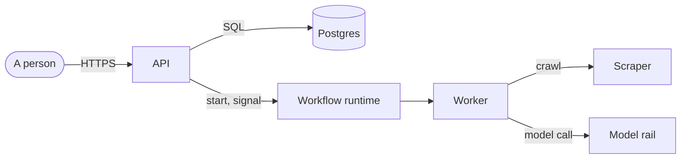

# bragi-documents — documents a person can read

> **Norse name:** **Bragi**, the skald. His craft is words that people want to hear. The law behind this skill is
> **Rule 52**, `RULES/52-documents-are-for-people.md`.

## Before you write

Ask one question: **will a person read this?** If yes, it is a document, and everything below applies. If only a
machine reads it (tool output, a registry a script parses, a ledger row), keep it machine-shaped and stop here.

Then decide what **kind** of document it is (Diátaxis):

| Kind | The reader wants to… | Typical file in Ymir |
|---|---|---|
| Tutorial | learn by doing it once | a getting-started page |
| How-to | get one task done | `docs/features/*`, a runbook |
| Reference | look a fact up | an API page, a register of tools |
| Explanation | understand why | an architecture page, a plan, a rule |

## The first screen

Every document opens the same way, so a reader knows in ten seconds whether to read on.

```markdown
# <Title: what this is>

**Status:** <plan · built · design · register> — written <date> at <whose word>.

<Three sentences: the answer, or what this document decides.>

> [!IMPORTANT]
> <What is owed, and by whom — a decision, an approval, a credential. Omit if nothing is.>
```

## The tools, and when each is right

| Use | When | Not when |
|---|---|---|
| Paragraph | explaining why; telling what something means | listing ten facts |
| Bulleted list | single items or pairs, parallel wording | each item has three or more facts (use a table) |
| Numbered list | steps in order | order does not matter |
| Table | three or more facts per item | one row, one column, or page layout |
| Mermaid diagram | boxes and arrows, sequences, states, data relations, timelines | to decorate |
| Callout (`> [!NOTE]` and friends) | a warning, a decision, a trap | more than two or three per page |
| Code block | code, commands, exact output | prose or tables |

**Sentences:** aim for about 20 words, never over 40. Active voice. One idea in each paragraph.

**Tables:** introduce each with a full sentence. Keep each cell short, about a line. If a cell needs a paragraph, the
paragraph belongs under the table, not in it. Bold the first column only when it is the name of the row.

## The template shelf

Do not start from a blank page. `assets/templates/INDEX.md` lists a template for every kind of document, including
house templates for a plan, an architecture page, a research note and a rule. It also carries The Good Docs Project's
README, quickstart, tutorial, how-to, concept, reference, installation, runbook, troubleshooting, release-notes and
glossary templates, MADR for decisions, and arc42 for a large architecture, each with its licence. The collaboration
kit ships the same shelf to every repository at `docs/templates/`.

## Diagrams

Use **Mermaid** in a fenced `mermaid` block. GitHub, most editors and most docs sites render it.

| Showing | Diagram |
|---|---|
| a system and what it talks to (C4 *context*) | `flowchart` or `C4Context` |
| the running parts and their wires (C4 *container*) | `flowchart` with subgraphs, or `C4Container` |
| who calls whom, in order | `sequenceDiagram` |
| a record moving through states | `stateDiagram-v2` |
| tables and relations | `erDiagram` |
| work over time | `gantt` |

A system diagram, as an example:



Keep a diagram to about a dozen boxes. Split it if it grows. Label every arrow with what crosses it. Never draw boxes
in ASCII art. If you touch a document that has one, redraw it in Mermaid.

## Converting a TOON block

A block like this:

````
```
rail[2]{item,value}:
  "engine","llama-server (CUDA)"
  "unit","llama-swap.service"
```
````

becomes a sentence and a table:

```markdown
The rail runs on two parts:

| Item | Value |
|---|---|
| Engine | llama-server (CUDA) |
| Unit | `llama-swap.service` |
```

A one-column TOON block (`rules[n]{rule}:`) becomes a bulleted list. A block with one row becomes a sentence. Conversion
is **format only**: every fact, number and link is kept, and the document's change log says it was converted.

## Before you call it done

1. The first screen says what it is, its status, the answer, and what is owed.
2. There are no TOON blocks and no ASCII-art diagrams.
3. Every table has an introducing sentence and three or more columns' worth of facts per row.
4. Every diagram renders: paste it into <https://mermaid.live> or view it on GitHub.
5. Read the first screen aloud. If it does not sound like a person talking, rewrite it.
