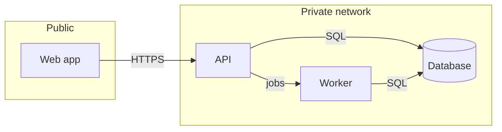
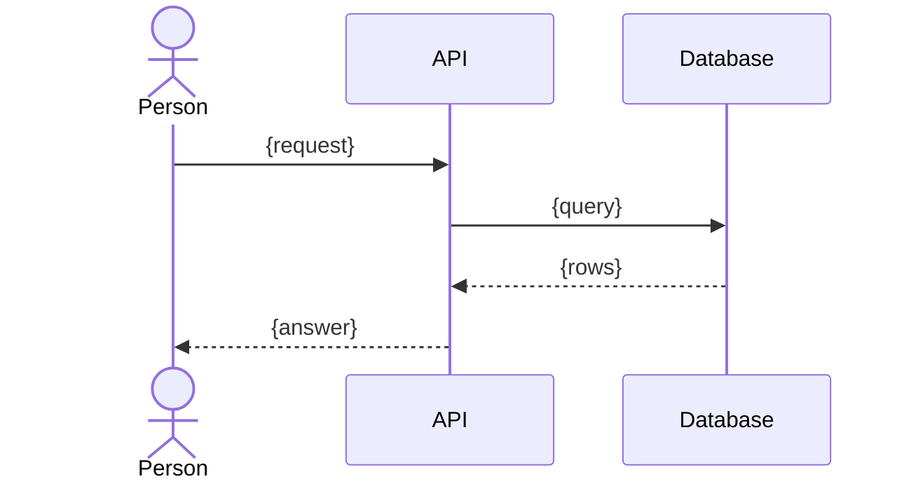

# {Title}

**Status:** {design | built}, {date}. This is an *explanation* page: it says how the system is shaped and why.

{Three sentences: what the system does, its main parts, and the one thing a reader must not get wrong.}

## Context: the system and what it talks to

{One sentence introducing the diagram.}

```mermaid
flowchart LR
    user([{Who uses it}]) -->|{what they do}| sys[{The system}]
    sys -->|{what it sends}| ext1[{An outside system}]
    ext2[{Another outside system}] -->|{what it sends}| sys
```

## Containers: the running parts and their wires



{Under the diagram, one short paragraph per part that needs explaining. Keep the diagram to about a dozen boxes.}

## How one request moves



## Decisions that shaped it

| Decision | Chosen | Why | Record |
|---|---|---|---|
| {question} | {answer} | {one line} | {link to the decision record} |

## What can go wrong

| Failure | How we notice | What happens |
|---|---|---|
| {failure} | {signal} | {behaviour} |

## References

- {Rules, plans, code paths, decision records.}

## CHANGE LOG

- **{YYYY-MM-DD}** — Written.
