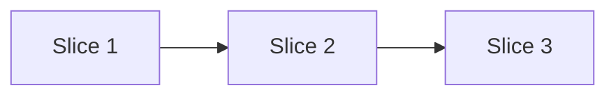

# {Title}

**Status:** Proposed, written {date} at {whose word}: *"{the ask, quoted}"*.

{Three sentences. What this plan builds, why now, and what is true when it is done.}

> [!IMPORTANT]
> {What is owed before this can start, and by whom: a decision, an approval, a credential. Delete if nothing is.}

## Where we stand

{One short paragraph on today, measured, not remembered. Link the audit or the code it rests on.}

## What we build

{A sentence introducing the slices.}

| Slice | What it delivers | Size | Done when |
|---|---|---|---|
| 1 | {deliverable} | {days} | {an observable result someone else can check} |
| 2 | {deliverable} | {days} | {…} |

## The order

{Why this order, in two or three sentences.}

## What this plan does not do

- {A thing a reader might expect, and why it is left out.}

## Decisions owed

1. {The question, the options, and the default this plan assumes.}

## References

- {The rules, documents, code paths and decisions this plan rests on.}

## CHANGE LOG

- **{YYYY-MM-DD}** — Written.
