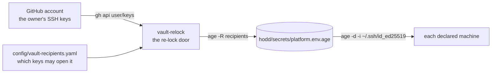

# The vault's keys — the fall from `age.key` to the owner's GitHub SSH keys

## What changed and why

The secrets vault (`hodd/secrets/platform.env.age`) was encrypted to a key file committed in
the same repository (`hodd/secrets/age.key`). The lock travelled with its key: reading the
repository gave a reader both halves, and the only real protection was that the home
repository is private. Plan 342 moves the lock onto **the owner's GitHub SSH keys**.

`age` can encrypt to SSH public keys, and GitHub publishes the owner's. So the vault is
encrypted to every key GitHub lists for the owner that the **home declares**, and each
machine opens it with its own private SSH key, which never leaves it. No key file sits in the
repository. A machine is added or revoked by adding or removing its key on GitHub and
re-locking.



## The doors

```
doors[5]{path,verb,what}:
  "bin/vault/vault-relock.sh","--plan","who would be added or dropped, by title; writes nothing"
  "bin/vault/vault-relock.sh","--relock [--ship]","decrypt, re-encrypt, verify byte for byte, replace, keep the backup"
  "bin/vault/vault-relock.sh","--add-machine [--title N]","print the gh ssh-key add command for this box, then re-lock"
  "bin/vault/vault-relock.sh","--check [--strict] [--quiet]","does this seat open it; do the declarations match GitHub"
  "bin/vault/vault-relock.sh","--recipients","the age -R file, for a writer that must re-encrypt (hodd-set.sh)"
```

`bin/vault/vault-identity-lib.sh` is the ONE answer to *which key opens the vault here*, and
the order is law (Rule 07):

```
identity_order[4]{step,source,when}:
  "1","$YMIR_VAULT_IDENTITY","an explicit word from the machine"
  "2","identity: in config/vault-recipients.yaml","a seat names its own key"
  "3","~/.ssh/id_ed25519 · id_ed25519_sk · id_rsa","the ordinary SSH identities"
  "4","<hoard>/secrets/age.key","the LEGACY key, only while it still exists"
```

Step 4 is a fallback through the switch and is **reported as legacy** by `--check` and by
Eir's surface, so a seat that has not yet been given a GitHub key says so instead of looking
healthy by accident.

## The declaration (the home's, never the package's)

`<home>/config/vault-recipients.yaml`: the vault path, an optional `login:` and `identity:`,
and one row per key that may open the vault. The public tree ships
`config/vault-recipients.yaml.example` with invented titles.

```
rule[4]{about,law}:
  "a key GitHub lists that this file does not name","reported by --plan, never used"
  "a key this file names that GitHub does not list","the re-lock REFUSES — silence here takes a machine's access away"
  "the title","how a human finds the key on GitHub"
  "the fingerprint","how the door proves it is the same key — a title can be reused, a fingerprint cannot"
```

## The guards, each from a real loss

```
guards[5]{guard,what}:
  "non-empty plaintext","the decrypted vault must have at least one KEY= line, or nothing is written"
  "byte for byte","the NEW file is decrypted again and compared with the old plaintext before it replaces anything"
  "the backup","the old file is kept as platform.env.age.bak-<timestamp>, mode 0600"
  "the write","install to a new name then mv, mode 0600; the only plaintext on disk is a 0600 temp, shredded on exit"
  "no value printed","no door in this contract prints a secret value — only titles, fingerprints and counts"
```

## The ward

`bin/gates/guards/secrets-plaintext-guard.sh` judges the **home** repository, and the home's
pre-commit hook runs it (seated by `bin/gates/guards/hoard-guard.sh --install`). It refuses a
commit that adds a non-empty plain-text `*.env` under `hodd/secrets/`, adds
`hodd/secrets/age.key` back, or keeps changing a tracked plain-text secret there. An **empty**
scaffold is allowed: the installer seeds one so `hodd.sh emit` resolves on a fresh home.

## Eir

The `vaultkeys` surface (registered in `config/surfaces.yaml`, risk `never`) asks the re-lock
door: the vault opens on this seat, the declarations match GitHub, and nothing plain is
tracked under `hodd/secrets`. A plain file or a legacy key is reported in the row's detail and
never changed — a re-lock changes who may read the vault, and that is the operator's step. A
seat with no vault at all is a clean pass (Rule 25).

## Tests

`bash bin/vault/tests/test_vault_relock.sh` — a throwaway home, generated ed25519 keys and a
fake `gh`; it proves the re-lock, the refusals, the byte-for-byte round trip, the readers
without `age.key`, the writer, and the ward. Nothing in it touches a real vault.

## What this does not do

The **history** still holds the old `age.key` and every old encrypted vault, so anyone who can
read the repository can open the *old* secrets. The switch protects what is added afterwards;
rotating the credentials that are still live is the honest answer (plan 342, the history
question).

## CHANGE LOG

- **2026-11-20** — written with phase 1 of plan 342, at the Allfather's word.
