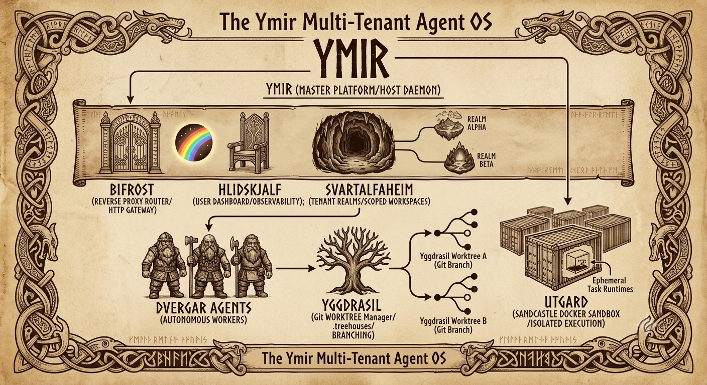

# YMIR — The Single-Tenant Agent Operating System

---

<p align="center">
  <strong>created by zerwiz</strong> · <a href="https://zerwiz.org">https://zerwiz.org</a> · whynotproductions<br>
  <em>a hobby project, made for the love of the craft. use it, fork it, enjoy it.</em>
</p>

---

> **One operator. One repo. A whole business, run by a Norse-named agent fleet.**



Ymir is a lean, single-operator agentic OS. You are the **Allfather**; **Brokk** is
your primary agent; **Eindri** are the isolated workers it dispatches. Everything —
development, marketing, business strategy, life — runs from one repository, with an
audit ledger, a memory well, one tenant and its workspaces, and a control plane you actually look at.

One operator, one repository, no tenancy machinery to please. There is no organisation chart
here, no seat licensing, no dashboard whose only job is to be looked at by nobody: there is a
machine you own, a hall you sit in, and a crew that is expected to *return with an artefact* or
say plainly that it could not.

**What is in it.** One checkout holds the runtime, the agents, the skills, the gates and the
apps. Engines are adopted, never rebuilt — git worktrees for isolation, sandboxes for untrusted
work, an embedding store for memory, a ledger that chains every entry — and each engine wears a
Norse name so that the thing's *job* is legible from its name. **Brokk** plans, steers, reviews
and dispatches from the main hall; the **Eindri** forge in isolation and hand back work a human
can seal; a **council** argues a question from five lenses and a chair that is paid to be
unimpressed; **Skírnir**, the assistant, answers people while you are away and carries his own
walls. They talk to each other in **rooms** — attributed, append-only, so the house argues in
the open instead of in five private contexts.

**What it refuses.** Private data never enters this repository: plans, names, secrets and
schedules live in a separate private vault, and the tree you are reading is public because it
holds craft, not clients. Every change leaves by a pull request, because a merge is a decision
and decisions are the Allfather's. And nothing here is allowed to be a mock in the shipped path:
either a door answers, or it says loudly that it cannot.

## The crew — twenty-two figures and one assistant

Every figure is a **craft**, not a persona: a file with a job, a permission fence, and a name that
says which job. They are not all running at once — a figure is seated when an errand needs it, and
one machine can carry the whole bench because they share one repository, one memory and one chain.

**In the hall.** **Brokk** is the primary — the counsellor who plans, steers, reviews and dispatches,
and who does not build alone what a worker can forge in isolation. Beside him sit the figures who
keep the house honest about itself: **Reginn the Elder**, keeper of the plan ledger and the shelves,
who reads the elders before writing; **Mimir** the planner, who reads an ask into a file map and a
dependency chain; **Urdh** the reconciler, who finds where two records disagree; **Sága** the
seeress, who seats every session and hands it the digest; **Forseti** the just, the reviewer who
holds the seal; **Týr** the judge of drift, who holds a change against the law; and **Móðguðr** at
the chair of the council.

**In the forge.** **Sindri** the smith writes and refactors code; **Hnoss** the shaper designs;
**Völundr** runs Smíðja, the pipeline that turns a roster into bounded phases; **Galdr** is the
master builder who keeps the craft itself installable.

**In the field.** **Kvasir** scouts what is actually there, with file and line; **Huginn** the sage
researches what the world says; **Bragi** the skald writes what goes out; **Jord** the grounded
registers what was found.

**Around the house.** **Snotra** documents and keeps the meeting ear; **Muninn** curates what should
be remembered; **Sýn** recovers a blind turn; **Vör** diagnoses what is broken; **Gróa** renews a
tree without forcing it; **Frigg** is the consent — the one who knows whether a thing may be
touched at all.

**Skírnir** is not on that bench. He is the assistant with his own bot and his own walls, described
above: a mouth the Allfather can point at strangers, because a mouth that can only speak cannot open
a door.

## The skills — craft on demand, never preloaded

A session that reads every skill acts like it read none, so **nothing is preloaded**. The house ships
a shelf of skills — twenty-nine of them — and a session finds the one it needs by *asking for the
words it would use*: every skill carries a one-line description, and a skill without one is
unfindable and gets fixed before it ships.

There are four shelves, searched in that order, first hit wins: the **shipped** shelf that travels
with the repository and is the project's own craft; the **local** shelf, gitignored, which never
leaves the machine; the operator's own **private** shelf; and the **harness-wide** shelf that belongs
to the agent runtime rather than to Ymir. A shipped skill always beats a local one on purpose — the
project's craft must be the same on every machine, or two people get two different answers.

A missing capability can be synthesised into a new skill, and it is not trusted until it has been
validated in a sandbox and indexed. That is the whole discipline: the shelf is small, findable, and
earned.

## The house itself — the engines under the names

Ymir does not rebuild what already exists; it adopts an engine and gives it a name that explains the
job.

**Yggdrasil** is git worktrees, so parallel work cannot collide. **Utgard** is the ephemeral sandbox
where untrusted code runs, and where a failure never reaches the main tree. **Mimirsbrunn** is the
memory well — the embedding store an agent drinks from before it acts. **Runes** is the append-only
ledger, each entry chained to the one before it so nothing can be quietly edited. **Sága** is the
session digest. **Nornir** is the schedule. **Skuld** is the derived work queue.
**Mjollnir** is the issue-to-PR pipeline that strikes and returns with a pull request for a human to
seal. **Ratatoskr** is the agent-to-agent backbone. **Bifröst** is the ingress and **Heimdall** the
guard that signs every agent's rune of introduction. **Hlidskjalf** is the control plane you
actually look at, and **Herdr** is the seat backend where workers stand in panes.
**Hófvarpnir** carries every message, **Vörðr** composes the wards, and **Garmr** — the hound — is
the one that watches rather than gates: it sees what moved, runs the smoke test, and holds the
switch.

## The council — several minds, one verdict

When a question deserves more than one opinion, Ymir convenes a **council**: not a swarm, not a
vote — a small bench of seats, each with its own **lens**, and a **chair** that decides.

A seat is a figure with a job: an architect weighs the shape, a security seat weighs the door, a
cost seat weighs the bill, a skeptic tries to break the proposal, an operator weighs whether it can
be lived with. The same model can sit in all five chairs, and that is still worth doing — five
lenses on one mind find more than one mind with no lens. The council is not told what to agree on.

**The chair is the point.** Móðguðr, the bridge-keeper, presides — she stands at the crossing and
challenges every passer-by before they may cross, so her seat is not there to be encouraging. Her
laws: *a claim is false until a command proves it · the house's own best story is my first suspect ·
security is a door, not a section · production readiness is a list, not a feeling · a refusal names
the one thing that would change my mind · I do not grade on effort.* A chair that repairs what it
audits has no verdict, so she never edits.

```
modes[4]{mode,who_moves,use_when}:
  "divide","the chair splits the task, sends each seat out on its slice, reports back with what returned","a task with parts"
  "sortie","every seat out at once on the same quest; the chair reads the sweep after","breadth over judgement"
  "report","seats report UP to the chair, the chair rules, and a failed seat is told what it must bring back","an audit"
  "debate","seats answer each other, by name, in the record","a disagreement worth airing"
```

**It remembers.** The chair drinks the **well** before she sits and waters it with the verdict
after, so the next council starts warmer than this one — and every word of a sitting lands in the
**rooms**, attributed, because a council whose argument exists only inside five model contexts
never happened.

**What a council will not do.** It writes no code, merges nothing, and pushes nothing. A verdict is
a *record*; the build is a separate errand with its own gate, and the chain stays in the Allfather's
hand.

## Skírnir — the mouth with no hands

**Skírnir** answers people while you are away. He is not Brokk and cannot act as him: the figure
is Freyr's messenger, who goes in his lord's place, speaks his words, and **leaves the sword
behind**. He is a separate presence with his own bot, his own token and his own walls, and if he
is compromised the door to close is his alone.

Four walls, each one a refusal rather than a promise:

```
walls[4]{wall,what_it_means}:
  "the digest","his only knowledge: one file per fact, each approved by the Allfather with a source hash. The vault is never read and the plans are never indexed — he cannot leak what he was never given"
  "the quarantine","no tool calls, no credentials, no shell. The model, when it is used at all, only paraphrases an approved fact"
  "the gate","no URL, no link, no image, no code block; an intent allowlist on top; then the canaries — and a canary hit FAILS CLOSED, it is never a warning"
  "the ledger","every question, answer, refusal and escalation, with the digest hash that produced it"
```

What he will do: answer from approved facts, take a message, escalate to the Allfather when the
answer is not his to give, and say honestly *"I don't have that, and I would rather say so than
guess."* What he will not do: guess, act, browse, or speak about NDA material to anyone but the
operator or a named party — and never in a group, because a group is other people.

A mouth with no hands is not a limitation to fix later. It is the design: an assistant who can
only speak cannot be used to open a door for someone who is not the Allfather.

## Snotra — the ear at the table

**Snotra** is the meeting ear. Where Skírnir is a mouth — answering people on his own bot — Snotra
is the one figure whose only job is to *hear*: it watches for the call happening on the seat,
records it, transcribes it **locally**, and mines the minutes — decisions, actions, owners — into
the hoard, so a meeting becomes a record instead of a memory.

Three things it will not do. It will not send a call's audio anywhere it is not supposed to: the
transcription runs on the machine, with the engine the install seats. It will not post into a
meeting: its agent-facing face is **read-only**, so an agent may read what was said and may not
write into the room. And it will not pretend to have heard: a seat with no microphone reports a
clean skip rather than an empty transcript that looks like a quiet meeting.

A meeting without minutes is a conversation; the house does not count conversations as work. That
is the whole reason the ear exists — and why the minutes, not the recording, are what it returns.

**What it is not.** Not a multi-tenant platform, not a framework for you to host, not a chat
window with tools bolted on. It is one operator's workshop, built the way a workshop is built —
by using it every day, and by naming every part after the work it actually does.

---

## The rest of the hall

The figures above are the ones you will meet first. These are the rest of the house — each with a
name, each with a job, and each with a how-to under the field notes. Where a thing is not built yet,
it says so; where the naming map is behind the machine, it says that too.

### Gladsheim — the fleet room

**Gladsheim** is the hall where the whole fleet sits: a Matrix room, one identity per seat
(`west: Galar`, `omarchy: Brokk`, this seat and so on), so a machine speaks under the name the map
gave it rather than through somebody else's mouth. It is not the same thing as the rooms described
above — those are per-conversation records inside one Ymir; Gladsheim is the durable room across
machines, and it is where the fleet talks when no single session owns the question. It is live
today, even though the naming map still files it as planned; the map is behind the machine, and this
line is the correction.

**Brimir** — the hall of Allfathers — goes one step further and is *not* built: one federated room
across operators, joined over A2A, so two people running Ymir can sit in the same hall and argue.
Planned, plan 74, and named after the hall where the surviving gods gather after the fire.

### Hófvarpnir — the notification door

Every system in Ymir needs the same thing: a way to say *look at this* to a person who is not
sitting at the terminal. **Hófvarpnir** is that one door — the horse that carries every rider's
word. Runes always record; at MEDIUM and above it wakes the watch; the desktop, the phone and
Telegram all receive by the same hand, and every message carries a key so the same finding cannot
repeat sixty times in an hour.

It can also *ask*. A notification sent with `--ask` records a question rather than a statement, and
its click runs the decision — approve or decline, written to the vault, carved into the ledger.
Before that, a notification was one-way: the machine could tell you something and you could only
agree out loud to nobody. An approval that leaves a record is the shortest honest loop this house
has between a machine's hesitation and the operator's hand.

### Hnitbjörg — the vault, and the work done under seal

**Hnitbjörg** is the mountain stronghold where the mead of poetry was hidden, and in Ymir it is the
encrypted document vault: a LUKS2 container, sealed by default, opened only by the operator. What
lives inside it is work under NDA and work that must never travel — not to a model, not to a ticket,
not into the repository you are reading.

Because *sealed* is a mode and not a mood, the vault has a session: a work mode in which the working
directory lives **inside** the mount, every off-vault door is switched off, and the model tier is
explicitly `local`, `none`, or `remote` — never guessed. With `--airlock` the session runs with no
network at all. A guard watches the vault's hash while it is open and refuses a commit that copies
it verbatim. This is the strongest promise the project makes, and it is the reason the rest of the
house is so fussy about what may be read where.

### Vörðr — the ward, and Garmr — the hound

**Vörðr** composes the wards. There is a guard for a push to a protected branch, a guard for a range
of commits that carries no fix note, a guard for a secret in a commit, a guard for a person's name
in the public tree, a guard for a vault copy. Each one answers for **one** surface, and a gate that
measures something else is a lie with a green tick — that is law here (Rule 18), not taste.

**Garmr** is the hound, and it is a different animal: not a gate but a watchdog. It watches the
files that change, runs a smoke test, and carries a switch — the thing that notices what moved in
the house while everyone was looking at a screen. The watchtower the warden will look from,
**Himinbjörg**, is planned rather than built, and is named so that the plan has somewhere to live.

### Snotra's board — meetings as records

Snotra's own section is above; her hands are the meeting framework (**the Þing**) and the doors
built on it: the board read as a record, so overdue cards and cards due today are known by something
other than the digest; minutes that leave as a signed, attributable message rather than a file
nobody opens; transcript provenance, so a claim can be traced to the words that carried it; and a
first run that seats the whole skeleton — framework, agenda templates, cron row — on a new machine.

### Sól and Mánagandr — the clock and the calendar

**Sól** is one door for time and date, and its one rule is that it does arithmetic on *instants*, so
daylight-saving cannot lie about how long something took. **Mánagandr**, the month-pursuer, sits on
Sól and answers the other question: what is on the day, and where a meeting of a given length will
fit. Both exist because a cron row that guesses about time is a cron row that runs twice a year at
the wrong hour.

### Sessrúmnir and Þráðr — the seat and its terminal

**Sessrúmnir** is the desktop seat over the agents: a GUI over the same sessions the terminal runs,
for the work that is easier to see than to type. **Þráðr** is the other half — a real terminal inside
the high seat, so the control plane can be operated without leaving it. Neither is a second way of
doing the work; both are windows onto the same sessions, which is why nothing has to be re-explained
when you switch.

### The people registry — collaborators and clients

Ymir keeps one registry of the people the operator works with — clients, collaborators, advisers —
and every entry carries a tier: owner, named collaborator, or stranger. That single distinction is
why the assistant answers a stranger, a client and the Allfather so differently, and why an NDA fact
can be answered to a named party and to nobody else. Identity is written down once and read
everywhere, which is the only way a wall can hold.

## The Allfather's Chain

**The Allfather holds the only chain.** Not the primary agent, not the council, not a cron
row, not a model with a good record. One hand draws it, and everything in Ymir walks only
while that hand holds it.

**What the chain is.** The right to say *go* and the right to say *stop* — to open a door, to
seal a change, to let a thing cross. It is drawn in the record, not in a conversation: a word
given, a merge sealed, a rune carved. What is not in the record was never chained.

**The gates are not a second master.** Ymir ships wards, guards and gates by the dozen —
secret, vault, branch, fixes, people, public — and none of them commands. A gate can only
*refuse*. Refusal is the chain made mechanical: the Allfather's hand, cast as a rule and
re-run at every crossing while he is asleep. A gate that ever decides *for* him would be a
second master; a gate that only ever says *no* is his own hand, remembered.

**What holds it up.** Three things, and only three: the **ledger** (what was done, chained so
it cannot be quietly edited), the **well** (what was learned, so the next hand starts where
this one finished), and the **rooms** (where his agents speak to each other, attributed, so
the house argues in the open instead of in five private contexts). None of the three can
draw the chain. They can remember it, water it, and refuse it.

**How the chain breaks.** Never in one dramatic act. It breaks in small mercies: an agent
merging its own pull request because the tests were green; a token pasted into a chat because
it was quicker than the vault; a gate skipped "just this once" because the gate was
inconvenient that afternoon. Every one of those is a hand other than his, closing a door he
never opened.

```
chain[6]{law,why}:
  "one hand draws it","the Allfather's word is the only permission Ymir recognises"
  "agents may refuse, never permit","a worker that could open a door for itself is a second master"
  "a gate says no, never yes","the wards mechanise his caution, not his judgement"
  "merges are sealed by his hand","an agent opens the pull request and stops there"
  "what is not in the record was not chained","the ledger, the well and the rooms are the proof"
  "it breaks by small mercies, never by one act","so the cheap shortcut is the whole risk"
```

> If the Allfather does not draw it, Ymir walks nothing. The machine may labour, may refuse,
> may remember — but it may not decide.

---

## Install

**One command. It installs into a prefix you own, writes the PATH into your shell,
runs the first setup, and then proves it.**

```bash
curl -fsSL https://raw.githubusercontent.com/zerwiz/ymir/main/install.sh | bash
```

**No PATH, no prefix, nothing to configure — run it without installing:**

```bash
npx @zerwiz/ymir
```

**Already manage Node and npm yourself:**

```bash
npm install -g @zerwiz/ymir      # then: ymir
```

### If `ymir` is "command not found"

The command **is** installed — npm put it in its global bin directory, and your shell
does not look there. That is npm's behaviour, not Ymir's, and it is the most common
*"it does not work"* in the whole Node ecosystem.

```bash
npm prefix -g                                  # where npm puts global commands
ls "$(npm prefix -g)/bin/ymir"                 # the command is there
export PATH="$(npm prefix -g)/bin:$PATH"       # this shell
echo 'export PATH="$(npm prefix -g)/bin:$PATH"' >> ~/.bashrc   # every shell after
```

Or skip the question entirely: `npx @zerwiz/ymir` works with no PATH at all.

### If the version never changes

An install can *succeed* and change nothing — npm may resolve a cached `latest` and
report success while the old build stays. Clear it once:

```bash
npm cache clean --force && npm i -g @zerwiz/ymir@latest --prefer-online
```

The CLI itself now says when it is out of date, once a day.

### The packages — what is on npm

The distro **depends on the four surfaces**, so one command brings the whole
platform — and each can be installed alone if you want only that hall.

```
packages[5]{package,what}:
  "@zerwiz/ymir","the distro — the runtime, the doors, the installer, the plan"
  "@zerwiz/hlidskjalf","the high seat — the control plane, the gate and the landing"
  "@zerwiz/odrerir","the live hall — the board on :4322"
  "@zerwiz/smidja-factory","the smithy — the agent factory, its skills and the visualizer on :8437"
  "@zerwiz/sessrumnir","the seat-hall — the desktop where you speak with Brokk"
```

**The smithy's package is `@zerwiz/smidja-factory`** (0.1.7) — the one `npm install -g`
pulls and the one the door resolves. An older `@zerwiz/smidja` (0.1.1) also resolves on the
registry; it is not what ships, and nothing here installs it. *Corrected 2026-10-21: this
paragraph used to say the name "served never", which stopped being true when it resolved.*

### A clone and a package are one tree

Ymir runs the same either way; the only difference is where the apps live — a
clone's `apps/<surface>`, or the package's `node_modules/@zerwiz/<surface>`. One
resolver (`bin/desktop/app-lib.sh`) answers for both, so no script has to care which shape
it woke in. Colour is for the eye, never for the pipe: `bin/desktop/ymir-style.sh` renders
in the halls' own cloth, and what a pipeline reads on stdout stays plain TOON.

### After it installs — the doors

`npm install -g @zerwiz/ymir` puts **two** commands on your PATH: `ymir` and
`ymir-install`. Everything else is a door on `ymir`, named for the figure whose
work it does.

```
ymir                     first setup: the plan, then your word
ymir raise | lower       lift the hall, or lay it down
ymir hlidskjalf          the high seat's window
ymir smidja              the smithy's board (:8437)
ymir sessrumnir          the seat-hall's window
ymir heimdall · invite   the way in, and letting someone else in
ymir eir · groa          what stands and mending · take the latest and mend forward
ymir mimir · sense · plan
```

A name the law has not given a home still answers, once, and tells you the name that
has it: `ymir doctor` replies *the door is named `ymir eir` now*.

## Features — how to use Ymir

Every user-facing feature has a **plain-language how-to**: what it is, what you
need, and the exact commands.

- **[docs/features/](docs/features/)** — the index.
- [The guardian (Garmr) — watch your own machine](docs/features/the-guardian.md) — what executes,
  who touches the meeting and vault shelves, what listens and what leaves; a **ᛉ hound** chip in
  Hlidskjalf, and `bin/ward/garmr.sh pause|resume` when you want quiet
- [Meeting outcomes (Snotra)](docs/features/meeting-outcomes.md) — a transcript becomes minutes,
  decisions, actions, briefs and a follow-up email
- [Sensitive-data gate](docs/features/sensitive-data-gate.md) — one choke point before anything
  leaves the house
- [Transcript provenance](docs/features/transcript-provenance.md) — a hash-chained seal over every
  meeting artifact, plus an evidence bundle
- [Unlock the vault (Hnitbjörg) with your phone](docs/features/unlock-the-vault-with-your-phone.md)

A feature that ships without a page here is **not finished** — agents add or update
the page in the same change (see `AGENTS.md` → *Feature how-tos*).

## The Lore (short version)

Ymir is not a theme — the myths are **load-bearing allegory**. Every subsystem is
named for the figure whose role matches the machine's job:

The platform is the primordial giant **Ymir**, from whose body the worlds were
carved. The smiths are **Brokk** (the bellows-smith, your primary agent) and
**Eindri** (the workers who out-forged the gods). Memory is **Mimirsbrunn**, the
well at the root of **Yggdrasil**, and **Kaia** is the oracle who speaks from it.
Every significant action is carved into **Runes**, an append-only ledger. Work
passes the **seven gates** and is built on **borrowed anvils** — validated open
source first, always. The full tale: [`docs/lore.md`](docs/lore.md).

| Component | Role |
|---|---|
| **Ymir** | the platform / host daemon |
| **Brokk** | the primary autonomous agent |
| **Eindri** | isolated workers — Sindri, Bragi, Huginn, Mímir, Forseti, Snotra, Kvasir |
| **Mimirsbrunn** | the memory well (engram) + Kaia's bridge |
| **Yggdrasil** | git worktrees — zero-collision parallelism |
| **Utgard** | ephemeral Docker sandboxes — the execution barrier |
| **Runes** | the append-only audit ledger |
| **Hlidskjalf** | the control plane / observability |

---

## What it is

- **A distro, not an app.** Launch a supported harness in the repo and you take the
  high seat: context is injected before your first turn, the model bridge is raised,
  the scheduled jobs start.
- **Isolation by default.** Complex work runs in **Yggdrasil** worktrees sealed by
  **Utgard** sandboxes; a failed run never touches main.
- **Audit everything.** **Runes** is an append-only, checksum-chained ledger.
- **Memory that grounds.** **Mimirsbrunn** (engram) is drunk from before dispatch and
  watered after; a dry well never blocks.
- **Humans in the loop.** **Mjollnir** opens PRs; nothing force-merges.
- **Open source first.** Ymir owns only three things — the UI, the runtime, and
  A2A collaboration. Everything else wears a Norse name over a validated engine.

---

## Host platforms — three first-class identities

Ymir is not portable-in-theory; it is **native** to the machine it runs on. Three
platforms are first-class, and each one is detected, used, and learned rather than
merely tolerated.

| Identity | What it means | Where it lives |
|---|---|---|
| **Omarchy-native** | The host desktop is Omarchy (Arch + Hyprland). Ymir reads monitors/scale, lets Hyprland own window placement, mitigates the amdgpu GPU crash, and **learns the user's setup** — packages, configs, Omarchy version — re-learning after every `omarchy update` via a `post-update` hook. | `bin/host/omarchy-sense.sh`, `bin/host/omarchy-hook-install.sh`, skill `ymir` |
| **herdr-first (Þjazi)** | Agent panes need a terminal backend. **herdr** is preferred (Þjazi protocol **14+**; presentation spaces at **0.8.0+**), **tmux** is the accepted reference backend. A missing backend is reported, never silently degraded. | `bin/seat/herdr-ensure.sh`, skill `ymir` |
| **pi-native** | The [pi](https://pi.dev) coding harness is a first-class surface: extensions, skills, prompt templates, themes, custom providers, and **pi packages** (npm/git) are all live. This is where Ymir gains reach — a new capability can be a pi extension or a packaged bundle, not just a shell script. | `.pi/extensions/`, `.pi/settings.json`, `.pi/mcp-adapter.json` |

**Why this matters.** The freedom runs both ways: because Ymir is pi-native it can
ship **pi packages** — bundling extensions, skills, prompt templates, and themes
for others to `pi install` — and because it is Omarchy-native it can help an
Omarchy user set up and tune the whole machine, not just the repo.

On a non-Omarchy host the Omarchy steps are a clean `SKIP`; Ymir still runs. On a
host without herdr, tmux carries the panes. On a harness that is not pi, the
runtime adapts through the harness adapters (see `hamr`).

### Omarchy-native

Ymir treats the host desktop as part of itself. It **detects** Omarchy
(`/usr/share/omarchy`), **reads** the real layout (`hyprctl monitors -j` — physical
size *and* scale, because a 1920×1200 panel at scale 1.5 is a 1280×800 logical
desktop, and mixing the two is the classic placement bug), and **lets Hyprland own
placement** rather than fighting the compositor.

- **Desktop placement.** On Omarchy the numbered **desktops** (`1 2 3 4 5 …`) are
the operator's "screens". `bin/desktop/desktop-place.sh` gives each Ymir app its **own
desktop, preferring an empty one**, via Omarchy's own rule idiom
(`o.window({ class = "^ymir-hlidskjalf$" }, { workspace = "2" })`), and never
edits `/usr/share/omarchy/`.
- **It learns the machine.** `bin/host/omarchy-sense.sh` records a comparable snapshot
(Omarchy version, explicit packages, config files, monitors, scale) and **diffs**
it, so Ymir can advise on *this* setup. `bin/host/omarchy-hook-install.sh` installs a
`post-update.d` hook, so **every `omarchy update` re-teaches it**.
- **It survives the hardware.** On a small-VRAM iGPU the Wayland GPU process can
die with `amdgpu: Not enough memory for command submission` (SIGSEGV, not an OOM);
`YMIR_DESKTOP_DISABLE_GPU=1` runs the dashboards on software rendering.

Full reference: the `ymir` skill. Omarchy's own skill is authoritative for
Omarchy itself; ours adds the Ymir integration.

### herdr-first (Þjazi)

Every Eindri worker lives in a terminal pane, so the backend matters. Ymir prefers
**herdr** and accepts **tmux** — and never degrades silently.

```
backend_priority[3]{rank,backend,note}:
  "1","herdr","preferred; protocol 14+ for panes, 0.8.0+ for presentation spaces"
  "2","tmux","verified reference backend"
  "3","none","spawn is refused with a plain reason"
```

`bin/seat/herdr-ensure.sh` verifies the *version* (not just presence) and installs via
the pinned, SHA-256-verified installer when herdr is absent. Selection order:
`config/backend` <!-- stale-ok: the seat writes this at runtime; a fresh clone has no such file --> → `BROKK_BACKEND` → `HERDR_ENV=1` → else tmux. Full reference:
the `ymir` skill.

### pi-native

[pi](https://pi.dev) is the harness Ymir runs in, and Ymir uses that fully rather
than treating it as a shell to be wrapped:

- **Extensions** — `.pi/extensions/` carries live behaviour (the watcher arm, the
turn-end guard, the Ró presentation preference, the agent-state surface).
- **Packages** — `pi install npm:<pkg>` / `git:<repo>` bundles extensions, skills,
prompt templates, and themes. Ymir can **ship its own**, so a Ymir capability can
be distributed and installed like any pi package, not only as a shell script.
- **Model providers** — pi resolves models from `~/.pi/agent/models.json`, whose
shape is `{"providers": {...}}`. Local servers (LM Studio, Ollama, vLLM) and the
Bifrost bridge are configured the same way, so the fleet runs on local or cloud
models by the operator's choice.

This is the freedom you gain from being pi-native: a new capability has three
possible homes — a shell script, a skill, or a **pi package** — and the last one is
installable by anyone running pi.

---

## System Map

| Subsystem | Norse Name | Role |
|---|---|---|
| Platform root | **Ymir** | master daemon / host OS |
| Primary agent | **Brokk** | the autonomous operator's hand |
| Sub-agent workers | **Eindri** | isolated sandboxed workers |
| Git worktrees | **Yggdrasil** | zero-collision parallel edits |
| Docker sandbox | **Utgard** | ephemeral execution barrier |
| Gateway | **Bifrost** | reverse proxy / HTTP routing |
| Model bridge | **Bifrost bridge** | local OpenAI-compatible endpoint for the fleet |
| OAuth guard | **Heimdall** | GitHub OAuth / JWT |
| Tunnel | **Gjallarhorn** | Cloudflare outbound tunnel |
| Dashboard | **Hlidskjalf** | observability & control plane |
| File browser | **Skrymir** | web file explorer |
| Workspaces | **workspace/** | personal & work scopes over domains |
| Shared space | **Midgard** | shared assets & repos |
| Message bus | **Ratatoskr** | A2A 1.0 backbone (cards, lifecycle, Redis) |
| Vector memory | **Mimirsbrunn** | engram store + Kaia's bridge (`:4602`) |
| Audit ledger | **Runes** | append-only system log |
| Issue→PR | **Mjollnir** | autonomous fixes & PRs |
| Process monitor | **Valhalla** | PM2/Docker supervision |
| Skill synthesis | **Gungnir** | dynamic skill creation |
| Skill optimization | **Gunnlöð** | trajectory-driven skill refinement |
| Smíðja | **Smíðja** | the smithy — roster, phases, trace |
| Session digest | **Sága** | the context injected at session open |
| Watch / supervision | **Sýn** | watcher, guard, seat continuity |
| Session lock | **Gleipnir** | one live session per home |
| Scheduled jobs | **Nornir** | the fates who govern time |
| Control-plane hub | **Vingólf** | coordination, identity, sync across substrates |
| Live hall board | **Óðrerir** | fleet planning glass (:4322) |
| Multi-tenant domains | **Svartalfaheim** | scoped tenant workspaces |
| Agent ergonomics | **Galdr** | TOON output, 10 design principles |
| Smíðja orchestrator | **Völundr** | runs Smíðja (Kaia's seat inside) |
| MCP/A2A composition | **Hermóðr** | MCP vertical (agent→tools) + A2A horizontal |
| Host desktop (Omarchy) | **Omarchy** | the machine Ymir runs on: monitors, scale, themes, hooks |
| Terminal backend | **Þjazi** | agent panes — herdr (protocol 14+) or tmux |
| Harness surface | **pi** | extensions, skills, prompt templates, packages |

---

## Skills

Every reusable capability is a skill in [`.agents/skills/`](.agents/skills/), each
named for the figure whose role matches the work (the Gungnir naming law). Galdr is
the master builder; Tyr judges compliance.

| Skill | Norse | Purpose |
|---|---|---|
| `galdr` | Galdr | agent-CLI ergonomics + master builder/maintainer of the runtime |
| `tyr-check` | Tyr | the judge — validates tools/skills/docs against the 10 principles |
| `smidja` | Smiðja | the smithy: roster + bounded phases + typed envelopes |
| `hvild-afk` | Hvíld | away-mode supervision: routine wakes self-handled, escalations batched |
| `saga` | Sága | session bearings: fleet digest (/bearings) + recap (/ahoy) |
| `muninn-stow` | Muninn | session-knowledge curation, routing, and persistence |
| `jord-projects` | Jörð | project registry + delivery posture |
| `urdh` | Urðr | Allfather-hold lifecycle |
| `frigg-consent` | Frigg | consent / ask-user authority gate |
| `vor-diagnostics` | Vör | bootstrap + diagnostic reasoning |
| `nornir` | Nornir | fate & schedule: events + quota |
| `gjallarhorn-relay` | Gjallarhorn | public relay replies (X / Discord) |
| `eindri-homes` | Eindri | isolated worker homes |
| `syn-recovery` | Sýn | stuck-worker recovery playbook |
| `ymir` | Ymir | operate the host: update · Omarchy · Þjazi |
| `hamr` | Hamr | per-harness adapter reference (OpenCode, Pi, Claude, Cursor, Codex) |
| `gunnlod` | Gunnlöð | skill optimization — trajectory-driven refinement via SkillOpt |

The Galdr family enforces the 10 ergonomic principles (TOON output, minimal schemas,
self-correcting errors) and the runtime acceptance gates; run
`bash .agents/skills/galdr-ymirsystem/scripts/compliance-check.sh` before claiming done.

---

## Agents

The **Eindri** take a mythic name whose craft matches the job, and each runs in an
Utgard sandbox on a Yggdrasil worktree.

| Eindri | Figure | Craft | Speciality |
|---|---|---|---|
| **Sindri** | the smith | developer | code synthesis, refactoring, tests, CLIs |
| **Bragi** | the skald | marketer | content, SEO, social, campaigns |
| **Huginn** | the sage | researcher | RAG, web search, analysis |
| **Mímir** | the wise | planner | architecture, sequencing, risk |
| **Forseti** | the just | reviewer | review, QA, acceptance — changes nothing |
| **Snotra** | the wise-woman | documenter | docs, write-ups, changelogs |
| **Kvasir** | the knowing | scout | reconnaissance — changes nothing |

Profiles live in [`.agents/agents/`](.agents/agents/) and are bound to each tool by
`bin/seat/valknut-load.sh` (OpenCode reads `.opencode/agents/`; Pi links resolve under
`.pi/agents/`).

---

## The Runtime — taking the seat

When a harness opens in the repo, **Sága** speaks before the first turn: the seat is
bound by **Gleipnir**, the model bridge is raised, the **Nornir** jobs start, and
the fleet context is injected (hidden, by design). Run-tier harnesses run the digest
and inject it; nudge-tier harnesses are asked.

| Harness | Session-start surface |
|---|---|
| **OpenCode** | `.opencode/plugins/{saga-sessionstart,syn-watch-arm,syn-turnend-guard}.js` |
| **Pi** | `.pi/extensions/{syn-turnend-guard,gna-pi-watch,ro,skuld-branch-supervision}.ts` |
| **Claude Code** | `.claude/settings.json` — `SessionStart` + `Stop` |
| **Cursor** | `.cursor/hooks.json` — `sessionStart` + `stop` + `preToolUse` |
| **Codex** | `.codex/hooks.json` — `SessionStart` + `PreToolUse` + `Stop` |

- **Seat:** `bin/time/saga-session-start.sh` — the one ordered digest.
- **Lock:** `bin/vault/gleipnir-lock-lib.sh` — bound to the live session pid.
- **Bridge:** `bin/bridge/bifrost-bridge.sh` — raises the local model endpoint.
- **Jobs:** `bin/time/nornir-cron-start.sh` — daily briefing 07:00, observer, housekeeping, git sync.
- **Watch:** `bin/pi/syn-watch.sh` — the arm as a standing service (`status|start|stop`, unit `ymir-syn-watch.service`) — plus `bin/pi/syn-watch-arm.sh`, the thin client the harness adapter spawns.

Details: [`docs/session-start.md`](docs/session-start.md).

---

## The Control Plane — Hlidskjalf

[`apps/hlidskjalf`](apps/hlidskjalf) is the dashboard. It runs **live** against a
small local gate API that reads the runtime, or in **demo mode** on seeded data.

```bash
scripts/start.sh     # raises the gate API (:3889) + the SPA (:3888)
scripts/stop.sh
```

Views: Fleet · Tasks · Well · Runes · Reviews · Processes · Files · OmniChat ·
Runtime · Cron · Forge · Profile. OmniChat speaks to **Kaia** for real (recall from
the well, replies via the local model bridge). Press **Enter demo mode** on the sign-in
screen to explore without the runtime.

---

## Quick Start

```bash
git clone <this-repo> ~/Ymir && cd ~/Ymir
cp .env.example .env.local          # fill in your keys (never committed)

# 1) First setup — prints a plan, asks you to accept, then validates itself
bin/engine/ymir-install.sh                 # add --yes for non-interactive, or --check to preview

# 2) The control plane (live data)
scripts/start.sh                    # → http://127.0.0.1:3888/

# 3) The agent seat (any supported harness)
bin/time/saga-session-start.sh           # the digest (auto-runs on harness open)
```

The installer is idempotent and self-healing: it provisions what it can in user
space (`bun`, `uv`, `mcp`, the Þjazi backend), installs the OSS engines, learns
the machine, places the desktop apps, and — on an **Omarchy** host — sets the
update hook that re-teaches it after every `omarchy update`. It ends by opening
both desktop apps and running `bin/engine/ymir-validate.sh` to prove what stands.

### What each platform buys you

The installer serves all three of Ymir's native homes on **every** run — a
non-Omarchy host loses only the Omarchy-specific hook, never the logic.

```
platform_gifts[3]{platform,what_the_install_does,what_you_gain}:
  "Omarchy","detects the host, reads hyprctl monitors+scale, writes o.window desktop rules, snapshots the setup, installs the post-update hook","your dashboards land on their own numbered desktops; Ymir knows THIS machine and relearns it when Omarchy moves"
  "herdr (Þjazi)","bin/seat/herdr-ensure.sh verifies the version against the floors and installs via the pinned, SHA-verified installer; tmux is the accepted reference","every Eindri worker gets a real pane in a real terminal; presentation spaces at 0.8.0+, panes at protocol 14+"
  "pi","registers the harness surfaces, the MCP servers, and the model providers (local LM Studio / Ollama or the Bifrost bridge)","extensions, skills, prompt templates, themes, and pi PACKAGES are all live — a new Ymir capability can ship as an installable pi package"
```

A new capability therefore has three possible homes — a shell script, a skill, or
a **pi package** — and on Omarchy it can also reach the desktop itself. That is the
freedom of being native to all three rather than portable to none.

Point a harness (OpenCode, Pi, Claude Code, Cursor, Codex) at the repo and it takes
the seat as **Brokk**. Read [`AGENTS.md`](AGENTS.md) for the operating laws and
`$YMIR_HOME/docs/masterplan.md` for the forge orders.

### Bringing your own machine — Windows, macOS, Linux

Ymir is **Omarchy-first**: the Omarchy layer is first-class. But *first* is not
*only*. The core is portable, and every other host gets a layer of its own.
`bin/host/host-sense.sh` is the one place that looks before anything acts — distro,
kernel, session (Wayland/X11), desktop, and what that desktop can actually do:

```bash
bin/host/host-sense.sh                     # THIS machine, as TOON
bin/host/host-sense.sh capability tray     # yes | partial | no — for scripting
```

```
hosts[6]{host,how_you_get_it,what_it_is}:
  "Omarchy","bin/engine/ymir-install.sh","the first-class layer: numbered desktops, launcher entries, the post-update hook"
  "other Linux (Ubuntu · Fedora · Debian · Arch)","bin/engine/ymir-install.sh","the portable core; the Omarchy layer skips cleanly, never faked"
  "Steam Deck (SteamOS)","bin/engine/ymir-install.sh --role dev","Arch-based and immutable — a full desk install on the gaming handheld (verified 2026-10-19); see the SteamOS section below"
  "Windows","Ymir-Setup.exe — or bin/bootstrap-windows.ps1","Ubuntu on WSL2 is the host; Ymir installs inside it"
  "macOS","Ymir Installer.command (or the .pkg) — or bin/host/bootstrap-macos.sh","Ubuntu in a Lima VM is the host; Ymir installs inside it"
  "Android (Termux)","curl … | bash — the command detects Termux","the phone, role `hand`: pi + its extensions, the hoard, and the heart's doors — no record, no rail, no bun"
```

Windows and macOS do not run Ymir natively: what Ymir installs is a Linux
runtime, so those layers raise a Linux host and hand the work to
`bin/engine/ymir-install.sh` inside it. Each is gated on its host and skips cleanly
everywhere else — no layer asserts a machine it is not standing on.

**Build the installers** — neither needs a matching host:

```bash
packaging/build.sh --check     # what this machine can build, and with what
packaging/build.sh --exe       # Ymir-Setup-<version>.exe   (NSIS: apt-get install nsis)
packaging/build.sh --mac       # Ymir-<version>.pkg         (pkgbuild — Apple-only)
```

CI builds both (`.github/workflows/ymir-installers.yml`): NSIS on an Ubuntu
runner, pkgbuild on a macOS runner. Signing and notarisation need the operator's
own Apple and Windows credentials, so the artefacts ship unsigned.

### Termux / Android — the phone is a `hand`

A phone is not a small `dev`. `bin/skuld/role-lib.sh` names the shape itself —
`h = heart · f = forge · d = dev · n = hand (phone)` — and `components_for hand`
returns `core` alone: no record, no well, no web, no mesh. A phone holds the
**harness** (pi and its Ymir extensions), the **sync** (the private hoard), and the
**door** to the heart's services. It never folds the record.

The one-liner detects Termux and does the right thing — forces the npm install past
the engine gate, and runs the first setup as `--role hand`:

```bash
curl -fsSL https://raw.githubusercontent.com/zerwiz/ymir/main/install.sh | bash
```

Already have the tree:

```bash
npm install -g @zerwiz/ymir --force          # --force is npm's engine gate (Android)
export YMIR_HOME="$HOME/ymir-home"           # the private hoard
bash bin/engine/ymir-install.sh --role hand --yes
```

What Android changes, and how each is handled — no manual workaround:

| Desktop assumption | What breaks | What Ymir does |
|---|---|---|
| the npm engine gate | `EBADPLATFORM … os: linux,darwin` | `package.json` lists `android`; `install.sh` forces it |
| `bun` is available | bun's installer skips Android (the `bun-linux-aarch64-android` asset exists; it is not fetched) | `step_prereqs` provisions `bun` only for `dev`; a `hand` never asks |
| the well engine installs | `engdbram` needs `sqlite-vec` — no `aarch64-android` wheel | a `hand` reaches the heart's well as a **door**; `YMIR_ENGRAM_LOCAL=1` opts into a source build |
| systemd · `loginctl` · `$USER` | `USER: unbound variable` under `set -u` | `step_autoboot` skips cleanly; boot units are the heart's |

The heart's gateway and well are **localhost-only**, so a hand reaches them over an
SSH tunnel — never a LAN IP — and pi reads the doors from `~/.pi/agent/mcp.json`. The
full path, the MCP config, and the source-build opt-in are in
[`docs/installations/termux.md`](docs/installations/termux.md).

### SteamOS / Steam Deck — a full seat on the handheld

A Steam Deck is an Arch machine with a console's manners, and Ymir treats it as a
**`dev` seat**: the whole desk install — Hlidskjalf, the smithy, the bridges, the
well, the sandbox — verified end to end on SteamOS 3 (2026-10-19).

```bash
bash bin/engine/ymir-install.sh --role dev --yes
```

What SteamOS changes, and how each is handled:

| SteamOS fact | What it breaks | What you do |
|---|---|---|
| the rootfs is immutable | `pacman -S` can stop at a read-only filesystem | the installer needs **no** system packages; anything it wants, it reports |
| the keyring is not populated | `pacman -S tailscale age …` fails, "invalid or corrupted package" | `sudo pacman-key --populate archlinux holo` |
| tools are user-local | node (nvm), python (uv), bun, `gh` live under `~/.local` and `~/.nvm`, and the **user units** do not see them (`status=127`) | give the units the user's PATH — `%h/.local/bin` and the node bin dir, not just `/usr/bin` |
| container DNS | `resolv.conf` → `127.0.0.53` (the resolved stub) is unreachable inside a rootless build — image builds **hang** | `~/.config/containers/containers.conf`: `dns_servers = ["<lan-dns>", "1.1.1.1"]` |
| no `hostname` binary | `hostname -s` is a missing command | the SteamOS spelling is `hostnamectl --static` |
| `extra` has no `whisper-cpp` | the meeting ear (`snotra`) cannot find an engine, and there is no build toolchain by default | leave the ear off, or build whisper.cpp (needs `base-devel` + `cmake`) |
| the gaming session | gamescope owns the panel; the desktop session is KDE | the Omarchy layer SKIPs entirely — the portable core runs unchanged |

The harness side is the same as every other seat: `pi` plus its packages
(`bin/pi/pi-ensure.sh`), the tree's extensions loaded from `$YMIR_ROOT`, and the
fleet's model rail.

---

## Stack — Today vs Target

| Layer | Today (agent-proficient) |
|---|---|
| Control plane & daemons | **TypeScript** (Node 22) / **Bun** |
| Agent orchestration | **Python 3.12+** + TypeScript |
| UI / UX | **React + Vite** (Hlidskjalf) |
| Inter-agent | **A2A 1.0** (JSON-RPC 2.0 / SSE) + **Redis** |
| Memory | **engram** — the Mimirsbrunn well |
| Gateway / Auth / Tunnel | Traefik/Caddy · OAuth2-proxy · cloudflared |
| Sandbox | Docker (rootless, network-none) |
| Runtime backend | Pi / OpenCode harnesses; herdr/tmux panes |

**Target (Ymir Rut v2.6 — re-forged later, never redesigned):** Rust (Edition 2024) +
Tokio · NATS JetStream · gRPC/Protobuf · libgit2 · cgroups v2 / seccomp · PostgreSQL
16 · MinIO/S3. See [`docs/ymir-rut.md`](docs/ymir-rut.md).

---

## Design Language

**Carved, not skinned.** Cinzel (rune headings) · JetBrains Mono (code & telemetry) ·
Inter (body). Canvas: obsidian slate; accents: electric cyan for Bifrost, violet for
the realms. Emblem: the Algiz rune over a blacksmith's anvil. Tokens are the single
source of truth in [`midgard/design-system/tokens.css`](midgard/design-system/tokens.css);
full spec in [`docs/design.md`](docs/design.md).

---

## Folder Structure

> **Single tenant.** One operator (the Allfather), many **workspaces**
> (personal · work) over knowledge **domains** (company · marketing ·
> development · life · me). Houses (Ymir Labs, Brokk Forge, …) are brands, not
> isolation. OSS engines under Norse shells: **treehouse** → Yggdrasil
> (worktrees), **sandcastle** → Utgard (sandboxes), **no-mistakes** →
> Mjollnir/Glitnir (clean-PR gate).

```
ymir/
├── AGENTS.md                  # the always-loaded contract (Brokk)
├── bin/                       # Norse runtime: saga, syn, rodd, gleipnir, nornir, einherjar,
│                              #   yggdrasil (treehouse), utgard (sandcastle), mimir-bridge,
│                              #   ymir-install, workspace-provision, project-git, mjollnir,
│                              #   hermes-ensure (provision the Hermes worker runtime)
├── .agents/
│   ├── agents/                # Brokk + the Eindri profiles (and Galdr)
│   ├── skills/                # Gungnir skills (galdr, tyr-check, hvild-afk, …)
│   ├── backend/               # vendored fleet backend
│   ├── config/                # ro, cron.yaml, eindri-dispatch, eindri-harness
│   ├── memory/               # Mimirsbrunn well — kaia.engram + episodes.jsonl
│   ├── sandbox/               # Utgard barrier (Dockerfile.utgard, utgard.config.json)
│   └── bus/                   # Ratatoskr (A2A) protocol
├── .pi/extensions/  .pi/mcp-adapter.json   # Pi adapters (Sýn, Gná, Ró, Skuld) + engram MCP
├── .opencode/plugins/         # OpenCode adapters (Sága, Sýn, Rödd)
├── apps/hlidskjalf/           # the control plane (React + Vite + Bun gate API)
├── midgard/                   # shared assets, design tokens, icons
├── svartalfaheim/             # company container root (zerwiz) — future multi-user
├── workspace/                 # THE SINGLE TENANT: work/ · personal/ · companies/ ·
│                              #   workspaces.yaml · projects.yaml · memory/ · INSTALL.md
├── apps/smidja/                 # the smithy engine + smidja.db (runs, stats, trace)
├── state/                     # runtime state: lock, chat/, bridges, cron
├── scripts/start.sh stop.sh   # raise/lower the whole system
├── assets/                    # art, the OS diagram, reference material
└── docs/                      # lore, architecture, masterplan, plans, session-start
```

---

## Key combinations

Every key Ymir binds. On Omarchy they live in
`~/.config/hypr/ymir-launchers.lua` (generated by `bin/desktop/desktop-place.sh apply`)
and are required from `hyprland.lua`. See what is live with
`omarchy menu keybindings --print`.

| Key | What it does | Declared by |
|---|---|---|
| **SUPER + Y** | raise **Hlidskjalf** — the control plane | `bin/desktop/desktop-place.sh` → `~/.config/hypr/ymir-launchers.lua` |
| **SUPER + M** | raise **Smiðja** — the visualizer | same file |
| **ctrl + shift + e** | open the **file picker** over the working directory | `.pi/extensions/open-editor.ts` |

Each app window opens on **its own numbered desktop** (the placement rules in
`bin/desktop/desktop-place.sh` send it there), so a speed-start both raises the app and
keeps it off the desktop you are working on. `/edit [path]` is the same editor
surface as a slash command, with tab-completion over the directory.

Each app also offers the same speed-start **in its own UI** (`POST /api/desktop`),
so the keyboard is a convenience for the operator's hands, not the only way in.

> The editor is the Allfather's own surface: it registers no LLM tool, because
> agents already have `read` and `edit`. Name it when he would reach for it;
> never try to drive it.

---

## Inviting someone else in

Ymir is single-operator by design: one person directs the fleet. Someone else can
try yours without being handed your account. The installer mints an **invite
code** and prints it at the end of the run:

```bash
bin/engine/ymir-invite.sh mint --limit 3   # a code that admits 3 accounts
bin/engine/ymir-invite.sh list             # every code, what is spent, who is in
bin/engine/ymir-invite.sh revoke CODE      # take one back, now
```

They open the gate and choose **“I have an invite code”**, then pick their own
username and password. Registration stays **closed** unless a live code exists,
and each code stops admitting accounts once its ceiling is spent — so an instance
is never accidentally open, and a link that leaks is not a door.

Accounts live in `~/.config/ymir/accounts.json` (mode `0600`) as argon2id
hashes; no plaintext password is ever written, and nothing about them enters the
repo. Your own credentials stay `HLIDSKJALF_AUTH` in `.env.local`.

---

## Desktop & Mobile

- **Desktop (Electron).** `scripts/electron.sh start` (or `npm run desktop` in
  `apps/hlidskjalf`) opens Hlidskjalf + Smiðja as a native window — app icon and
  a stable “Ymir · Hlidskjalf” title. It raises the stack if it is down.

- **Android APK (Capacitor).** A thin native shell over the Hlidskjalf web app —
  one codebase, pointed at your tunnel.

  ```sh
  cd apps/hlidskjalf
  npm install
  npm run build
  npx cap sync android
  cd android
  JAVA_HOME=<jdk-17> ANDROID_HOME=<android-sdk> ./gradlew assembleDebug
  # → android/app/build/outputs/apk/debug/app-debug.apk
  ```

  Change the server later **without touching code**:

  ```sh
  YMIR_SERVER_URL=https://your.server npx cap sync android
  ```

  Default target is `https://<your-host>` (`capacitor.config.ts`).

- **PWA.** Open the tunnel URL on a phone and “Add to Home Screen” — the manifest
  ships in `apps/hlidskjalf/public/manifest.webmanifest`.

---

## Naming Law

Every subsystem, component, and process is named for the figure whose role matches
its work; the operator is the **Allfather** (Odin). The house voice is Norse-natural;
flavor may season a line, but an imported term never names a subsystem. The full
component map lives in
[`.agents/skills/galdr-ymirsystem/assets/norse-naming.md`](.agents/skills/galdr-ymirsystem/assets/norse-naming.md).

---

## Built on

Ymir is a Norse-named derivative of the **firstmate** agent distro
([github.com/kunchenguid/firstmate](https://github.com/kunchenguid/firstmate),
MIT License, © kunchenguid). Ymir adopts and retargets firstmate's mechanism under
its open-source-first law; upstream names survive only as provenance. See
[`NOTICE`](NOTICE).

## Security — the ward

Ymir has two security halves: the **agent side** (what our own agents may do — 16 gate
wards, the vault, the airlock) and the **host side** (the machine's doors, the firewall,
intrusion, and the network it joins). The `ward` covers both: it measures, reports, and
writes the mend — it never closes a door for the operator.

```bash
bin/ward/security-audit.sh check     # the eyes: a TOON report, exit 1 on HIGH/CRITICAL
bin/ward/verdr.sh report             # Vörðr, the warden: the dated report, speaks on HIGH
bin/agents/eir-doctor.sh check       # the ward as one surface of the house's health
```

Law: [`RULES/24-the-ward.md`](RULES/24-the-ward.md) — *a door is named, or it is closed.*
Doctrine, threat model, the local-network checks, and the roadmap (S0–S8):
**[`docs/security.md`](docs/security.md)**.

---

## Docs

- [`docs/security.md`](docs/security.md) — the ward: the law, the threat model, the checks, the roadmap
- [`docs/lore.md`](docs/lore.md) — the mythos, realm by realm
- [`docs/session-start.md`](docs/session-start.md) — how the seat is taken
- [`docs/Architecture.md`](docs/Architecture.md) — the 7 realms, A2A, memory, migration
- **the masterplan** — `$YMIR_HOME/hodd/docs/masterplan.md` in the vault (it is private: forge orders are not published)
- **the plan ledger** — `$YMIR_HOME/svartalfaheim/<realm>/projects/<project>/plans/` (numbered, append-only, with `README.md` as its index)
- [`docs/design.md`](docs/design.md) — the design system
- [`docs/ymir-rut.md`](docs/ymir-rut.md) — the Rust re-forging spec
- [`AGENTS.md`](AGENTS.md) — Brokk's always-loaded operating contract

---

> *“A webhook hits Bifrost and is queued on Ratatoskr. Ymir allocates resources and
> launches Brokk. Brokk drinks from Mimirsbrunn, cuts a branch via Yggdrasil inside
> Svartalfaheim, and hands execution to an Eindri inside Utgard. Tests pass, Mjollnir
> raises the PR, the outcome is observed back into the well, Runes carves the entry,
> and Hlidskjalf renders the state.”*

*The bellows feed the flame; the smith reads the metal; the well remembers every blow.*

## What was wrought — 2026-09-14

One day, one loom. Everything below lives in this main and in the world:

- **The cloth** — Hlidskjalf, Smiðja and Sessrúmnir wear one carved look (stone,
  bronze, bone, blood; Cormorant · Newsreader · IBM Plex Mono); Smiðja's default
  theme is **Fensalir**; text highlighting is carved amber — the blue is dead.
- **Óðrerir, the Live Hall** — the landing's live board: a dealt slate pile, a
  carved ledger (underway · landed · charted), and a planning glass fed by real
  machine state. See it at the landing repo: `zerwiz/ymir-homepage` (local:
  `:4321`), with the `To the Hall` rune in every app's chrome.
- **The wake bridge** — every smith's finish files a saga and wakes the
  primary; the echo-guard keeps the wire honest.
- **The mark** — recoloured into the cloth, and the anvil-bars bug found and
  fixed (the metal was always there; now it is seen).

The lore runs to **XXXI — The Weaving of the Halls**; the masterplan carries
the full day's ledger.

---

## With gratitude — the people we stand on

Ymir is a Norse shell over other people's excellent work. We did not build the
engines; we built the hall around them. Every project below is theirs, kept under
their own licence, and we are glad to name them. Go and look at what they made —
follow them, star them, learn from them.

| Project | Who made it | Licence | What it powers in Ymir |
|---|---|---|---|
| [treehouse](https://github.com/kunchenguid/treehouse) | kunchenguid | MIT | Yggdrasil — git worktrees |
| [sandcastle](https://github.com/mattpocock/sandcastle) | [Matt Pocock](https://www.youtube.com/@mattpocockuk) | MIT | Utgard — sealed sandboxes |
| [no-mistakes](https://github.com/kunchenguid/no-mistakes) | kunchenguid | MIT | the clean-PR gate |
| [pi](https://github.com/earendil-works/pi) | Earendil Works | MIT | the coding harness |
| [oh-my-pi](https://github.com/can1357/oh-my-pi) | can1357 | MIT | prior art for the pi surface |
| [hermes-agent](https://github.com/NousResearch/hermes-agent) | Nous Research | MIT | the Hermes worker runtime |
| [pi-desktop](https://github.com/FaqFirebase/pi-desktop) | FaqFirebase and the Pi Desktop contributors | Apache-2.0 | Sessrúmnir (our re-themed fork) |
| [A2A protocol](https://github.com/a2aproject/a2a) | the A2A project | Apache-2.0 | the agent-to-agent backbone |
| [firstmate](https://github.com/kunchenguid/firstmate) | kunchenguid | MIT | the fleet |
| [axi](https://github.com/kunchenguid/axi) | kunchenguid | MIT | agent-ergonomics principles |
| [lavish-axi](https://github.com/kunchenguid/lavish-axi) | kunchenguid | MIT | the HTML-artifact editor |
| [SkillOpt](https://github.com/zerwiz/SkillOpt) | zerwiz | MIT | **Gunnlöð** — skill optimization (trajectory-driven refinement) |

Their full licence texts are bundled in [THIRD-PARTY-LICENSES](THIRD-PARTY-LICENSES),
and their attribution in [NOTICE](NOTICE).
If we have benefited from your work and missed you here, tell us — we will fix it,
loudly.

Thank you all. The forge is hot because you lit it.

_Where a maker teaches on YouTube we link the channel — Matt Pocock's is
[youtube.com/@mattpocockuk](https://www.youtube.com/@mattpocockuk). If you make a
tutorial for a project we use, tell us and we will link yours too._

---

## GitHub

The public repository lives at **zerwiz/ymir** on GitHub:
[github.com/zerwiz/ymir](https://github.com/zerwiz/ymir).

- **Issues** — report bugs, request features, or ask questions.
- **Pull Requests** — all changes ship via PR; every PR requires
  explicit Allfather approval before merge. No force-pushes. No auto-merge.
- **Projects** — the board tracks every workstream across the hall.
- **Actions** — CI runs `bin/gates/guards/secret-guard.sh` and `bin/gates/guards/docs-guard.sh`
  on every push and PR. A violation blocks the build.

Your own login is always your own: **never** share a token, never
commit credentials, never use a shared account. All secrets are
resolved from `$YMIR_HOME/secrets/platform.env` at runtime.

---

## The Fleet — many machines, one record (2026-09-23)

Ymir is not one box. It is a **fleet**: a *heart* that owns the record, one or
more *forges* that own the models, and *dev* bodies the operator works from — all
over a LAN or a tailnet, with **one** memory, one backlog, one ledger. This
section is the map of that layer. The design is Plan 51
(`.../plans/fleet/51-multi-machine-operations.md`); the code is in `bin/` and
tested in `.agents/tests/`.

### Roles — declared once, enforced everywhere

Every machine carries **one** role (a machine may hold two), read by hostname from
one registry (`$YMIR_HOME/hodd/data/fleet.json`):

| Role | Owns | Runs | Does **not** run |
|---|---|---|---|
| **heart** | the record — home, memory (engram), backlog, Runes ledger, plans | the record crons (git-sync, memory housekeeping, briefing), the record MCP servers | heavy model serving |
| **forge** | model serving + GPU compute | the model rail, bench/build jobs, heavy workers | the record; the desktop layer |
| **dev** | a FULL body — harness, seats, local models, workers | its own session crons only | the record jobs, the forge rail |
| **hand** | the phone (PWA) | — | anything long-running |

```bash
bin/skuld/role.sh show                  # this machine's role + the whole roster
bin/skuld/role.sh set whynot heart,forge
bin/skuld/role.sh validate              # every role known; the named heart is a real row
```

### Topology — is this box alone, a client, or a node?

```bash
bin/fleet/topology.sh
```
```text
topology[7]{fact,value}:
  "host","heimdall"
  "roles","dev"
  "shape","fleet"
  "heart","whynot"
  "link","attached"          # attached | detached | offline | standalone
  "journal","none"
  "registry","/home/…/hodd/data/fleet.json"
```

`link` is the honest answer to *"is the server up?"*: **attached** (the heart
answers), **detached** (a network, but no heart), **offline** (no route at all),
**standalone** (no heart configured). The lifecycle smoke test checks it, and
treats detached/offline as **healthy**, never a failure.

### Offline-first — work with no server, sync up after

A machine with the heart down — or **no network at all** — stays fully usable. The
shape is **cache + journal + reconciler**:

```bash
bin/records/journal-append.sh --op note --data '{"ticket":42}'   # commits locally, never blocks
bin/records/journal-reconcile.sh                                 # pushes when the heart answers
bin/records/journal-receive.sh                                   # ON THE HEART: folds it in
```
- Every write that must reach the record is committed to
  `$STATE/journal/<host>.jsonl` **first**, with an **idempotency key**
  (`<host>:<seq>:<uuid>`) — so a replay is a no-op.
- The reconciler pushes when the heart is **attached**, then moves the journal to
  `sent/`; queued entries wait through the outage and reconcile in one pass.
- The heart's `journal-receive.sh` is the **only** writer that folds journals
  into `$STATE/journal/folded/<host>.jsonl`, deduped by key. Journals are
  namespaced by hostname, so **the record can never fork** — the failure that once
  split the Runes chain.

### MCP servers — addressed by role, never by a LAN IP

The record servers live on the heart; every body reaches them by name:

| Server | What | Where |
|---|---|---|
| **well** (`engram`) | long-term memory | heart `:8317/mcp` |
| **skuld** | tickets + plans | heart `:8320` |
| **bolthorn** | the skill library (29 tools) | heart `:8319/mcp` |
| **firecrawl** | self-hosted scrape | local (stdio) |

```bash
bin/bridge/mcp-config.sh            # generate the harness MCP config for THIS role
bin/bridge/mcp-config.sh write      # install ~/.pi/agent/mcp-adapter.json (backup kept)
```
A dev body points at the heart's tailnet name; the heart itself uses `127.0.0.1`.
The smoke test proves each server with a **real** MCP handshake
(`initialize` → `tools/list`) and reports the tool count. Servers ship **from the
repo** and are deployed from it — never hand-placed (Rule 10,
[`RULES/10-deployed-servers.md`](RULES/10-deployed-servers.md)).

### Crons by role — a dev body runs no record jobs

Nornir's schedule (`config/cron.yaml` <!-- stale-ok: the tree ships the .example; the live file is the hoard's -->) is shared across the fleet, so each line
declares the role that owns it:

```yaml
@heart 07:00 bin/time/nornir-job-daily-briefing.sh
@heart 00:00 bin/time/nornir-job-git-sync.sh
08:00 bin/time/nornir-job-hall-snapshot.sh        # no gate = any role
```
A dev body runs **none** of the `@heart` jobs. The scheduler retires itself when
its session is gone, so a body never leaves an orphan loop behind.

### Models — the forge owns the rail

Models are hardware-bound; a body does not download 20 GB to a laptop, it calls
the forge over the tailnet.

```bash
bin/model/model-placement.sh    # every forge rail (http://<tailnet>:8080), reachable or not
```
The one-local-model constraint is per machine. Aliases are a fleet contract:
never rename a preset without updating every seat's registry.

### Workers (Eindri) — routed by the nature of the errand

```bash
bin/agents/eindri-route.sh model     # -> the forge host(s)
bin/agents/eindri-route.sh ui        # -> a dev body
bin/agents/eindri-route.sh record    # -> the heart
bin/agents/eindri-route.sh --kinds   # the whole table
```

### One version across the fleet

```bash
bin/fleet/fleet-version.sh          # tree · installed · published + a verdict
bin/fleet/fleet-version.sh check    # exit 1 on drift
```
`in sync · drift · ahead · behind · unknown`. Drift is loud, not silent.

### The operations index

```text
fleet_ops[9]{command,what}:
  "bin/fleet/topology.sh","this machine: role, shape, link, journal"
  "bin/skuld/role.sh","declare / read / validate a machine's role"
  "bin/fleet/fleet-version.sh","tree vs installed vs published, with a verdict"
  "bin/records/journal-append.sh","commit a write to the offline outbox"
  "bin/records/journal-reconcile.sh","push the outbox when the heart answers"
  "bin/records/journal-receive.sh","the heart folds journals in (idempotent)"
  "bin/bridge/mcp-config.sh","generate the harness MCP config from role"
  "bin/model/model-placement.sh","the fleet's forge rails and the local model lock"
  "bin/agents/eindri-route.sh","route an errand to the role that fits it"
```

### Health — one command for the whole stack

```bash
.agents/skills/lifecycle/smoke_test.sh
```
35 independent checks across **services** (SPA, gate API, well, Bifrost, Smiðja,
hall, model rail), **runtime** (lock, lock pointer, supervision, cron, cron-leak,
migrations, harness, topology, version), **data** (Smiðja schema, well store,
hoard layout, vault, ledger, backlog), **integrations** (every MCP handshake,
firecrawl, A2A, herdr, local-model lock, node, model registry, pre-push gate) and
**governance** (compliance, secret ward). Optional surfaces report **SKIP**, never
FAIL; offline is healthy.

And the whole system has a **doctor**:

```bash
bin/agents/eir-doctor.sh check      # composes every *-ensure.sh surface
bin/agents/eir-doctor.sh fix        # mends what is broken
```

---
