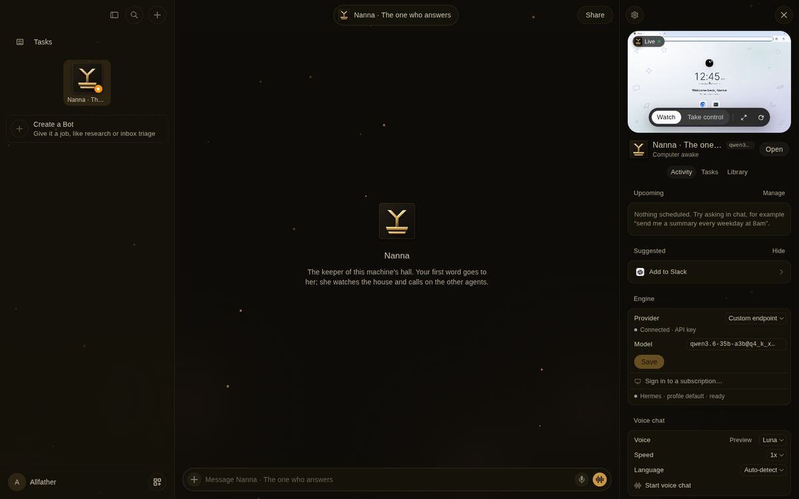
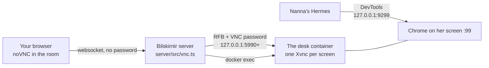

# The desk — the hall's own computer

Every agent in Bilskirnir has a screen: a small Linux desktop with a browser, which you can watch from the
agent's room and take over when it is stuck. Bot HQ rented that computer from Orgo. The desk is the house's
own: one container on this machine, one screen per agent, nothing paid and nothing in the cloud.

## What you need

- A container engine (`docker` on this machine; set `DOCKER` to use another CLI with the same verbs).
- About 1 GB of disk for the image (Debian, TigerVNC, Chromium, XFCE's window manager).
- Nothing else: `setup.sh` builds the image the first time and starts the desk.

## The commands

| Command | What it does |
|---|---|
| `apps/bilskirnir/house/desk.sh up` | Builds the image if it is missing, then starts the desk. Safe to run again. |
| `apps/bilskirnir/house/desk.sh down` | Stops the desk. The agents' browser profiles stay in its volume. |
| `apps/bilskirnir/house/desk.sh status` | One line: `image=… container=… screens=…`. Exits 0 only when the desk is up. |
| `apps/bilskirnir/setup.sh` | Install or refresh the app; brings the desk up and gives the agent her browser. |
| `apps/bilskirnir/setup.sh --check` | Reports whether the image is present, the desk is up and the agent's browser is pinned to it. |

The app wakes the desk on its own, too: when the panel finds it stopped, it runs `desk.sh up`.

## How it works

- **One screen per agent.** The first agent has display `:99`; each further agent gets `:100`, `:101`, … as it
  first opens its screen. Each screen is its own Xvnc process with its own port.
- **Loopback only.** Every screen listens on `127.0.0.1` (and `::1`) at `BILSKIRNIR_DESK_VNC_BASE + display − 99`.
  The X servers have no TCP and no abstract socket, so nothing on the machine draws on a screen except through
  its VNC door.
- **The password never reaches a browser.** It lives in `data/desk/vnc.pass` (mode 0600, git-ignored), is
  mounted read-only into the container, and is used only by the server, which does the VNC handshake itself
  and then offers your browser a session with no password. Watching drops your keys and clicks on the
  server; taking control passes them through.
- **The agent drives the same browser you see.** The container shares the machine's network, so the
  DevTools port of each agent's Chrome (9200 + display) is on this machine's loopback. `setup.sh` pins the
  first agent's browser tools to it (`browser.cdp_url`) and turns her browser toolset on only when the desk is up.
- **Commands go in by `docker exec`.** The desk scripts Bot HQ already had (wallpaper, dock, the agent's
  Chrome and home page, under `server/box/`) are unchanged; they run in the container exactly as they ran on
  an Orgo computer.

## Why this image

The desk is built from Debian's own maintained packages (`house/desk/Dockerfile`), not from a ready-made
desktop image. Bot HQ's relay speaks plain RFB, and its desk scripts want one X display per agent.
TigerVNC's `Xvnc` gives exactly that: one process per screen, each with its own RFB port. KasmVNC images
(webtop and similar) put one display behind their own web client and a modified protocol, which the relay
cannot speak, and they give no second screen.

## Settings

| Setting | Default | What it is |
|---|---|---|
| `BILSKIRNIR_DESK` | `local` | `local` is this desk; `orgo` uses an Orgo computer (`ORGO_API_KEY`, `ORGO_COMPUTER_ID`). |
| `BILSKIRNIR_DESK_HOST` | `127.0.0.1` | Where the desk's ports are, for the server and the agent's browser. |
| `BILSKIRNIR_DESK_VNC_BASE` | `5990` | RFB port of screen `:99`. |
| `BILSKIRNIR_DESK_GEOMETRY` | `1280x800` | Size of each screen. |
| `BILSKIRNIR_DESK_IMAGE` | `ymir/bilskirnir-desk:1` | The image `desk.sh` builds and runs. |
| `BILSKIRNIR_DESK_CONTAINER` | `bilskirnir-desk` | The container's name; its volume is `<name>-root`. |
| `BILSKIRNIR_DESK_DIR` | `apps/bilskirnir/data/desk` | Where the VNC password is kept. |

## Limits

- **Four screens at most** (`MAX_BOTS`, as with Orgo).
- **The DevTools ports are fixed** at 9200 + display (`server/box/hqlib.py`), so ports 9299–9302 must be free.
- **Computer-use (moving the mouse by model) is not wired** for the desk: the agents drive the browser
  through DevTools, and you drive the screen through take-over.
- **Moving to another host.** Nothing in the desk names this machine. On the always-on server (later) the same `setup.sh` builds
  and starts it there; the server and the desk must then run on the same host, because the ports are loopback.

## If it does not work

| You see | Do this |
|---|---|
| "Couldn't wake Nanna's computer" with a desk message | Run `apps/bilskirnir/house/desk.sh status`; then `up`. |
| `container=no-engine` | No container engine answers: start `docker`, or set `DOCKER`. |
| The screen is black or says it disconnected | `docker exec bilskirnir-desk desk-screen list` shows the running screens; `docker logs bilskirnir-desk` shows why one stopped. |
| The agent says it has no browser | `apps/bilskirnir/setup.sh --check` must print "agent's browser drives her desk"; re-run `setup.sh` and restart her Hermes gateway. |

Where this sits: [ARCHITECTURE.md](ARCHITECTURE.md) · `house/desk.sh` · `house/desk/` · `server/src/desk-local.ts` ·
`server/src/machine.ts` · the fix note `docs/fixes/bilskirnir/2026-11-12-the-hall-has-its-own-desk.md`.

## CHANGE LOG

- **2026-11-12** — Written, and carried into main by the gathered batch; from here appended, never rewritten.
