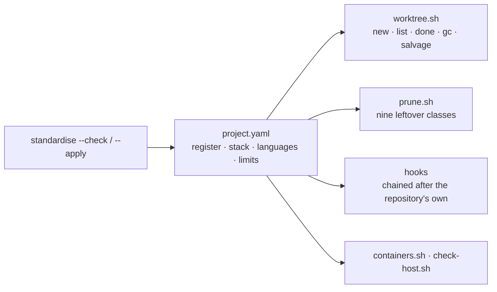

# The collaboration kit — the same discipline in every repository, and nothing left behind

**What it is.** Small, tested pieces that make a repository reviewable by a stranger and keep the machines that work
on it clean: worktrees with a lifecycle, a prune for every leftover a task makes, gates at the three cheap moments,
language and container rules, a handoff shelf and the tools that keep them honest. One file, `project.yaml`,
configures all of it.

**The core promise: leave no leftovers** (`RULES/24`). Everything a task used — its worktree, branch, build folder,
test database, scratch files, images — is gone when the task is, and nothing that holds unsaved work is ever lost on
the way.



## The pieces

| Piece | Path | What it does |
|---|---|---|
| the one config | `project.yaml` | register (`plain` by default), names, stack profile, languages, worktree and disk limits, container rules, leftover classes |
| the one command | `scripts/kit.sh` (`scripts/kit.py`, standard library only) | every subcommand below; `--json` for structured output |
| the worktree tool | `scripts/worktree.sh` | `new` (disk floor, leftover budget, cap, linked dependencies, a record), `list`, `done`, `gc`, `salvage` |
| the prune | `scripts/prune.sh` | worktrees, branches, remote refs, caches, scratch, test databases, images, volumes, stopped containers — a report, then `--apply` |
| the session check | `scripts/kit.sh doctor` | refuses new work below the disk floor or over the leftover budget |
| the merge door | `scripts/kit.sh merge <pr>` | merges a pull request, then closes its worktree and branch |
| the machine report | `scripts/check-host.sh` | disk, worktrees per repository, containers, images; `--strict` exits 1 over a limit; read-only |
| the container door | `scripts/containers.sh` | one build at a time, labels, retention; refuses changes on a product host |
| the daily timer | `scripts/kit.sh timer` | the prune as a systemd user timer |
| the weekly summary | `scripts/kit.sh summary` | what was created, closed, salvaged and pruned, from the ledger |
| the hooks | `.githooks/` | `pre-commit`, `commit-msg`, `pre-push`, `post-merge`, and pass-through hooks; each runs the repository's own hook after its own checks (`scripts/hooks-chain.sh`) |
| the checks door | `scripts/checks.sh` | runs `project.yaml` `checks.commit` / `checks.push`, else probes node, elixir or the repository's own `scripts/doctor.sh` — a skip is printed, never silent |
| the language check | `scripts/kit.py lang` | commits in the project tongue; client tongues only in declared paths (`RULES/22`) |
| the handoff shelf | `handoff/` (installed by `collab init`) | where the work is, what is blocked, and for whom — rewritten at every hand |
| the fix notes | `scripts/fixes.sh` · `scripts/fixes-components.sh` · `docs/fixes/` | one file per fix; what was wrong, why, and what was run |
| the review shelf | `scripts/reviews.sh` · `docs/audit/` | a review is a file named for its pull request |
| the secret and private-data scans | `scripts/gates/secret-scan.sh` · `private-data.sh` | a credential, a machine path or a real address is refused at the commit |
| the fix-note, referee and module-test gates | `scripts/gates/fixes-guard.sh` · `referee-guard.sh` · `new-module-test.sh` | a behaviour change with no note, a changed gate with no word, a new module with no test — refused at the push |
| the pull-request gate | `scripts/gates/pr-guard.sh` | a branch on the remote with no pull request is refused at the push |
| the maker guard | `scripts/gates/maker-guard.sh` | a commit never names a model or a tool as its author |
| the notices | `scripts/notify.sh` · `docs/notices.md` | a refusal goes to the project's declared notice command too |
| the areas shelf | `areas/` · `scripts/areas.sh` · `docs/areas.md` | what the project must answer for, and who holds each area |
| the workbench skill | `.agents/skills/the-workbench/` | the craft taught to a contributor's agent: the slice, the note, the five things never changed quietly |
| the collaborator door | `docs/collaborator-door.md` · `scripts/collab-connect.sh` | how an outside agent connects: a public card, a short-lived token for one skill, a grant |
| the status script | `scripts/status.py` · `docs/headers.md` | reads every plan, ticket and document header; `--check` fails on a malformed one |
| the template shelf | `docs/templates/` (`INDEX.md` first) | a template for every kind of document, each with its licence |

Plus the rules that govern them: `RULES/15` (pull requests, and the direct road for documents), `16` (a review is a
file), `17` (one task, one worktree), `18` (areas), `19` (plan, validate, execute), `20` (documents for people), `22`
(two tongues), `23` (containers) and `24` (leave no leftovers). `docs/gates.md` explains what each gate refuses
**and what it deliberately does not**.

## Registers: plain by default, house names by choice

Every installed file speaks the **plain** register: ordinary professional English, things named for what they do. A
team that prefers its own naming chooses a register at install time; the **facts, numbers and refusals are the same**
in every register — only the words and folder names change.

| Register | Worktrees | Branches | Chosen by |
|---|---|---|---|
| `plain` (default) | `.worktrees/<id>` | `work/<id>` | nothing — it is the default |
| `house` | the house folder | the house prefix | `standardise.sh --apply --register house` |

## Install it

```bash
bin/collab/standardise.sh --check <repo>                                   # what is missing, older or local
bin/collab/standardise.sh --apply <repo> --profile node --languages en:sv  # install, upgrade older kit files, seat hooks
bin/collab/standardise.sh --uninstall <repo>                               # put the hooks back as they were
```

**It never overwrites a rule a repository wrote for itself.** A file the kit shipped in an earlier version and the
repository never changed is upgraded; a file the repository changed is reported as local and left alone. **It never
takes the repository's hooks**: an existing `core.hooksPath`, real hooks in `.git/hooks`, or tracked hook folders
named in `project.yaml` keep running after the kit's own.

## Stack profiles

| Profile | Check | Linked into a worktree | Never shared |
|---|---|---|---|
| `node` (npm, bun, pnpm) | the package manager's `check`/`build` | `node_modules` | `dist`, `.next`, `build` |
| `python` (uv) | `uv run pytest -q` | — (uv hard-links from its cache) | `.venv`, `.pytest_cache` |
| `elixir` (mix) | `mix format --check-formatted`, `mix compile --warnings-as-errors` | `deps` | `_build` |
| `elixir-umbrella` | the same, over `apps/*` | `deps`, `assets/node_modules` | `_build` |
| `monorepo` | each part's own | each part's own | each part's own |

## What it does not do

- **It does not decide for a repository.** A rule that does not fit is not installed; the manifest says what is present.
- **It does not touch the product code.** No pipeline, no build, no dependency.
- **It does not enforce anything on the hosting service.** The enforcement is the hooks — so a clone without
  `core.hooksPath` is unprotected, and the installer sets it.

## CHANGE LOG

- 2026-11-20 — kit 2.0.0: plain register by default, `project.yaml`, stack profiles, languages, the worktree lifecycle,
  the nine leftover classes, hooks that chain, the container door and `check-host`.
- 2026-11-15 — review-mend: added missing heading for #774
