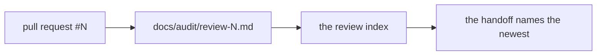

# 16 — A review is a file in the repository

**Added 2026-11-03.** A review lives in the repository, so a partner who starts work again finds it without asking.

## At a glance



| What | Means |
|---|---|
| a review | is a file named for its pull request, under docs/audit/ |
| the index | lists every review |
| the handoff | names the newest one, so the next person starts there |

## The rule

```
law[4]{rule,why}:
  "**a review of a pull request is a file under `docs/audit/`**","a comment on a pull request is invisible to a person starting from the repository, which is where every session starts"
  "**the name says which pull request it judges** — `<date>-review-of-pr<N>.md`","so a next hand can find the judgement of the branch it is about to touch"
  "**the shape is evidence, then what is good, then what must change, then the next tasks**","a review that only lists faults teaches nothing; one that only praises is not a review"
  "**the handoff names the newest one**","a review nobody is pointed at is a file, not a review"
```

## How it is used

```bash
bash scripts/reviews.sh new --pr=19 --title="the guided journey"
bash scripts/reviews.sh list
bash scripts/reviews.sh newest
```

**What it must contain, at minimum:** the commands that were run and what they printed · one thing that is good and why · what must
change before merge · and the next tasks in the order they should be taken.

## Why it is not a pull-request comment

A pull-request comment lives where the work was, and a person starting work today starts at the repository's handoff, not at the
conversation of a branch that later merged. **The review belongs where the next hand already looks** — and posting it *in addition* to
the pull request is courtesy, not record.

## CHANGE LOG

- 2026-11-14 — review-mend: added missing heading for #758
