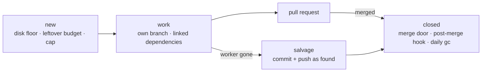

# 17 — One task, one worktree, and it is closed when the task is

**Added 2026-11-03; rewritten 2026-11-20 (kit 2.0.0)** after one machine filled its disk with 117 worktrees of a
single repository — 109 of them merged and clean, six holding work nobody had pushed — and every worker on it
stopped. The rule below is the lifecycle that prevents it; `scripts/worktree.sh` enforces it.



## The rule

| Rule | Why |
|---|---|
| **code is changed in a worktree, never in the main tree** — `bash scripts/worktree.sh new <id>` makes `<worktrees>/<id>/` on branch `<prefix>/<id>` (names from `project.yaml`, default `.worktrees/` and `work/`) | two hands in one tree overwrite each other's edits, share one build folder and fight over one lock |
| **a worktree is born with a record**: owner, purpose, created, expires (in the worktree's own git folder, `kit.json`) | a folder whose owner and purpose nobody knows is a folder nobody dares remove |
| **at most `worktrees.max` per repository on one machine** (default 8). The ninth `new` is refused and names the oldest merged one | each worktree is a full checkout; without a cap a busy day makes a hundred |
| **no `new` below the disk floor** (`disk.min_free_pct` and `disk.min_free_gb`, default 15 % and 40 GB) | a full disk stops every worker at once, mid-write |
| **no `new` while more than `worktrees.max_leftovers` leftovers wait** (default 2) — clean up first | a cap without a cleanup only moves the wall |
| **dependencies are linked, build outputs never are** — the stack profile in `project.yaml` lists the dependency folders a worktree links from the main tree (`node_modules`, `deps`) and the outputs it must build itself (`dist`, `_build`, `.next`) | a second `node_modules` costs a gigabyte for nothing; a shared build output is a collision |
| **a worktree is closed when its pull request merges** — by the merge door (`kit.sh merge <pr>`), by the `post-merge` hook, by `new` itself, and by the daily `gc` | a finished worktree left open is a second copy of the code that the next hand edits by mistake |
| **a dead worker's work is saved before anything is removed** — idle longer than `worktrees.stale_hours` with no process inside, its uncommitted and unpushed work is committed as `WIP (worker gone): saved as found, not reviewed` on its own branch and pushed | the only copy of an afternoon's work must never be one `rm` from gone |
| **nothing is removed while a process works inside it, or while it holds work that exists nowhere else** | a cleanup that loses work is worse than the disk it saves |

## How it is used

```bash
bash scripts/kit.sh doctor                         # at session start: safe to begin?
bash scripts/worktree.sh new ada-c1 --purpose "the invoices list"
cd .worktrees/ada-c1                               # …work, commit, push, open the pull request…
bash scripts/kit.sh merge 42                       # merges, then closes the worktree and its branch
bash scripts/worktree.sh list                      # every worktree, its state and why
bash scripts/worktree.sh gc                        # what would be closed; --apply closes it
```

## Only a code change needs a worktree; a handoff does not

| The change | Worktree | Pull request | Pushed to |
|---|---|---|---|
| code, tests, configuration, scripts, hooks | yes | yes, and a person merges | its own branch |
| documents and handoffs only (`docs/`, `handoff/`, `plans/`, `RULES/`, `areas/`, `*.md` outside code paths) | no, written in the main tree | no | the default branch, directly |

The kit's `pre-push` lets a push to `main` or `master` through when every file it changes is a document, and says
so. A push that carries code beside the documents is refused there. A handoff that also fixes "one small thing" in
code is a code change: split it.

## What this does not answer

**Which agent is which.** A worktree named `ada-c1` is a name, not an identity; the record names an owner and the
commits carry their own author. The rule prevents collision and leftovers, not confusion — the handoff prevents
confusion.

## References

- `scripts/worktree.sh`, `scripts/kit.py` — the tool
- `RULES/24-leave-no-leftovers.md` — every other class of leftover
- `project.yaml` — names, cap, floors, stack profile

## CHANGE LOG

- **2026-11-20** — Rewritten for kit 2.0.0: names from `project.yaml` (plain `.worktrees/` + `work/` by default), the
  record, the cap, the disk floor, the leftover budget, linked dependencies per stack profile, closing on merge, and
  salvage before removal. The handoff road widened to documents (RULES/15).
- **2026-11-11** — Only a code change needs a worktree; a handoff goes straight to the default branch.
- **2026-11-03** — Added: one agent, one worktree.
