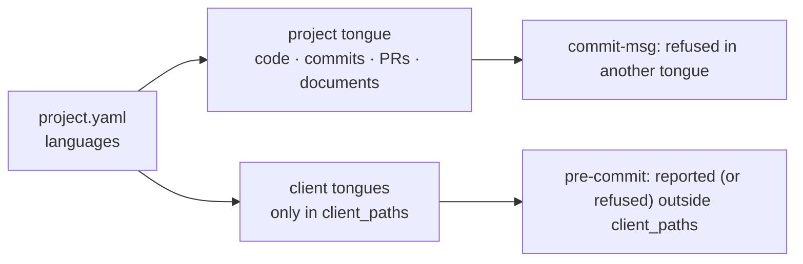

# 22 — Two tongues: the project's for the work, a client's only where a client reads

**Added 2026-11-20 (kit 2.0.0).** A repository is read by people who did not write it: a reviewer next month, an
auditor in three years, a maintainer in another country. Every one of them must be able to read the work. A client,
meanwhile, must read their own screens, mails and documents in their own language. Both are true at once, in
different places — and `project.yaml` says which places.



## The rule

| Rule | What it means |
|---|---|
| **the project tongue is the language of the work** | code, identifiers, comments, commit messages, pull requests, plans, fix notes and documents are written in `languages.project` (for most repositories, `en`) |
| **a client tongue lives only where a client reads it** | the words on a client's screens, their mails, their spoken prompts and the domain words their own records require — in the paths `languages.client_paths` declares (`ui/**/words.*.json`, `templates/mail/**`) |
| **recognising a language is not writing in it** | code that detects or translates a language may carry the words it matches; declare it in `language.allow` with the class `detector` |
| **a quotation is kept as it was said** | a person's own words and a program's own output are recorded as they came; a line starting with `>` in a commit message is a quotation |
| **correct by translation, never by deletion** | text in the wrong tongue is replaced by the same meaning in the right one |

## The declaration

```yaml
languages:
  project: en
  client: [sv]
  client_paths: ["ui/**/words.*.json", "templates/mail/**"]
  files: report        # report | refuse
```

`language.allow` (repository root) declares the exceptions, one per line — `<glob> | <class> | <reason>` — with the
classes `fixture` (the foreign text is the test's assertion), `detector`, `quotation`, `table` (a table of letters)
and `specimen` (a document that names what the rule refuses). A line with no reason is itself a finding.

## What enforces it

| Moment | Check | On a finding |
|---|---|---|
| `commit-msg` | `kit.py lang msg` — the message, line by line | **refused** |
| `pre-commit` | `kit.py lang staged` — every added line outside `client_paths` and `language.allow` | reported; refused when `files: refuse` |

**What it cannot see**, stated so nobody assumes it does: one foreign word inside a sentence in the project tongue, a
transliteration, and whether a translation is faithful. It raises the floor; the rule is the standard.

## References

- `scripts/kitlib/languages.py` — the detector and its word lists
- `project.yaml` — the declaration
- `RULES/20-documents-are-for-people.md` — how a document is laid out

## CHANGE LOG

- **2026-11-20** — Added with kit 2.0.0: the project tongue and the client tongues, declared in `project.yaml`.
