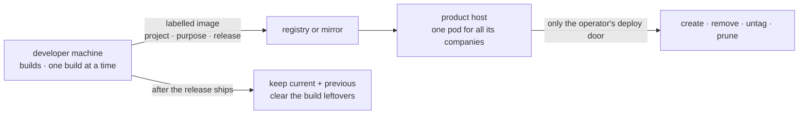

# 23 — Containers: a developer machine builds, a product host runs, and nothing old stays

**Added 2026-11-20 (kit 2.0.0)** after repeated release builds filled one machine's image storage and nothing was
ever pruned. The rule decides who may build, who may remove, and how many old images any machine keeps.



## The rule

| Rule | Why |
|---|---|
| **a developer machine builds images; it runs no product containers** | a product container on a laptop is a second production nobody watches |
| **a product host runs the product: one pod per host for all of its companies** | one pod is one thing to update, back up and roll back |
| **no worker creates, removes, untags or prunes anything on a product host** — the operator's deploy door does (`KIT_OPERATOR_DEPLOY=1`, set by that door alone) | a cleanup that removes the image a running client needs is an outage |
| **one image build at a time per machine** — `containers.sh build` takes a lock and refuses a second build | two parallel builds double the disk, the memory and the time, and both can fail |
| **every image carries the labels `project`, `purpose` and `release`** — `containers.sh build` adds them | an image without labels cannot be told apart from a stranger's, so it is never safely removed |
| **after a release ships, keep the current and the previous tag and clear the project's build leftovers** — `containers.sh retain --apply` (on the build machine); the product host keeps the same two for a rollback | an image nobody will run again is disk taken from the next build |
| **no image build below the disk floor** (`disk` in `project.yaml`) | a build that fills the disk stops every worker on the machine |

## How it is used

```bash
bash scripts/containers.sh build --tag app:1.4 --purpose product --release 1.4 .
bash scripts/containers.sh retain               # what would go: dangling images, tags past the newest two
bash scripts/containers.sh retain --apply       # after the release has shipped
bash scripts/check-host.sh                      # untagged, unlabelled, tags past retention, stopped containers
bash scripts/containers.sh ps                   # read-only commands pass through anywhere
```

A machine is a **product host** when `KIT_PRODUCT_HOST=1` is set, when `~/.config/collab-kit/machine.yaml` says
`product_host: true`, or when its host name is listed in `project.yaml` `containers.product_hosts`.

## What this does not do

It does not wrap the engine for a person typing at the terminal: a person who runs `podman rmi` directly is outside
the door. The door is what agents and scripts use, and `check-host.sh` is how anyone sees what the door was meant to
prevent.

## References

- `scripts/containers.sh`, `scripts/kitlib/containers.py` — the door
- `scripts/check-host.sh` — the read-only report
- `RULES/24-leave-no-leftovers.md` — images, volumes and stopped containers among the leftover classes

## CHANGE LOG

- **2026-11-20** — Added with kit 2.0.0: who builds, who removes, one builder, labels, retention.
