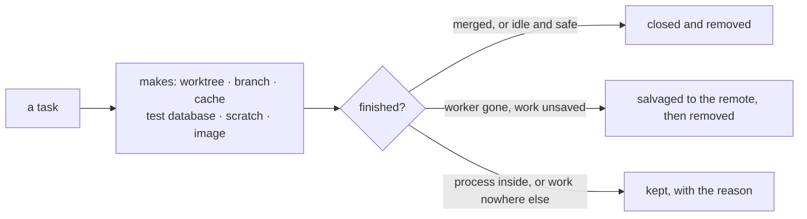

# 24 — Leave no leftovers: everything a task used is gone when the task is

**Added 2026-11-20 (kit 2.0.0)** — the kit's core promise. A development task makes things: a worktree, a branch,
a build folder, a test database, a scratch file, an image, a stopped container. When the task is finished, every one
of them goes. A machine is not a store of what was once useful.



## The rule

| Rule | Why |
|---|---|
| **every class of leftover is declared in `project.yaml` (`leftovers:`) with its rule** | what nobody declared, nobody cleans |
| **a report first, then `--apply`** — `bash scripts/prune.sh` says what would go and why; `--apply` does it | a person must be able to see a cleanup before trusting it |
| **nothing with a live process inside is removed** | the worker may still be there |
| **nothing that holds work existing nowhere else is removed** — uncommitted or unpushed work is salvaged to its own branch on the remote first, or kept | a cleanup that loses work is worse than the disk it saves |
| **nothing on a product host is removed by a worker** (RULES/23) | the running product depends on it |
| **`doctor` runs at session start and refuses new work over the budget** — the disk floor, `worktrees.max_leftovers`, the cap | the cheapest moment to clean up is before the next mess |
| **a daily timer runs the prune** — `bash scripts/kit.sh timer --install` | a promise that needs remembering is not kept |

## The classes

| Class | Removed when | Never removed when |
|---|---|---|
| `worktrees` | merged, clean and nothing unpushed; or idle past `worktrees.stale_hours`/expired with everything on the remote; a dead worker's work is salvaged first | a process works inside; it is locked; the salvage push failed |
| `branches` | merged into the default branch and checked out nowhere | unmerged — that is someone's work |
| `remote_refs` | the branch is gone from the remote (`git remote prune`) | — |
| `caches` | an ignored build output (`stack … never_share`) inside a worktree idle past `caches.idle_hours` | the folder is tracked; a process works inside |
| `scratch` | older than `scratch.older_than_hours` under the declared `scratch.dir` | in use; the folder is the repository, the home or `/` (refused) |
| `test_databases` | its name matches `pattern` — dropped with the project's own `drop` command, only when `apply: true` | the project declared no list/drop command |
| `images` | dangling and labelled for the project, or a tag past `containers.keep_tags` | on a product host; unlabelled (not provably ours — reported) |
| `volumes` | dangling and labelled for the project | on a product host |
| `stopped_containers` | labelled for the project and stopped past `older_than_hours` | on a product host |

## How it is used

```bash
bash scripts/kit.sh doctor                     # at session start
bash scripts/prune.sh                          # the report: class, verdict, target, reason
bash scripts/prune.sh --apply                  # do it
bash scripts/prune.sh --class worktrees,branches --apply
bash scripts/kit.sh summary                    # the week: created, closed, salvaged, pruned — from the ledger
bash scripts/check-host.sh --strict            # exits 1 when any line is over its limit
```

Every action is appended to the ledger, `.git/kit-ledger.jsonl` — the record `summary` reads, never committed.

## References

- `scripts/prune.sh`, `scripts/kitlib/leftovers.py` — the classes
- `RULES/17-one-agent-one-worktree.md` — the worktree lifecycle
- `RULES/23-containers-build-here-run-there.md` — images, volumes, containers

## CHANGE LOG

- **2026-11-20** — Added with kit 2.0.0: nine declared classes, report then apply, salvage before removal, doctor at
  session start, the daily timer and the weekly summary.
