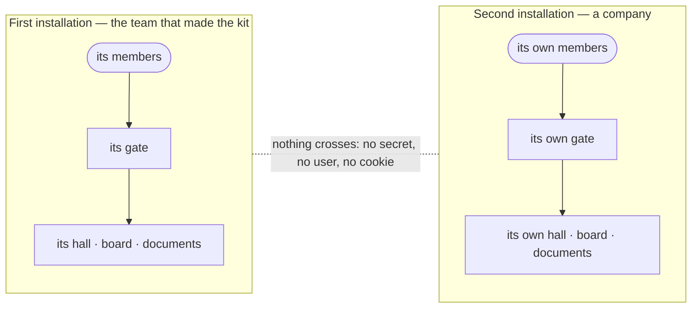

# A company's own suite — a second installation, owned by the company that runs it

**What this is.** The kit describes one collaboration suite: a hall with a desk, a board, documents, a
whiteboard, files and code, all behind one login. A company that wants that suite for itself does **not** join
ours. It raises **its own copy**, on its own hardware, renamed and themed as its own, and it owns every part of
it. This page is the checklist that copy follows, and the one line that proves the two installations are
separate.

> [!IMPORTANT]
> A second installation is finished only when it shares **no secret and no user** with the first. Until that
> line can be printed from both ends, what exists is a copy of our suite with our keys still in it.

## Two installations, one discipline

The discipline is the same in both: the handoff, the fix notes, the gates, the areas, the door with its card and
its grant. Nothing else is shared. The suite is software a company runs, not a service it subscribes to.

## Why it is separate

A shared secret is a shared front door. Every row below is a thing that must belong to exactly one
installation, and the reason it cannot be lent.

| What | Belongs to | Why it cannot be shared |
|---|---|---|
| the gate secrets | the company's own host | a session secret shared with another installation forges a session on both |
| the members | the company's roll | an account in two installations is a person in two companies, and no membership boundary is real |
| the domain and the cookie domain | the company's own name | a cookie scoped to a wider domain travels to every host under it |
| the routes | behind the company's gate | a second front door on the same host is a door the gate does not watch |
| the theme and the names | the company's own | a company that looks like another company has not been given a suite, it has been given a skin |
| the MCP tokens | one per member, scoped to that company's places | a token minted here opens places there; reach is not authority, and a shared token has no subject |
| the mail identity | the company's own domain, after its SPF and DMARC | a letter from a domain that does not authorise the sender is a letter nobody trusts |
| the secrets themselves | out of the tree, by reference | a key in a repository is a key in every clone of it, forever |

## The checklist a company follows

Work in this order. Each step ends with something that can be shown, not remembered.

1. **One host, its own.** The suite is installed on a machine the company controls, with its own checkout and
   its own state directory. A second installation on the first one's machine is not a second installation; it
   is a second tenant, which is a different promise.
2. **Fresh gate secrets, generated there.** The session secret, the encryption keys and the database password
   are created on the company's host with its own random source. **Nothing is copied from the first
   installation** — not a key, not a hash, not a sample value from a document.
3. **Its members only.** The company's roll holds its own people. No account from the first installation is
   carried over, and no member of the first installation is granted an account "to help with the install".
   Whoever installs it works through a temporary account that is removed, and removed accounts are written in
   the roll as removed.
4. **Its own domain, its own cookie domain.** The gate and every subdomain sit under the company's name, and the
   session cookie is scoped to that name alone. A cookie set for a parent domain is a cookie every sibling host
   receives.
5. **Every route behind its gate.** The hall, the board, documents, whiteboard, files and code are all proxied
   through the one gate, and every one answers `401` without a session. The only anonymous answers are the card
   and a booking page where one is offered.
6. **Its theme and its names.** Colours, logo and titles are the company's own, and the words its people see are
   its words. The kit's own voice does not travel into a company's suite.
7. **One MCP token per member, scoped to that company's places.** A token names one subject and the places that
   subject may touch; a place outside the token is refused by name, never answered with an empty list. Write
   stays off until the company switches it on for a named member.
8. **Mail only after its SPF and DMARC.** The suite sends from the company's own domain, and only once that
   domain's SPF and DMARC records authorise the sender. Letters sent before this land in spam, or are refused,
   and either way the company's name is the one damaged.
9. **Secrets out of the tree.** They live in the company's own vault or environment and are referenced by name
   from the configuration. The repository carries the shape of a requirement, never a value.

## The proof line

The checklist is done when this sentence is true, and it is worth printing from both ends:

> **The two installations share no secret and no user.**

Print it as two halves, because a claim is only as good as the check behind it:

| Half | How it is shown | What fails it |
|---|---|---|
| no shared secret | every secret on both hosts was generated there; the two sets have no value in common | one copied value, one default from a document, one shared signing key |
| no shared user | the two rolls have no subject in common, and each gate's account list is its own | one account present on both, one shared invitation, one shared token |

A test worth running once, by hand, at the end: take a session from one installation to the other and expect a
`401`; take a token from one and call a skill on the other and expect a refusal naming the places it may not
touch. Two refusals are the whole proof, and both are recorded.

## What this page does not do

- **It does not install anything.** The kit carries discipline and documents; it runs no server. The company's
  own installation steps are the company's, and they belong in that company's repository.
- **It does not name anyone.** A company, its domain and its people are the company's to write down, in its own
  repository. This page is written in roles so that nothing here becomes a fact about anybody.
- **It is not gated.** There is no ward that inspects a second installation and refuses a shared secret. Until
  there is, the proof line is a discipline held by review, and this page is what that review cites.

## CHANGE LOG

- **2026-11-15** — first written, at the operator's word, after a company asked to run its own copy of the suite
  renamed and themed as its own. The checklist, the separation table and the proof line are the answer.

## References

- `docs/collaborator-door.md` — a hand that is not on our network, and the ward a public door must carry
- `docs/a2a.md` — the card a repository publishes, and the rule that a card grants nothing
- `docs/gates.md` — what each gate refuses, and what it deliberately does not
- `RULES/16-a-review-is-a-file.md`, `RULES/20-documents-are-for-people.md` — the review and document rules the
  company's own copy will carry
