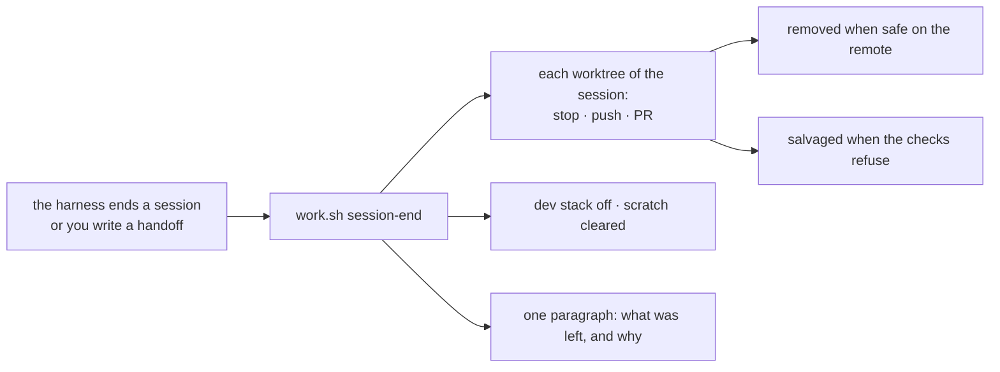

# Ending a session cleanly — the harness hooks

**The rule.** When a coding session ends or hands over, everything it opened is closed:
`bash scripts/work.sh session-end` stops every worktree the session started (checks, commit, push, pull request),
removes what is safely on the remote, saves the rest as found, stops the servers and test databases it tracked,
turns the app's development stack off when no other worktree of the app is open, and writes one paragraph saying
what was left and why (in `.git/kit-handoffs/`). Run it yourself before you write a handoff; the hooks below run it
when the harness ends a session.



## Which worktrees belong to a session

`work.sh start` writes the session id and the agent into the worktree's record. The id is `KIT_SESSION` when set,
else the harness's own (`CLAUDE_SESSION_ID`, `HERMES_SESSION_ID`, `OPENCODE_SESSION_ID`). `session-end` takes
`--session <id>`, `--agent <name>` or `--all`.

## The hooks, per harness

| Harness | Event | How the kit is wired | Source |
|---|---|---|---|
| Claude Code | `SessionEnd` (fires on exit, `/clear`, `/resume`) | `standardise.sh --apply` adds `bash scripts/work.sh session-end --from-hook` to `.claude/settings.json`, beside any hook already there. The hook reads the session id from its JSON input and finishes detached, because a SessionEnd hook has a 1.5-second budget | <https://code.claude.com/docs/en/hooks> (SessionEnd) |
| Hermes Agent | `session:end` gateway hook, or a plugin's `on_session_finalize` | a gateway hook directory in `~/.hermes/hooks/kit-session-end/` with the two files below | <https://hermes-agent.nousresearch.com/docs/developer-guide/gateway-internals> · <https://hermes-agent.nousresearch.com/docs/developer-guide/observer-hooks> |
| OpenCode | `session.deleted` plugin event (`session.idle` fires after every reply, so it is not used) | the plugin below in `.opencode/plugin/` | <https://dev.opencode.ai/v1/docs/plugins/> |
| pi | no session-end event is documented | run `work.sh session-end` before the handoff, by hand or from the agent's closing step | — |

### Hermes — `~/.hermes/hooks/kit-session-end/`

```yaml
# HOOK.yaml
name: kit-session-end
events: ["session:end"]
```

```python
# handler.py — the session's repository is the working directory the session ran in
import subprocess

def handle(event, context):
    subprocess.Popen(["bash", "scripts/work.sh", "session-end", "--session", str(context.get("session_key", ""))],
                     start_new_session=True)
```

### OpenCode — `.opencode/plugin/kit-session-end.js`

```js
export const KitSessionEnd = async ({ $ }) => ({
  event: async ({ event }) => {
    if (event.type === "session.deleted") {
      await $`bash scripts/work.sh session-end --session ${event.properties?.info?.id ?? ""}`.nothrow();
    }
  },
});
```

## References

- `scripts/work.sh`, `scripts/kitlib/work.py` — `session-end`
- `docs/how-we-work.md` — start, stop, sweep, deploy
- `RULES/24-leave-no-leftovers.md` — why nothing a session used may stay

## CHANGE LOG

- **2026-11-20** — First written with kit 2.0.0: session end as a first-class trigger, and the hooks per harness.
