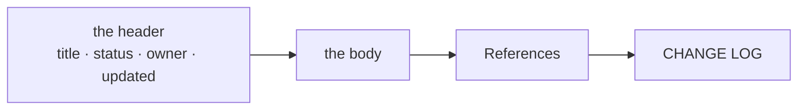

# Document and plan headers — how a file says what state it is in

**What this is.** Every document, plan and ticket opens with a small header between two `---` lines, so a person
or a script can tell its state without reading it. `python3 scripts/status.py` reads those headers and prints a
table; `--check` fails when one is missing or malformed. A file with no header is reported as `no header`, never
guessed at. The reader needs no library: the headers are plain `key: "value"` lines.

## At a glance



## A document

```
---
title: "The tenant architecture"
status: "review"        # draft | review | accepted | superseded | record
owner: "Name of the person accountable"
reviewer: "Name of who reads it"
updated: "2026-11-11"
---
```

| Status | Meaning |
|---|---|
| draft | being written; nobody has been asked to read it |
| review | the reviewer has been asked and is reading it |
| accepted | agreed; it is the current word |
| superseded | replaced; it names its successor and is kept, never deleted |
| record | a dated record of what happened, not a living statement |

`docs/fixes/` and `docs/kit/` are skipped by the status script: fix notes are records of their day, and the kit's
own documents are copied in as shipped.

## A plan

`plans/<PREFIX>-NNN-*.md` carries `ticket_number`, `title`, `type`, `priority`, `status`, `validated_by`,
`validated_on`, `updated`. Plan status runs `Proposed → In Review → Validated → In Progress → Done`, plus
`Rejected` and `Superseded`. A plan whose status is Validated or later must have `validated_by` and
`validated_on` filled in (`RULES/19`). A ticket has its own header — see `plans/tickets/README.md`.

## The References rule

**Every document, plan and ticket ends with a `## Fields for a board

A project that mirrors its plans and documents to a work board reads a few more lines. `created` is the one every
plan and document should carry; the rest are optional.

| Field | Meaning |
|---|---|
| `created` | the date the file was first written. Set once, never changed |
| `updated` | the date of the last change |
| `product` | which product the file belongs to, when a repository holds more than one |
| `id` | the file's own number under its product's prefix, for example `BETA-004` |
| `legacy_id` | an earlier number the file was known by. The old number is kept here, never rewritten |
| `owner` | the person accountable: one name. An optional `co_owners` line lists others |
| `start`, `due` | optional dates for the board |
| `labels` | optional, comma separated |
| `parent` | on a ticket: the plan it belongs to |
| `links` | optional: pull request, issue or document links |

**One prefix per product.** When a repository holds more than one product, each product has its own prefix and its
own counter, so two products never share a number. A product may name its prefix in a one-line `.prefix` file in its
plans folder. When a product is renamed, its earlier plans keep their old numbers in `legacy_id`; nothing is
renumbered, because other files link to them.

## References` section** naming what it was built from: the rules,
the other documents, the code paths and the decisions it rests on. The status script reports `no References` for
a file without one (a `README.md` index is the one exception). A claim with nothing behind it is a claim the next
reader cannot check.

## References

- `RULES/19-plan-validate-execute.md` — what validation means and who gives it
- `plans/tickets/README.md` — the ticket header
- `scripts/status.py` — the reader and the checker

## CHANGE LOG

- **2026-11-11** — written by the errand that shipped it; CHANGE LOG section added when the branch was merged for one PR.
- **2026-11-24** — added the board fields (`created`, `product`, `id`, `legacy_id`, `co_owners`, `start`, `due`, `labels`, `parent`, `links`) and the one-prefix-per-product rule.
