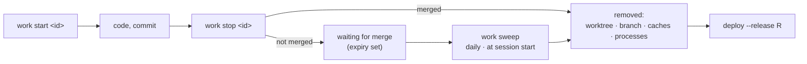

# How we work — start, stop, sweep, deploy

Four commands cover a task from its first minute to its release. Each one refuses rather than leave a mess:
no work starts on a full disk or on top of old leftovers, no task ends with its folder, branch, server or test
database still there, and no release removes the one before it until the new one is proven.



## 1 · Start a task

```bash
bash scripts/work.sh start invoices-list --purpose "the invoices list"
```

| It does | Or refuses when |
|---|---|
| `git fetch --prune`, then a worktree from `origin/<default>` in `.worktrees/<id>` on `work/<id>` | the disk is below the floor (`disk` in `project.yaml`) — and prints what to clean |
| links the dependency folders the stack profile names; builds nothing that must not be shared | more leftovers wait than `worktrees.max_leftovers` — and prints them |
| writes the record: owner, purpose, started, expiry | the repository already has `worktrees.max` worktrees — and names the oldest merged one |
| turns the app's development stack on (`stack.sh on`), when the machine's manifest lists it | |
| prints the next command | |

If the task starts a server, a database or anything else that keeps running, tell the record, so `stop` can end it:

```bash
bash scripts/work.sh track invoices-list --pid 41234 --what "dev server"
bash scripts/work.sh track invoices-list --port 4000
bash scripts/work.sh track invoices-list --db app_test_invoices
```

## 2 · Stop a task

```bash
bash scripts/work.sh stop invoices-list -m "Show the invoices list with its due dates"
```

| Step | What happens |
|---|---|
| checks | the project's push checks (`checks.push`); a failure stops here and changes nothing |
| commit, push | the message is required when anything is uncommitted; the hooks run as always |
| pull request | opened when there is none, refreshed by the push when there is |
| what the task started | tracked processes and ports stopped; tracked test databases dropped with the project's `drop` command |
| merged | the worktree, its branch and its caches are removed |
| not merged | the record says **waiting for merge** with a new expiry; the merge door (`kit.sh merge <pr>`), the `post-merge` hook or the sweep closes it |
| the dev stack | turned off when no worktree of the app is still open |

## 2b · End a session, or hand over

```bash
bash scripts/work.sh session-end            # every worktree this session opened (KIT_SESSION or the harness's id)
bash scripts/work.sh session-end --agent ada
```

Each worktree is stopped as above; what is safely on the remote is removed, what the checks refuse is saved as
found, the dev stack goes off when no other worktree of the app is open, and one paragraph — what was left and why —
is written to `.git/kit-handoffs/`. Run it before you write a handoff. The harnesses call it at their own session
end (`docs/harness-hooks.md`).

## 3 · Sweep

```bash
bash scripts/work.sh sweep            # closes, salvages, prunes, reports the budget
bash scripts/work.sh sweep --dry-run  # what it would do
bash scripts/kit.sh timer --install   # run it every day
```

It closes merged worktrees, saves a gone worker's unfinished work to its own branch on the remote before removing
the folder (`WIP (worker gone): saved as found, not reviewed`), deletes merged branches and stale remote refs,
clears build caches in idle worktrees and old scratch files, turns idle development stacks off, and ends with
`doctor`: the disk, the leftover budget and the cap. Run it at the start of a session too.

## 4 · Turn development stacks off

```bash
bash scripts/stack.sh status          # every app on this machine: role, running, memory, CPU, since
bash scripts/stack.sh off --all-dev   # the end of the day
bash scripts/stack.sh on shop         # started and health-checked
```

The machine's manifest, `~/.config/collab-kit/stacks.yaml`, lists every app's pieces — systemd user units,
podman containers and pods, docker containers, compose services — each with a role. **`prod` is never stopped**
(naming one is refused), **`dev` is stopped by `off` and started by `on`**, and **`unknown` is never touched**
until a person decides. Only what is in production needs to run all the time.

## 5 · Deploy

```bash
bash scripts/deploy.sh --release 1.4 --dry-run   # the plan, the storage driver, the rollback
bash scripts/deploy.sh --release 1.4
bash scripts/deploy.sh --rollback                # the project's own rollback, to the previous release
```

| Step | Rule |
|---|---|
| where | refused on a product host: images are built on a developer machine |
| storage | the filesystem decides the driver (`btrfs` on btrfs, `overlay` elsewhere); the door says which and passes it |
| disk, lock | the disk floor, and one image build at a time per machine |
| build | every image labelled `project`, `purpose`, `release` |
| ship, verify | the project's own `deploy.ship` and `deploy.hook` (backups and a live proof belong in the hook) |
| keep | the newest two tags per image — the current and the previous — and nothing older; the project's dangling build leftovers cleared |
| on failure | stops at that step, the previous release keeps running, and the rollback is printed |

## References

- `RULES/17-one-agent-one-worktree.md` — the worktree lifecycle
- `RULES/23-containers-build-here-run-there.md` — who builds, who removes, retention
- `RULES/24-leave-no-leftovers.md` — every class of leftover
- `project.yaml` — every limit and command named above

## CHANGE LOG

- **2026-11-20** — First written with kit 2.0.0: start, stop, sweep, the stack switch and deploy.
