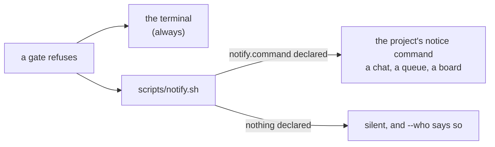

# Where a gate's words go — to the people and agents who own the work

**The fault this ends.** A gate printed its refusal at whoever typed `git commit` or `git push`. When an agent made
the commit, the person responsible for that agent never heard about it; when a person made it, the agent that will
pick the work up next never knew it was refused.

## The door

`scripts/notify.sh <gate> <message…>` — installed with the kit and called by every hook on a refusal. It is also
runnable by hand; `bash scripts/notify.sh --who` prints where notices go.

| Setting | Where | What it does |
|---|---|---|
| `notify.command` | `project.yaml` | a shell command run with two arguments: `[<repository>] <gate>` and the first lines of the message |
| `KIT_NOTIFY_CMD` | the environment | the same, and it wins over `project.yaml` |
| `KIT_NOTIFY_STRICT=1` | the environment | a failed delivery fails the hook, for a team that wants proof of delivery |

## The laws it keeps

| Law | Why |
|---|---|
| it never breaks a git operation — it exits 0 unless `KIT_NOTIFY_STRICT=1` | a notice is a courtesy; the gate's own refusal is the stop |
| no address leaks: a notice names the repository and the gate, never a host, a port or a path | the notice may travel further than the repository |
| no command declared, no notice — and `--who` says so | a notice that reached nobody must not look delivered |

## References

- `scripts/notify.sh` — the door
- `docs/gates.md` — the gates that call it
- `project.yaml` — where `notify.command` is declared

## CHANGE LOG

- **2026-11-20** — Rewritten for kit 2.0.0: one declared command (`notify.command`) replaces the older delivery chain,
  and the door is renamed `scripts/notify.sh`.
- **2026-11-11** — First written.
