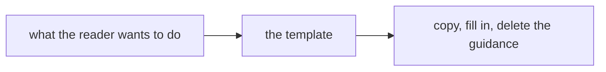

# Document templates — pick one, copy it, fill it in

**What this is.** A shelf of templates for every kind of document a project writes. Each is laid out for a person to
read (`RULES/20` in a repository that carries the collaboration kit). Copy the one you need, replace everything in
`{curly brackets}`, and delete the guidance lines.

## Which template

Start from what the reader wants to do.

| You are writing… | The reader wants to… | Template |
|---|---|---|
| a plan | know what will be built, in what order, and what is owed | [`project/plan.md`](project/plan.md) |
| an architecture page | understand how a system is shaped and why | [`project/architecture.md`](project/architecture.md), or the full [`arc42/architecture-arc42.md`](arc42/architecture-arc42.md) for a large system |
| a decision record | know what was decided, between which options, and why | [`madr/decision.md`](madr/decision.md) · short form [`madr/decision-minimal.md`](madr/decision-minimal.md) |
| a research note | get the answer to a question, with how sure we are | [`project/research.md`](project/research.md) |
| a rule | know the law, why it exists, and how it is kept | [`project/rule.md`](project/rule.md) |
| a README | know what a project is and how to start | [`the-good-docs-project/readme.md`](the-good-docs-project/readme.md) |
| a quickstart | get something working in minutes | [`the-good-docs-project/quickstart.md`](the-good-docs-project/quickstart.md) |
| a tutorial | learn by doing it once | [`the-good-docs-project/tutorial.md`](the-good-docs-project/tutorial.md) |
| a how-to | get one task done | [`the-good-docs-project/how-to.md`](the-good-docs-project/how-to.md) |
| a concept page | understand an idea | [`the-good-docs-project/concept.md`](the-good-docs-project/concept.md) |
| a reference page | look a fact up | [`the-good-docs-project/reference.md`](the-good-docs-project/reference.md) |
| an installation guide | install it | [`the-good-docs-project/installation-guide.md`](the-good-docs-project/installation-guide.md) |
| a runbook | operate it, and recover it at 3 a.m. | [`the-good-docs-project/runbook.md`](the-good-docs-project/runbook.md) |
| a troubleshooting page | fix a known problem | [`the-good-docs-project/troubleshooting.md`](the-good-docs-project/troubleshooting.md) |
| release notes | know what changed | [`the-good-docs-project/release-notes.md`](the-good-docs-project/release-notes.md) |
| a glossary | know what a word means here | [`the-good-docs-project/glossary.md`](the-good-docs-project/glossary.md) |

## Where they come from, and their licences

The upstream templates are shipped **unchanged**, except that links to The Good Docs Project's writing guides point at
their upstream pages, and files were renamed.

| Set | Source | Licence | What the licence asks |
|---|---|---|---|
| `project/` | written with the kit, 2026-11-11 | the repository's own | — |
| `the-good-docs-project/` | <https://gitlab.com/tgdp/templates> (main, fetched 2026-11-11) | MIT No Attribution ([`LICENSE`](the-good-docs-project/LICENSE)) | nothing; credit is welcome |
| `madr/` | <https://github.com/adr/madr> `template/` (main, fetched 2026-11-11) | MIT or CC0-1.0 ([`LICENSE.MIT`](madr/LICENSE.MIT)) | keep the MIT notice if you take MIT |
| `arc42/` | <https://github.com/arc42/arc42-template> release 2026.10.19, English, plain GitHub Markdown | CC BY-SA 4.0 ([`LICENSE.txt`](arc42/LICENSE.txt)) | keep the attribution; a changed *template* shared onward stays CC BY-SA. What you write inside it is yours |

## References

- `RULES/20-documents-are-for-people.md` — the law these templates serve
- Diátaxis, the four kinds of documentation: <https://diataxis.fr/>

## CHANGE LOG

- **2026-11-20** — The kit's own four templates moved to `project/` (kit 2.0.0, plain register).
- **2026-11-11** — Shelf created: four project templates, eleven from The Good Docs Project, two from MADR, one from
  arc42, with their licences.
