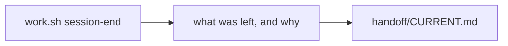

# handoff — where the work stands

One hand stops; another continues. Without a written handoff the second one re-derives the state of this
repository from the code and the tickets, and the first one's reasoning is lost — which is the expensive
part, because the reasoning is what the plans carry and the code does not.

**Two files and a shelf:**

```
handoff/
├── CURRENT.md      the live handoff — always the last five minutes of the previous hand
├── TEMPLATE.md     the shape every handoff must have
├── log/            one file per handoff, dated — append-only, never rewritten
└── check.py        the check (handoff/check.sh runs it)
```

`CURRENT.md` is the only living document in the repository: it is rewritten at every handoff, because a
handoff that accumulates is not a handoff. Everything it says is also written once into `log/`, which is
append-only — a correction is a new handoff that cites the old one.

## The law

| Rule | Why |
|---|---|
| write a handoff before you stop | a session that ends without one leaves the next hand to archaeology |
| write it for a stranger | someone who has read the repository's contract and nothing else must be able to continue |
| say where the work is, not what it was like | branch, commit, PR number, deployment, and the command that proves each |
| name what is blocked, and on whom | a blocker nobody wrote down becomes two people waiting |
| check it, do not trust it | a stale handoff must fail a gate instead of quietly lying |

**When to write one:** ending a session · handing to a sub-agent · going blocked · handing between
machines · before a merge is sealed. **Not** after every commit — a handoff is for a hand, not a habit.

## Use it

```sh
handoff/check.sh --new --from <your-name>     # writes handoff/log/<date>-<from>.md and refreshes CURRENT.md
handoff/check.sh --check                      # complete, dated, fresh, and its paths exist
handoff/check.sh --check --max-age-days 30    # a longer leash for a long quiet stretch
```

The check fails on: a missing handoff · a missing section · no date, an unparseable date, or an age over
the limit (default 14 days) · no branch or deployment line · a backticked path under a known shelf that
does not exist · an empty `log/`.

**Wire it into the gate.** The check is worth nothing if nobody runs it:

- Elixir: add `handoff/check.sh` to the `precommit` alias in `mix.exs`.
- Node: add `"handoff": "handoff/check.sh --check"` to `package.json` scripts, and call it from CI.
- Anything else: add `handoff/check.sh --check` to the CI job that must pass before a merge.

## Before you write it — appended 2026-11-20

Run `bash scripts/work.sh session-end` first (collaboration kit 2.0.0): it closes every worktree the session
opened, stops what it started, and writes a paragraph of what was left and why — paste it into section 4.

| Step | Command |
|---|---|
| close the session's work | `bash scripts/work.sh session-end` |
| write the handoff | copy `handoff/TEMPLATE.md`, fill all seven sections |



## Written for a business reader — appended 2026-11-06

These repositories are shared. A handoff is read by the client who owns the product, the partner whose name is on
the contract, the accountant who wants the invoice, the developer on their first day and the auditor three years
from now. None of them should have to learn a team's private vocabulary to read where the work stands.

| Rule | Why |
|---|---|
| plain English, and the reader named | a handoff with no `**For:**` line has no reader, and a document written for nobody is written for its author |
| full names, as the contract carries them | an internal nickname is a door a client cannot open: write the person, not the persona |
| no internal vocabulary | the names a team gives its own tools, agents and people mean something inside the team and nothing to a client |
| say what a person can see | a screen, a report, a number, a command and its output — never "the subsystem refused" |
| money and dates in full | a currency code and a year, not an amount a reader has to place in time |
| jargon that cannot be avoided gets one line in section 1 | one sentence of explanation costs the next hand ten minutes and saves the reader an hour |

**Say this, not that:**

| Inside the team | In a handoff a client reads |
|---|---|
| "the boss signed it off" | "the named approver accepted the change on 6 November 2026" |
| "the bot farmed it out" | "the assistant gave the work to a separate worker, who opened pull request #3" |
| "the ward refused the push" | "the release check stopped the deploy: one hard-coded password was found and removed" |
| "left it on the shelf for the next hand" | "the work is on branch `x`, unfinished; the next step is written in section 3" |

**Enforced, not hoped for.** The check refuses a handoff with no `**For:**` line, and refuses a word from its list of
internal names (`handoff/check.py`, `HOUSE_WORDS`) unless the line that carries one waives it in writing with
`allow-house-word:` — on the line it waives, never by widening the rule.

## CHANGE LOG

- **2026-11-20** — The business-reader section rewritten in the plain register (kit 2.0.0): the same rules and the
  same enforcement, without naming any one team's vocabulary.
- **2026-11-12** — this document gained a CHANGE LOG section so it carries its history (RULES/06). Its earlier history is its git log; entries are appended below, never rewritten.
