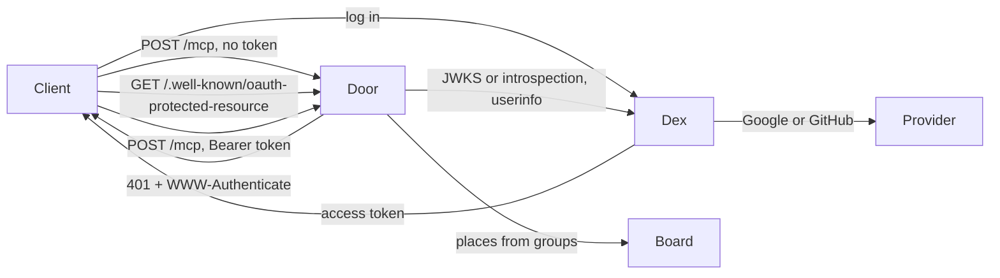

# Gimlé's MCP door — how it lets people in

This directory holds Gimlé's MCP server (`gimle-mcp.py`) and the OAuth resource server beside it
(`gimle_oauth.py`). It also holds the Dex deployment that logs people in with Google or GitHub, and the two
test scripts that prove it all. The governing plan is plan 149, *the door that logs its people in*, kept in
the operator's home.

> [!IMPORTANT]
> The live door runs from the Gimlé kit on the operator's heart, not from this tree. Installing is copying
> two files there and adding flags to its unit. The steps marked **operator** below need the operator's own
> hand: a password-guarded `sudo`, a unit edit and a restart. A worker prepares them and never runs them.

## What the door does now

The door admits a caller by one of two roads, and every ledger line says which road was taken.

| Road | How a caller proves who they are | What decides their places and writing |
|---|---|---|
| `bearer-file` | a static token from the token file (`--tokens`) | the token's own place column; writing follows the door's `--allow-write` |
| `oauth` | an access token the issuer gave one of the door's own clients | the caller's groups; writing needs `gimle-write` **and** the door's `--allow-write` |

The token file stays the fallback for harnesses that cannot do OAuth. Nothing about a static token changes,
except two faults that are now fixed for everyone:

- **Canvas writes obey the read-only door.** `add_elements`, `update_elements`, `save_room` and `share_room`
  are refused on a door started without `--allow-write`, for static tokens too. The refusal is logged.
- **A place name may contain a space.** The place column is split on commas only.



## The groups

Groups decide scope. They come from the issuer's `groups` claim, from the door's local groups file, or both.

| Group | What it grants |
|---|---|
| `gimle-all` | every place |
| `gimle-place-<Name>` | that one place, for example `gimle-place-Ymir` or `gimle-place-acme/Field Notes` |
| `gimle-write` | may write, but only on a door started with `--allow-write` |
| no place group | no places at all: the default is deny, as in the token file |

A group may arrive prefixed the way Dex's GitHub connector names teams, as `<org>:<team>`. The door matches
the part after the last colon, so a GitHub team named `gimle-all` works as it is.

Google carries no groups unless a Workspace admin key is configured. Grant those people in the local groups
file instead, one line each:

```text
# <username | email | sub> <group>,<group>
ada@example.org gimle-place-Ymir,gimle-write
octocat gimle-all
```

## Who the caller is

The subject written in the ledger is the first of these the issuer gives: `preferred_username`, then
`email`, then `sub`. Plan 149 named `preferred_username` with `sub` as the fallback. The worker put `email`
between them because Dex's `sub` is an opaque encoded id that nobody can read in an audit line. Google gives
no `preferred_username`, and Dex's own stand-in connector gives none either (measured).

## Flags

| Flag | Default | Meaning |
|---|---|---|
| `--oauth-issuer` | off | the OIDC issuer the door trusts; turns OAuth on beside the token file |
| `--oauth-resource` | from the request | the door's public `/mcp` URL, named in the metadata and in `WWW-Authenticate` |
| `--oauth-audience` | none | client ids, comma-separated, whose tokens are accepted; any other app's token is refused |
| `--oauth-mode` | `auto` | `jwt` checks the issuer's JWKS, `introspect` asks the issuer, `auto` uses JWT when the token looks like one |
| `--oauth-client-id` | none | the client the door introspects as (introspection only) |
| `--oauth-secret-file` | `/etc/gimle/oauth-client-secret` | the introspection secret, read from a file, never from the command line |
| `--oauth-groups` | none | the local groups file |
| `--oauth-cache` | `60` | seconds a verified identity is cached; a refusal is cached for 10 |

Each flag also reads an environment variable (`GIMLE_OAUTH_ISSUER`, `GIMLE_OAUTH_RESOURCE`,
`GIMLE_OAUTH_AUDIENCE`, `GIMLE_OAUTH_MODE`, `GIMLE_OAUTH_CLIENT_ID`, `GIMLE_OAUTH_SECRET_FILE`,
`GIMLE_OAUTH_GROUPS`).

With Dex, use JWT mode. Dex signs its access tokens as RS256 JWTs, so the door checks them against the
published keys and needs no secret of its own. Dex v2.41.1 also publishes an introspection endpoint
(`/dex/token/introspect`, measured), so introspection works too; it costs a round trip per new token and a
client secret in `--oauth-secret-file`. Introspection is the natural mode for Authelia.

## What the door serves

| Request | Answer |
|---|---|
| `POST /mcp` with no token, or a bad one | `401`, with `WWW-Authenticate: Bearer resource_metadata="…"` when OAuth is on |
| `GET /.well-known/oauth-protected-resource` (also `…/mcp`) | the resource metadata, naming the issuer |
| `GET /.well-known/oauth-authorization-server` | the issuer's own discovery document, for clients of the older MCP spec |
| `GET /mcp` | `405`, `Allow: POST` |
| `GET /health` | liveness, and whether OAuth is on |

## Install on the heart

The paths below use `$GIMLE` for the kit's checkout on the heart (the directory that holds
`systems/mcp/`) and `$ETC` for the door's private configuration directory. The operator's own filled-in
copy of these commands lives in the home, beside plan 149.

### 1. Copy the two files (the worker or the operator)

```bash
cp "$GIMLE/systems/mcp/gimle-mcp.py" "$GIMLE/systems/mcp/gimle-mcp.py.bak-$(date +%Y%m%d)"
scp bin/gimle/mcp/gimle-mcp.py bin/gimle/mcp/gimle_oauth.py heart:"$GIMLE/systems/mcp/"
```

`plane_tools.py` stays where it is; this tree does not carry it. Without it beside the door, the door still
serves its other tools and says so on stderr.

### 2. Raise Dex (the worker or the operator, no `sudo`)

```bash
mkdir -p "$GIMLE/systems/dex" && cp bin/gimle/mcp/dex/* "$GIMLE/systems/dex/"
cd "$GIMLE/systems/dex"
cp config.example.yaml config.yaml     # replace every https://id.example.org/dex with the real issuer URL
cp dex.env.example dex.env && chmod 600 dex.env
sed -i "s/^GIMLE_MCP_CLIENT_SECRET=.*/GIMLE_MCP_CLIENT_SECRET=$(openssl rand -hex 32)/" dex.env
mkdir -p state && docker compose up -d
curl -s http://127.0.0.1:5556/dex/.well-known/openid-configuration | head -c 200
```

Dex expands `$NAME` only inside connector configs. The `issuer:` line and the callback URLs must be written
into `config.yaml` literally (measured on v2.41.1).

### 3. Publish Dex on the tunnel (the operator)

Add one ingress rule to the tunnel that already fronts the door, pointing the issuer's host at
`http://127.0.0.1:5556`, then reload that tunnel. The issuer URL in `config.yaml`, the door's
`--oauth-issuer` and the provider callbacks must all agree exactly.

### 4. The provider apps (the operator, later, in their own consoles)

| Provider | Where | Callback | Goes in |
|---|---|---|---|
| GitHub | Settings, Developer settings, OAuth Apps, New OAuth App | `<issuer>/callback` | `GITHUB_CLIENT_ID`, `GITHUB_CLIENT_SECRET` in `dex.env` |
| Google | Cloud console, APIs and Services, Credentials, OAuth client ID (Web) | `<issuer>/callback` | `GOOGLE_CLIENT_ID`, `GOOGLE_CLIENT_SECRET` in `dex.env` |

Then run `docker compose up -d` again in the Dex directory. Until then, a login with that provider fails at
the provider. Nothing else waits on it.

### 5. The door's private files (the operator; `sudo` asks for a password)

```bash
sudo install -d -m 0750 -o "$USER" -g "$USER" /etc/gimle
sudo install -m 0600 -o "$USER" -g "$USER" /dev/null /etc/gimle/oauth-groups
# only for an introspecting issuer (Authelia); Dex in JWT mode needs no secret at the door:
sudo install -m 0600 -o "$USER" -g "$USER" /dev/null /etc/gimle/oauth-client-secret
```

Then write the grants into `/etc/gimle/oauth-groups`, one person per line.

### 6. The unit and the restart (the operator)

Add a drop-in beside the door's unit, for example `gimle-mcp.service.d/30-oauth.conf`. It repeats the
existing command line and appends the OAuth flags:

```ini
[Service]
ExecStart=
ExecStart=/usr/bin/python3 <GIMLE>/systems/mcp/gimle-mcp.py --port 8489 \
  --data <data>/meetings.json --tokens <etc>/mcp-tokens --audit <data>/access.jsonl \
  --plane --allow-write \
  --oauth-issuer https://<issuer-host>/dex \
  --oauth-resource https://<door-host>/mcp \
  --oauth-audience gimle-mcp,gimle-mcp-cli \
  --oauth-mode jwt \
  --oauth-groups /etc/gimle/oauth-groups
```

```bash
systemctl --user daemon-reload && systemctl --user restart gimle-mcp
ss -tln | grep ':8489 '                                   # the socket, not the unit, is the truth
curl -s -o /dev/null -w '%{http_code}\n' -X POST http://127.0.0.1:8489/mcp   # 401
curl -s http://127.0.0.1:8489/.well-known/oauth-protected-resource           # names the issuer
```

> [!NOTE]
> On the heart measured on 2026-11-19, the door's unit is a **user** unit, so the restart itself needs no
> `sudo`. Only `/etc/gimle` does. The plan still treats the unit edit and the restart as the operator's
> hand, and so does this page.

### Rollback

Remove the drop-in and restart. The token file road never stopped working. To return the old door file,
copy the `.bak-<date>` back.

## How a person connects

- **A custom connector** (Settings, Connectors, Add custom connector): the door's `https://<door-host>/mcp`.
  If the connector asks for a client, use `gimle-mcp` and the `GIMLE_MCP_CLIENT_SECRET` from `dex.env`.
- **A command-line harness or `mcp-remote`**: the same URL, with the public client `gimle-mcp-cli`. Dex
  v2.41.1 lets a public client call back to `http://localhost:<any port>`, but **not** to
  `http://127.0.0.1` (measured).
- **A static token**: unchanged, as before.

## Tests

```bash
python3 bin/gimle/mcp/test_oauth_door.py    # plan 149's eight tests and five more, against a stand-in issuer
python3 bin/gimle/mcp/test_dex_login.py     # the shipped Dex config, raised in docker, logs in for real
```

Both scripts choose their own free ports and kill only the processes they started, by PID. They write only
under a temporary directory and remove it. `test_dex_login.py` skips cleanly when docker is absent.

## Limits

- The door verifies RS256, RS384 and RS512 signatures only. Dex and Authelia sign with RS256 by default.
- `snapshot` and `focus` are not in the write gate. Plan 149 names four canvas writes. `snapshot` persists a
  room's current scene without changing it, and `focus` is a viewport hint.
- The last unproved step is a real connector's handshake against the published issuer. That needs the
  provider apps and one login by the operator.

## CHANGE LOG

- 2026-11-19 — written with plan 149: the OAuth road, groups for scope, the canvas write gate, comma-only
  places, and Dex.
