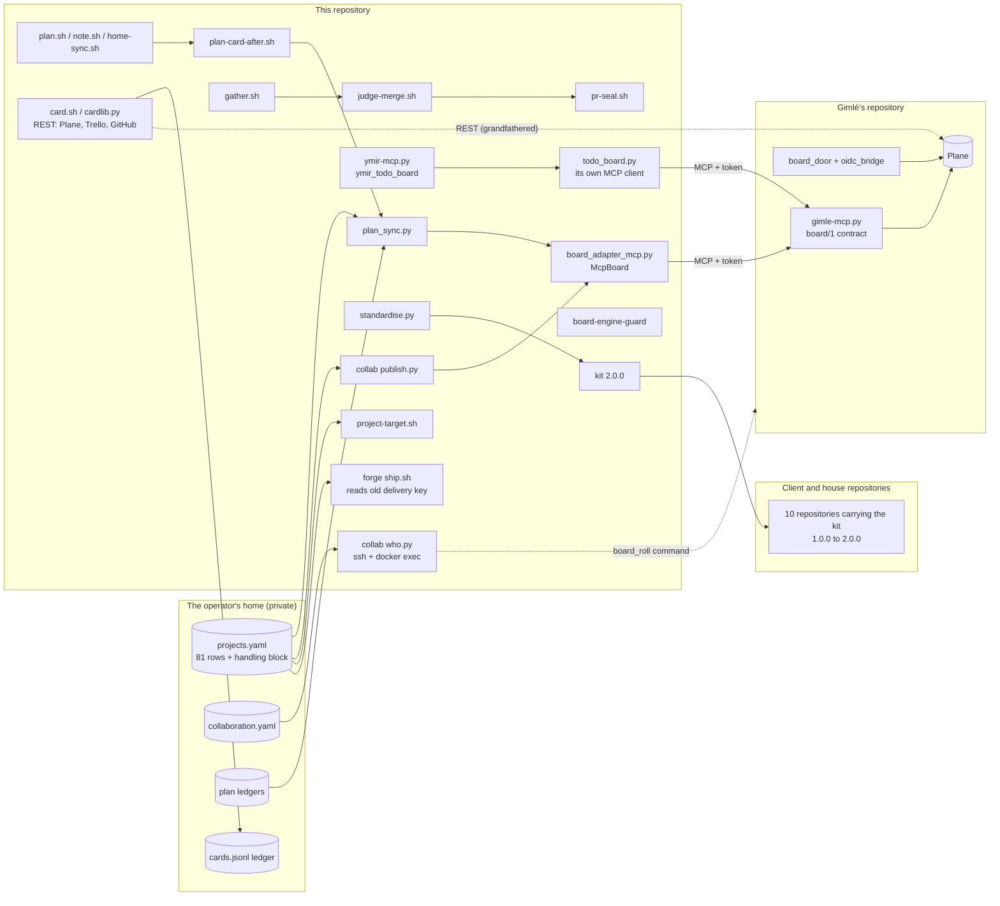
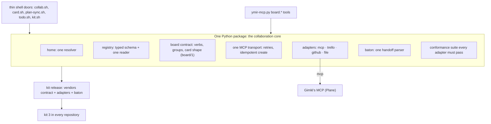

# The collaboration system, audited — and how much of the open plans can become code

**Date:** 2026-11-21 · **Kind:** audit (documents only; no code was changed except to run the tests) ·
**Plans read:** 335, 343, 345 and 346 in the operator's plan ledger, and plan 0003 on a machine shelf in the
operator's home (the company-server plan). Those plans are private and are cited by number only.

> [!IMPORTANT]
> The short answer. Of the **54** open steps in those five plans, **29 (54 %) are code still to write**, **9 (17 %)
> are already built**, **9 (17 %) are registry configuration**, and **7 (13 %) are decisions only a person can make**.
> So about **seven in ten** of the work is, or can become, code. Of the work still to do, code is **29 of 45 (64 %)**.
> The code base can carry it, but only after three small consolidations, named in [the first slices](#5-the-first-slices).

This page names no client repository, host or person (RULES/04). Where the plans name them, this page names a role:
*the heart* (the always-on server), *a dev seat*, *the host keeper*, *the designer*, *a client repository*.

---

## 1. What exists

The collaboration system is spread over six folders in this repository and one in Gimlé's. The table lists every
piece, what it does, its tests and its callers.

### In this repository

| Piece | Code | What it does | Tests | Called by |
|---|---|---|---|---|
| **The kit** (2.0.0) | `bin/collab/kit/` — `scripts/kit.py` + `scripts/kitlib/` (13 modules) behind 19 thin `scripts/*.sh` doors; 9 RULES (15–24, no 21); `.githooks/`; `docs/`, `areas/`, `plans/tickets/` | What a repository receives: the delivery rules, hooks, worktree and work commands, areas and keepers, leftovers, stack and deploy doors | `bin/collab/tests/test_kit.py` (40), `test_work.py` (13) | `standardise.sh --apply` copies it into a repository |
| **The installer** | `bin/collab/standardise.py` + `.sh`, `profiles/*.yaml` (6 stack profiles), `kit-history.sh` + `kit-history.tsv`, `registers/house.tsv` | Puts the kit into a repository, sorts every file into missing · older · local, upgrades only what was never changed locally, writes `.collab-kit.json` | `test_kit.py` | the operator or an agent, by hand |
| **The baton shelf** | `bin/collab/init.sh`, `templates/handoff-*.{md,py,sh}` | Installs `handoff/` (README, TEMPLATE, CURRENT, log, check) | `bin/collab/tests/test_collab.sh` (31) | by hand; `standardise.py` only *prints a note* when it is missing |
| **The roll** | `bin/collab/who.py` | Who is declared, on which surface, measured over ssh on the register's host | `test_collab.sh` | `collab.sh who` |
| **Publish** | `bin/collab/publish.py` | Turns the baton's §3 and §4 into cards, through the `mcp` board adapter | none of its own | `collab.sh publish` |
| **Letters, ship** | `bin/collab/letter.sh`, `bin/collab/ship.sh` | A collaboration letter as a mail draft; branch → commit named paths → **merge to base and push** | `test_collab.sh` | `collab.sh letter`, `collab.sh ship` |
| **The card door** | `bin/boards/cardlib.py` (632 lines), `card.py`, `card.sh`, `card_audit.py`, `report.py` | One contract for a card (title rules, owner, evidence), a ledger in the home, and **direct REST adapters for Plane, Trello and GitHub** | `bin/gates/tests/test_card_door.sh` | no caller outside `bin/boards/` |
| **The `mcp` board adapter** | `bin/boards/board_adapter_mcp.py` (`McpBoard`) | Reaches any board that speaks the board contract over MCP; resolves `token_from` (env · vault · claude-mcp) | through plan-sync's tests | `plan_sync.py`, `publish.py` |
| **Plan sync** | `bin/boards/plan_sync.py` (709), `plan-sync.sh`, `plan-card-after.sh` | Plan ledger (home or repo) → one card per plan with its phases as sub-cards, idempotent | `bin/boards/tests/test_plan_sync_repo.py` | `bin/records/plan.sh`, `note.sh`, `bin/vault/home-sync.sh` (through `plan-card-after.sh`) |
| **Arm members** | `bin/boards/arm_members.py` + `bin/boards/arm-members.sh` | Every arm holder is a board member | `test_arm_members.py` | by hand |
| **The to-do board** | `bin/records/todo_board.py` (795), `todo.sh`, `todos.sh` | The operator's to-do list on a board, with a cache and a queue for when the board is dark — **with its own MCP client** | `bin/records/tests/test_todo_board.py` | `ymir_todo_board` in `bin/mcp/ymir-mcp.py`, `todos.sh`, Sága |
| **Where a project lives** | `bin/agents/project-target.sh` (295) | Resolves a project id to this machine's clone, makes a worktree in it | `bin/agents/tests/test_project_target.sh` (20) | `eindri-start.sh`, briefs |
| **The batch road** | `bin/forge/gather.sh`, `gather-notice.sh`, `merge-method.sh` | Gathers finished errands into one worktree, one gate run, one PR | `.agents/tests/gather.test.sh`, `test_gather_notice.sh` (12), `test_gather_orders_by_base.sh`, `test_merge_method.sh` | the helm |
| **The merge doors** | `bin/forge/judge-merge.sh`, `bin/agents/pr-seal.sh`, `bin/forge/ship.sh`, `bin/forge/queue-warden.sh` | A judge's APPROVE → `pr-seal.sh seal` (the one merge door); `ship.sh` is an older reviewer-merge door with six conditions | `test_judge_merge.sh` (36), `.agents/tests/fm-pr-merge.test.sh` | the review spine, `ship-watch.sh` |
| **Worktree reap** | `bin/forge/worktree-reap.py` | Removes finished worktrees | none found | the clock |
| **The board ward** | `bin/gates/guards/board-engine-guard.sh` | Refuses a *new* file that calls Plane's API or names a Gimlé host | `test_board_engine_guard.sh` | pre-commit, pre-push |
| **Registry readers** | `bin/skuld/registry-lib.sh` (calls itself "the ONE reader"), `bin/identity/projects-validate.sh`, and 32 more | Read `hodd/identity/projects.yaml` | scattered | everyone |

### In Gimlé's repository

| Piece | Code | What it does | Tests |
|---|---|---|---|
| **Gimlé's MCP** | `systems/mcp/gimle-mcp.py`, `plane_tools.py` (833), `plane_markdown.py`, `mermaid_draw.py`, `mcp_token.py`, `gimle_oauth.py` | The board over Plane, per-person tokens and places, the whiteboard, meetings. `plane_tools.CONTRACT` declares **`board/1`**: the verbs, the six state groups, and which tool answers each verb | 10 test files, all green |
| **The board door and the login** | `systems/login/board_door.py`, `oidc_bridge.py`, `oidc/`, `dex-theme/` | Signs a person into Plane through Gimlé's own page; just-in-time membership; a themed Dex login | `test_board_door*.py`, `test_session_persistence.py` |
| **Plane engine pieces moved out of Ymir** | `systems/board/plane.sh`, `project.py`, `who-board.py`, `publish-baton.py` | The Plane client, project seeding, the board column of the roll | — |
| **The live diagram renderer** | `systems/mermaid-live/` (`live.js`, a unit example) | Draws `mermaid` blocks in Plane's web pages | — |

### How they connect

---

## 2. Its health, measured

### Tests — run on 2026-11-21 on a dev seat

| Suite | Result |
|---|---|
| `bin/collab/tests/test_kit.py` | **40 passed** (100 s) |
| `bin/collab/tests/test_work.py` | **13 passed** |
| `bin/collab/tests/test_collab.sh` | **31 passed, 0 failed** (the "complete baton" failure recorded on 2026-11-11 is gone) |
| `bin/boards/tests/test_plan_sync_repo.py` | passed, 0 failed |
| `bin/boards/tests/test_arm_members.py` | passed, 0 failed |
| `bin/records/tests/test_todo_board.py` | passed, 0 failed |
| `bin/gates/tests/test_board_engine_guard.sh` | passed |
| `bin/agents/tests/test_project_target.sh` | **20 passed** |
| `bin/forge/tests/test_gather_notice.sh` | **12 passed** |
| `bin/forge/tests/test_judge_merge.sh` | **36 passed** |
| `bin/gates/tests/test_gather_orders_by_base.sh`, `test_merge_method.sh`, `.agents/tests/fm-pr-merge.test.sh` | passed |
| Gimlé `systems/mcp/` (10 test files) | **all green** |
| **`.agents/tests/gather.test.sh`** | **RED — 18 failed, 9 passed** |
| **`bin/gates/tests/test_card_door.sh`** | **RED — "github carry: FAIL"** |

> [!WARNING]
> **`gather.test.sh` is red on `main`.** Its fixture copies only `gather.sh` and `yggdrasil.sh` into a scratch repo
> (line 32). `gather.sh` now sources `bin/forge/warden-lib.sh` (line 81), so every case fails with
> `warden-lib.sh: No such file or directory`. The test is stale, not the door. No CI step names this test, so nobody saw
> it go red.
>
> **`test_card_door.sh` is red.** The GitHub adapter's projection case reports Plane's fields as carried. The card
> door has no caller outside `bin/boards/`, which is why this went unseen too.

### Duplicated logic

| What is written more than once | Where | Cost |
|---|---|---|
| **The board road, three times** | `cardlib.py` (REST to Plane, Trello, GitHub) · `board_adapter_mcp.py` `McpBoard` (MCP) · `todo_board.py` `Board` (MCP again) | Two MCP clients with **different retry rules**: `McpBoard` retries 8 times on 429, 5xx, 52x and 530 and checks before repeating a create; `todo_board.Board` retries only on 429 and treats 5xx as "dark". A board hiccup is a retry in one door and a refusal in the other |
| **Finding the home** | `home()` or `home_root()` in `cardlib.py`, `plan_sync.py`, `publish.py`, `todo_board.py`, `worktree-reap.py`, `handoff-packet.py`, `warden-policy.py` — seven copies, each calling `hoard-lib.sh` its own way | Each one is a place a home move can break |
| **Reading the project registry** | **34 files** read `projects.yaml` directly (shell and Python). `registry-lib.sh` says it is "the ONE reader", but only for the realm key | No schema, so each reader guesses at the shape |
| **The delivery road** | `bin/forge/ship.sh` and `ship-watch.sh` read the **old top-level** `delivery:` key (`reviewer-merges` / `operator-merges`). The registry now carries `handling.delivery.road` (`judge-merges` 64, `operator-merges` 8, `no-pr-road` 4, `person-merges` 3, …) | Two vocabularies for one fact; only one row still has the old key |
| **The handoff baton** | `templates/handoff-check.py` checks it, `publish.py` `section()` parses it again for cards | Two parsers of one file shape; plan 346.15 would make a third |
| **YAML parsing** | the house uses PyYAML; the kit carries `kitlib/miniyaml.py` (169 lines) | Acceptable: the kit must run in a repository with no PyYAML. Keep it, but keep it the kit's only parser |
| **Two doors named `ship.sh`** | `bin/collab/ship.sh` (commit, merge to base, push) and `bin/forge/ship.sh` (reviewer merge) | Same name, opposite jobs |

### Pieces that bypass the board contract or the delivery gate

- **`cardlib.py`'s `Plane` class** calls `/api/v1/workspaces/…` with `PLANE_API_TOKEN`. Plan 335's split says Ymir no
  longer knows Plane. The board ward refuses only *new* files, so this survives as grandfathered code.
- **`collab.sh ship`** merges into the base branch locally and pushes. RULES/08 says every code change leaves by PR, and
  plan 343 says the helm never pushes. Only the branch-guard hook stands between this door and `main`.
- **`collab who`** reads one installation's containers by name (`docker exec <name>_postgres`, a Forgejo database on
  loopback, a password file under `~/.config`). That is one house's layout, not a contract (RULES/07, RULES/25). The board
  column already goes through a `board_roll:` command; the other surfaces should too.

### Pieces that only work on one seat

| Piece | Why |
|---|---|
| plan sync, publish, the to-do board | They need a `token_from` the seat can resolve. A `claude-mcp:` reference works only where Claude Code's MCP config holds that server. A pi-only seat gets "no road to the board on this seat" |
| `collab who` | It needs ssh to the register's host and that host's container names |
| `project-target.sh` | It works only where a clone is registered; briefs still say "clone it beside your worktree" |

### Hard-coded names (RULES/04, RULES/25)

A scan of `bin/collab`, `bin/boards`, the to-do board, `project-target.sh` and the merge doors for the operator's host
names, forge owners, domains, tailnet name and people found **one** line: `bin/collab/letter.sh:24` gives a real company
name as the letter's default sender. Everything else reads the home. That is good health.

### Version drift of the kit

The kit is installed in **ten repositories** (read from each repository's default branch on GitHub, and from the clones
on this seat). They are private, so they are labelled here; the operator's report in the home names them.

| Repository | Kit on its default branch | Kit in the local clone | Note |
|---|---|---|---|
| A (client, monorepo) | **2.0.0** (2026-11-20) | 2.0.0 | current |
| B (client) | **2.0.0** (2026-11-20) | 1.6.0 | the clone is behind its own origin |
| C (house, Elixir) | 1.3.0 | 1.3.0 | two majors behind |
| D (house) | 1.3.0 | no clone here | |
| E (house) | 1.3.0 | 1.3.0 | |
| F (house) | 1.3.0 | 1.3.0 | |
| G (house) | 1.3.0 | 1.3.0 | |
| H (house, node) | 1.3.0 | 1.3.0 | a second clone of the same project under another remote also carries 1.3.0 |
| I (house) | 1.3.0 | 1.3.0 | |
| J (a collaborator's fork) | **1.0.0** | 1.7.0 | the clone carries a newer kit its origin never received |

So **seven of ten** repositories are on 1.3.0 or older, and nothing tells their owners. There is no fleet view: the only
way to see this was to read each repository by hand. Three more `.collab-kit.json` files sit in a harness's scratch
cache, which are test leftovers (RULES/24).

---

## 3. Plan by plan: how much can be code

**Key.** *Code* = a door, a ward or a test still to write. *Config* = a registry field or a setting. *Decision* = only a
person can make it. *Built* = exists today (the file is named). Size: **S** about a day, **M** a few days, **L** a week
or more.

### Plan 335 — plans on the board

| Step | Class | Size | Where | Depends on |
|---|---|---|---|---|
| 0 · the template and the people (seed states, labels, features, members) | Code | M | **Gimlé** (`systems/board/plane.sh` grows a `seed`) | the Plane token, which is now in the vault |
| 1 · each engine's full API | Code | L | Plane's is mostly **built** in Gimlé's `plane_tools.py` (cycles, modules, labels, links, comments); Trello's and GitHub's adapters are still to write in Ymir | the typed contract (slice 2) |
| 2 · `board.*` in Ymir's MCP | Code | M | `bin/mcp/ymir-mcp.py`, a dispatcher over the contract | slices 1 and 2 |
| 3 · plans onto the board | **Built** | — | `bin/boards/plan_sync.py`, `plan-card-after.sh` | — |
| 3b.1 · one full card per plan, phases as sub-cards | **Built** | — | `plan_sync.py` (`read_phases`, `found_by_title(parent=…)`) | — |
| 3b.2 · diagrams drawn at sync time | **Built** | — | Gimlé `systems/mcp/mermaid_draw.py` | — |
| 3b.3 · the live renderer in Plane's pages | **Built** | — | Gimlé `systems/mermaid-live/` | — |
| 3b.4 · both ledgers, every plan | Config | S | a run of `plan-sync.sh` per project with a `board:` block | the registry rows |
| 4 · the errand lifecycle on cards (start, acclaim, gather, merge) | Code | M | `eindri-start.sh`, `eindri-acclaim.sh`, `gather.sh` and `pr-seal.sh` all call one card-event door. Today **none of them touches a board** | slice 2 |
| 5 · the readers (Sága, Telegram, panels, decision cards) | Code | M | `todos.sh` already reads the to-do board; the rest read through the contract | phase 4 |
| 6 · every project | Config | S | 17 rows already name Plane and 4 name Trello in `handling.board`; the dispatcher reads them | slice 1 |
| the move (Plane code out of Ymir) | Code | S | mostly **done** (`bin/gimle/` is gone, the ward stands). Left: `cardlib.py`'s `Plane` class and `who.py`'s engine surfaces | — |
| 7.1 · a company board with four projects | Decision | S | which projects, which place | phase 3b proven |
| 7.2 · one company-wide board | Decision | S | its shape | 7.1 |
| 7.3 · onboard two collaborators | Config | S | accounts and roles; the door is 346.12 | 7.2, plan 0003.3 |

### Plan 343 — the shipper, and the judge merges

| Step | Class | Size | Where | Depends on |
|---|---|---|---|---|
| 343.1 · a door that sends the shipper | Code | S | a new launcher (the name `bin/forge/ship.sh` is already taken by the reviewer-merge door) | `eindri-start.sh` |
| 343.2 · the Claude hook: the helm never ships | Code | S | `.claude/hooks/helm-never-ships.sh`, on the pattern of `eindri-only.sh` | `rodd-arm.sh who` |
| 343.3 · the same hook on pi | Code | S | the Valknut extension's tool-call handler | 343.2 |
| 343.4 · merge on the word | **Built** (superseded) | — | `bin/forge/judge-merge.sh` → `bin/agents/pr-seal.sh seal` | — |
| 343.5 · the kit carries the rule and the hook | Code | S | `kit/RULES/`, `kit/.githooks/`, a configurable "main agent" | 343.2 |
| 343.6 · RULES/08 and AGENTS.md | **Built** | — | RULES/08's 2026-11-21 sections | — |
| 343.7 · the law appended | **Built** | — | same | — |
| 343.8 · a grant file | Decision | — | dropped by the plan's own correction: the judge's verdict plus green gates is the seal | — |
| 343.9 · one merge door | **Built** | — | `pr-seal.sh` + `judge-merge.sh` (36 tests). Left: a second look for RULES, secrets and migration paths (S) | — |
| 343.10 · the permission layer allows the door and refuses raw merges | Code | S | worker profiles in `einherjar-spawn.sh` already refuse raw `gh pr merge`; prove it on both harnesses and every model | — |
| 343.11 · the loop: merge → release → fleet | Code | M | Skíðblaðnir (plan 333) and Gróa | `bin/engine/release.sh` |

### Plan 345 — one registry for how every project is handled

| Step | Class | Size | Where | Depends on |
|---|---|---|---|---|
| 345.1 · the schema and one reader | Code | M | **not built**: no `projects.schema.json` and no `project.sh` exist | — |
| 345.2 · fill all 81 rows from evidence | **Built** | — | the home's commit *"every project's handling block, measured"*: all 81 rows carry a `handling` block with 25 fields, each with its source. **1,200+ leaves are still `unmeasured`**, mostly `access` (826), `backups`, `people`, `clients`, `costs` | — |
| 345.3 · the doors read it | Code | M | **zero code reads `handling` today**; `ship.sh` reads the old key; a person-merges repository is protected only by a brief | slice 1 |
| 345.4 · a ward for rows that are missing or wrong | Code | S | an Eir surface `projects`; visibility checked against GitHub | 345.1 |
| 345.5 · a generated page for people | Code | S | from the reader | 345.1 |
| owed · which projects are private to one person | Decision | — | `private_to` is `OWED` on all 81 rows | — |

### Plan 346 — every project at once

| Step | Class | Size | Where | Depends on |
|---|---|---|---|---|
| 346.1 · the repo map from GitHub | Code | S | `gh repo list` per owner, into a `repos:` list (no row has one yet) | 345.1 |
| 346.2 · placement, one path convention, clone on demand | Code | M | grows from `project-target.sh` (resolve and worktree are **built**); new `project-clone.sh` with shallow, sparse and evict | 346.1 |
| 346.3 · a census of clones per machine | Code | S | a Nornir job | 346.2 |
| 346.4 · the worktree fence per harness, and a commit guard | Code | M | Claude settings and pi's hook allow writes only in the seat's worktree; the commit guard generalises `board-engine-guard.sh` | 346.2 |
| 346.5 · secrets scoped per project | Code | M | `hodd.sh emit --project`, a scope register, a per-project ward | 345.1 |
| 346.6 · the kit 3: one board contract, four adapters | Code | L | slice 2, then the kit vendors it | slices 1 and 2 |
| 346.7 · Gimlé's capacity, and where it lives | Decision | S | needs a load test (small code) first | — |
| 346.8 · environments and domains | Config | S | fields exist; a certificate probe is small code | 345.3 |
| 346.9 · data class and which models may see it | Decision | S | `data_class` and `models_allowed` are owed; then the model door refuses (small code) | the operator's word |
| 346.10 · scanning and backups | Config | S | fields exist; findings filed as cards | 345.3 |
| 346.11 · costs and clients | Config | S | fields exist; a deploy refusal without a signed DPA is small code | 345.3 |
| 346.12 · onboard and offboard in one act; every area has a keeper | Code | L | four systems (forge, board, Gimlé, vault). Keepers are half **built** in the kit (`scripts/areas.sh`, `kitlib/…`, `areas/canon.yaml`) | 345.3 |
| 346.13 · lifecycle, and the merge account ward | Code | S | a ward on every merge's account; lifecycle values are owed | 346.2 |
| 346.14 · toolchain raised before a worker starts; monitoring | Code | M | read manifests, raise `mise`; feed the trouble panel | 346.2 |
| 346.15 · `kit.sh handoff publish` and `pull` | Code | M | `publish.py` already turns the baton into cards (half **built**); needs the contract and one baton parser | slice 2 |

### Plan 0003 — the collaboration suite on the company server

| Step | Class | Size | Where | Depends on |
|---|---|---|---|---|
| 0003.1 · inventory and fit, signed by the host keeper | Decision | S | the plan's own table is the draft | — |
| 0003.2 · one code base, two looks | Code | L | Gimlé. Only the login is themed today (`systems/login/dex-theme/`); the board, the hall and the desk are not | the designer's tokens |
| 0003.3 · **many identity roads, one session** | Code | M | Gimlé `systems/login/oidc_bridge.py` and `board_door.py`: several sign-in roads (the house's road stays one, the company's identity is another), one Gimlé session, and the board door decides membership **from the registry**, never from which road was used | 345.3 (membership from the registry) |
| 0003.4 · the board contract on the company's MCP, per-seat tokens | Config | S | point Gimlé's MCP at the company's Plane; Gimlé's `bin/mcp-enrol.py` already enrols tokens | 0003.3 |
| 0003.5 · move the projects with their history | Code | M | a card migration tool over the contract (read from one place, write to another, keep links and comments) | slice 2 |
| 0003.6 · the homepage and the doors | Config | M | DNS, tunnels and certificates in the registry (346.8) | 0003.2 |
| 0003.7 · backups and the ward | Config | S | the host's backup units; the trouble panel reads the host | — |

### The total

| Plan | Steps | Code | Built | Config | Decision |
|---|---|---|---|---|---|
| 335 | 15 | 6 | 4 | 3 | 2 |
| 343 | 11 | 6 | 4 | 0 | 1 |
| 345 | 6 | 4 | 1 | 0 | 1 |
| 346 | 15 | 10 | 0 | 3 | 2 |
| 0003 | 7 | 3 | 0 | 3 | 1 |
| **All** | **54** | **29 (54 %)** | **9 (17 %)** | **9 (17 %)** | **7 (13 %)** |

Each step is counted once, by its main kind. Several config and decision steps carry a small piece of code (a probe, a
refusal), so the true share of code is a little higher than 54 %. The decisions are few, but most code waits on them:
`data_class`, `lifecycle` and `private_to` are `OWED` on every row, and they gate 346.9, 346.13 and every export.

---

## 4. The upgrade

**Yes, restructure, but by consolidating, not by rewriting.** The pieces are well tested one by one. The trouble is that
the same three things (the home, the registry, the board) are written in many places. Every plan above adds callers of
those three. Fix them first, or each new step copies the fault again.

### The target shape

1. **One package, one language for the logic.** Put the shared logic in one Python package (for example
   `lib/ymir_collab/`). Shell stays only as thin doors that parse arguments and call it. The kit is already built this
   way (`kit.py` + `kitlib/`, 14 small doors), so this copies a pattern that works here.
2. **The board contract as a typed interface.** Today `board/1` is defined only in Gimlé's code and in a Markdown page
   here. Ymir should own it as code: the verbs, the six groups, the card shape, and an `Adapter` protocol. Each adapter
   (`mcp`, `trello`, `github`, `file`) implements it. **One shared test suite** runs against every adapter, with a fake
   board for each, so "Trello parity" becomes a test that passes or fails.
3. **The registry as a typed schema with one reader.** `config/projects.schema.json` (generic, like the other schemas
   in `config/`) and one reader (`project.sh <id> --field <f>` over a Python module). The 34 direct readers move to it
   one at a time. The old `delivery:` key becomes an alias the reader names out loud, like `registry-lib.sh` already
   does for `workspace:`.
4. **The kit released like an app.** It already has a version, a manifest and a blob history. What is missing is a
   **fleet view and an upgrade command**: `standardise.sh --fleet` reads every registry row with a repository, reports
   each one's kit version, and with `--apply` opens one upgrade PR per repository on its own branch. Never a push to a
   default branch.

### Keep, merge, retire

| Piece | Verdict | How (RULES/11: moved, never deleted) |
|---|---|---|
| `kit/` and `standardise.py`, `kitlib/miniyaml.py` | **Keep** | the kit stays standalone; it vendors the core's contract and adapters at release time |
| `plan_sync.py`, `board_adapter_mcp.py` | **Keep, move onto the core** | `McpBoard`'s transport becomes the one MCP transport |
| `todo_board.py`'s `Board` | **Merge** | onto the one transport; keep its cache and queue, which are its own job |
| `cardlib.py` (contract, guard, ledger) | **Merge** | its validation and ledger become the core's card shape and evidence rules |
| `cardlib.py`'s `Plane` class | **Retire from Ymir** | move to Gimlé with a RULES/11 record; the `mcp` adapter reaches Plane |
| `cardlib.py`'s `Trello` and `GitHub` classes | **Keep, move** | they become the `trello` and `github` adapters and must pass the conformance suite |
| `card.sh` | **Keep the door** | it becomes the CLI over the contract (it has no caller today, so this costs nothing) |
| the seven `home()` copies | **Merge** | one resolver |
| `templates/handoff-check.py` + `publish.py` `section()` | **Merge** | one baton parser, used by the check, by publish and by 346.15 |
| `init.sh` (the baton shelf) | **Merge into the kit** | the kit installs `handoff/` itself, instead of printing a note |
| `collab who` engine surfaces (containers, Forgejo database) | **Move** | to commands the register names, like `board_roll:` already does; the code that knows those containers goes to the repository that runs them |
| `bin/collab/ship.sh` (merge to base and push) | **Retire** | record it under RULES/11; the road is a PR (`gather.sh`, then the judge) |
| `bin/forge/ship.sh` + `ship-watch.sh` | **Merge** | into `pr-seal.sh`, which is now the one merge door; until then, read `handling.delivery.road` |
| `letter.sh` default sender | **Fix** | read it from the register |

### The order, and the risk of each step

| # | Step | Risk | How the risk is held |
|---|---|---|---|
| 1 | Registry schema + one reader; point `ship.sh`/`ship-watch.sh` and `pr-seal.sh` at `handling.delivery` | **Medium.** A merge door reading a new key could merge a person-merges repository, or refuse every merge | The reader names the old key as an alias. A test proves a `person-merges` row is refused and a `judge-merges` row passes before any door switches |
| 2 | The typed contract, one transport, the `file` adapter and the conformance suite; plan sync and the to-do board move onto it | **Medium.** A retry change can write a card twice | Keep `McpBoard`'s check-before-retry for creates. The suite has a "lost answer" case. Plan sync's existing tests must stay green |
| 3 | The kit fleet view and upgrade PRs | **Low.** It reads; `--apply` only opens PRs | One PR per repository; a repository's own rule (for example, only a person merges) is read from the registry |
| 4 | Errand lifecycle on cards (335.4) and `board.*` in the MCP (335.2) | **Low to medium.** A dark board must never block an errand | Card events are queued like the to-do board's queue, and a failure is a named line, never a stop |
| 5 | Trello and GitHub adapters to full parity | **Medium.** A client's board is read-only to us | The registry's `write: owner-only / read-only` is enforced in the core, and tested |
| 6 | Retire `collab ship`, move the Plane class and the engine surfaces | **Low** | RULES/11 records first; the board ward then refuses them coming back |
| 7 | Fence, secret scopes, placement (346.2–346.5) | **High.** A wrong fence blocks every worker | Ship each fence in report-only mode for a week, then refuse |

---

## 5. The first slices

Each is small enough for one PR, and each unlocks many later steps.

1. **The registry gets a schema and one reader.** Add `config/projects.schema.json` for the `handling` block, and a
   reader `bin/records/project.sh <id> [--field f] [--audit]` over one Python module. Point `bin/forge/ship.sh`,
   `ship-watch.sh` and `pr-seal.sh` at `handling.delivery.road`, with the old key as a named alias. *Unlocks:* 345.1,
   345.3, 345.4, 345.5, the board dispatcher (335.6), and every 346 field. *Proof:* `project.sh <id> --field delivery`
   prints the road, and a `person-merges` row is refused by the merge door in a test.
2. **The board contract becomes code in Ymir, with its conformance suite.** Add `bin/boards/contract.py` (verbs,
   groups, card shape, an `Adapter` protocol), one MCP transport taken from `McpBoard`, a `file` adapter as the floor,
   and a suite every adapter must pass. Move `todo_board.py` onto the shared transport. *Unlocks:* 335.1 (Ymir's half),
   335.2, 335.4, 346.6, 346.15 and the card migration for 0003.5. *Proof:* the same suite passes for `file` and for
   `mcp` against a fake board, and the existing plan-sync and to-do tests stay green.
3. **The kit sees the fleet.** Add `standardise.sh --fleet`: read every registry row with a repository, print each
   one's kit version from its default branch, and with `--apply` open one upgrade PR per repository. In the same PR, fix
   the two red tests (`gather.test.sh`'s fixture must copy `warden-lib.sh`; the card door's GitHub carry case), so the
   collaboration system starts its upgrade from green. *Unlocks:* the drift above (seven of ten repositories on 1.3.0
   or older), 343.5, and every later kit release. *Proof:* the fleet table matches the one in section 2.

> [!NOTE]
> Not in the first slices, but owed by a person before most of plan 346 can be code: `data_class`, `models_allowed`,
> `lifecycle` and `private_to` for each project. They are `OWED` on all 81 rows.

## CHANGE LOG

- **2026-11-21** — first written: the collaboration system audited, its tests run, and the open steps of plans 335,
  343, 345, 346 and 0003 classified. 0003.3 is recorded as *many identity roads, one session*, per the operator's
  correction of that plan the same day.
