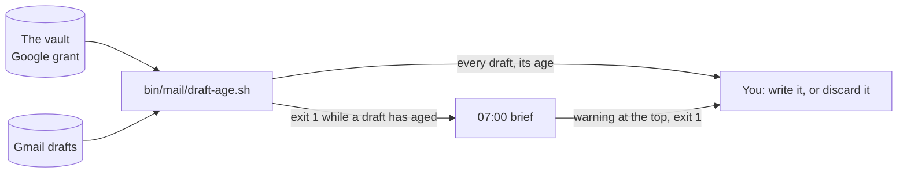
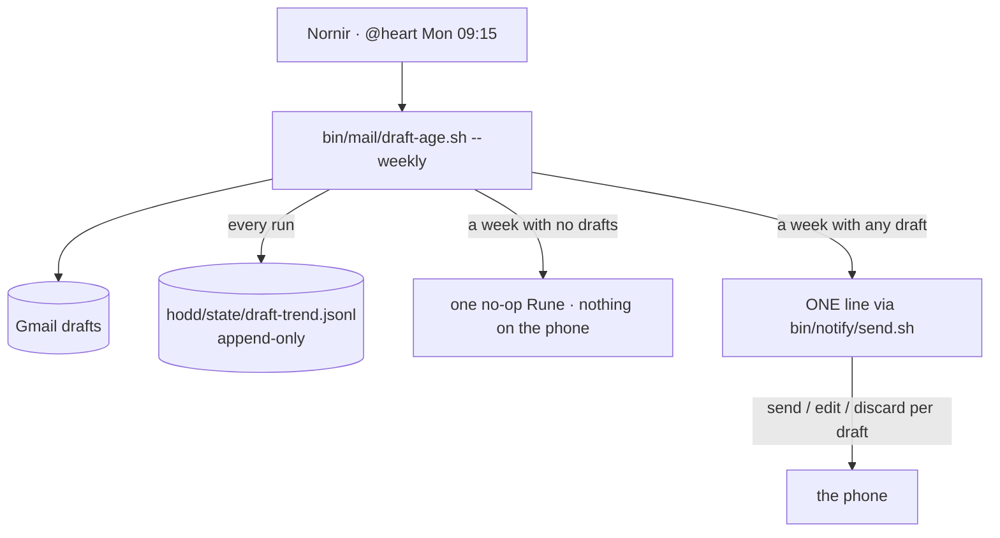

# A draft cannot grow old quietly

## What it is

A letter you started and never sent is the one piece of correspondence that fails without a sound. Nobody is
waiting for it, so nothing reminds you. Three days later the follow-up you promised is already late, and the
morning brief said the day was clean.

`bin/mail/draft-age.sh` closes that hole. It reads the drafts Gmail still holds, gives every one of them its age
in days, and **fails** when a draft is older than the limit. The 07:00 brief asks it before it publishes, so a
day with an aged draft is never reported as clean.

It is a reader. It cannot send, it cannot discard, and it writes nothing — the only act is naming the draft you
have been avoiding.

## How it fits together



## What you need

| Thing | Where | Notes |
|---|---|---|
| The Google grant | the vault (`hodd/secrets`) | `GOOGLE_MCP_CLIENT_ID` · `GOOGLE_MCP_CLIENT_SECRET` · `SNOTRA_GOOGLE_REFRESH_TOKEN` — the letters door's own grant |
| Gmail's API | the internet | the drafts are read over `gmail.googleapis.com`; nothing is written back |
| The limit | `--days`, or `YMIR_DRAFT_MAX_DAYS` | default **2** days |

The age is the draft message's own instant (Gmail's `internalDate`, or its `Date` header when that is missing),
so a draft you edited this morning is a fresh draft — the age of the letter, not of the idea.

## Do it

```bash
bin/mail/draft-age.sh                     # every draft, oldest first, with its age in days
bin/mail/draft-age.sh --days 5            # a longer limit for a slower week
bin/mail/draft-age.sh --brief             # the one line the morning brief carries
bin/mail/draft-age.sh --json              # the same answer for a script
```

The default face is TOON, oldest draft first:

```
draft-age{state,limit_days,drafts,aged}:
  "aged",2,2,1
drafts[2]{id,age_days,subject}:
  "r-old",5,"The letter I never sent"
  "r-fresh",0.2,"Re: the quarter plan"
aged[1]{id,age_days,subject}:
  "r-old",5,"The letter I never sent"
AGED: 1 draft older than 2 days — write it or discard it; a draft cannot grow old quietly
```

## What the exit codes mean

| Exit | Meaning | What you do |
|---|---|---|
| `0` | Nothing has aged — **or** the door said a named `SKIP`/`none` | nothing |
| `1` | A draft is older than the limit, and every offender is named | write it, or discard it in Gmail |
| `2` | The arguments were wrong (a `--days` that is not a number) | fix the command |
| `3` | The mailbox could not be read, and the reason is printed | check the grant, then re-run |

A skip is never a zero. With no Google key on this machine the door prints `drafts: SKIP — the vault carries no
Google client on this seat, so no draft was read` and exits 0. A permission that cannot be met is not an empty
outbox, and the two must not look alike.

## The morning brief

`bin/time/nornir-job-daily-briefing.sh` asks the door once, before it composes the day.

The line lands in the brief under **The letters nobody sent**. When a draft has aged the brief opens with a
warning, names the draft and its age — and the job **exits 1** instead of green.

> [!IMPORTANT]
> The brief is still published when a draft has aged; it is the *clean* brief that is refused. A brief that fails
> to appear, or one that appears with everything looking fine, are both worse than one that says out loud which
> letter is late.

## The weekly sweep — every draft, the trend, one line with buttons

The 07:00 brief answers one question: *is anything too old*. That is not the same question as *what
did I start and not finish*, and it is asked from inside a job that can itself be dead. So Monday
morning has its own sweep, at 09:15, on the machine that can read the mailbox:

```bash
bin/mail/draft-age.sh --weekly       # the week: every draft, the trend, one line to the phone
```

**It lists every draft, aged or not.** A draft one day old is correct on Tuesday and is the week's
unfinished correspondence by Friday. The brief lists only the offenders; the sweep lists the week,
oldest first, numbered, each with its age.

**It keeps the trend.** Every run appends one row to `hodd/state/draft-trend.jsonl` — `{at, drafts,
aged, oldest_days}`. Nothing is ever rewritten, so a habit is visible across weeks in a way a single
morning can never show.

**It sends one line, with buttons.** The line names every draft and goes to the phone through
`bin/notify/send.sh`, carrying a **send · edit · discard** button per draft. The buttons are the
house's own grammar (`bin/notify/telegram-buttons.sh`) rendered as the Bot API's `reply_markup`,
because a cron line has no session behind it to parse a wrapper. A draft's prompt reads, for
example, *Send draft 1, "The letter I never sent", now.*

**A quiet week says nothing at all.** No draft means no message — only one no-op Rune saying the
sweep looked. A nag gets muted, and a muted door is a dead one.



### What it will not do

A skip and an unread mailbox are **not** a quiet week: with no grant the door prints `weekly: SKIP`
and writes **no** trend row, and an unreadable mailbox stops the sweep with `UNABLE` (exit 3). Only a
week it really read, and really found empty, is silent.

The trend lives in your **home**, never in this repository — `hodd/state/draft-trend.jsonl`.

The row is in `config/cron.yaml.example` and is seated into an existing home by migration
`0025-the-weekly-draft-sweep`:

```
@heart Mon 09:15 bin/mail/draft-age.sh --weekly
```

`Mon` before the time is the **day gate** — Nornir reads it, and a day the scheduler does not
understand (`Funday`) is named in `state/.cron-invalid` instead of being a row that never fires.

## Limits

- It reads **drafts only** — a letter sent but unopened is the thread door's work (`bin/mail/threads.sh`).
- It reads up to 200 drafts per run (`--limit` moves it), and it follows Gmail's paging, so a full first page
  cannot hide the oldest draft.
- Gmail rate-limits like any API: one run per day, from the brief, is the intended cadence.
- If one draft's message cannot be read, it is listed as `unreadable` with the reason; the rest still answer.

## If it does not work

`drafts: SKIP` means the grant is missing from this machine — run the connect door (`bin/mail/connect.sh`) or
carry the vault over. `drafts: UNABLE — HTTP 401` means the refresh token was refused: re-sign-in. `UNABLE —
HTTP 403` is usually a missing `gmail.readonly` scope on the consent.

The proofs are `python3 bin/mail/tests/test_draft_age.py` — eleven of them, against a stub Gmail, including the
three that matter: no drafts, a fresh draft, an aged draft failing.

## CHANGE LOG

- **2026-11-17** — The weekly sweep: every draft oldest first, an append-only trend, one phone line
  with a send/edit/discard button per draft, and silence (plus a no-op Rune) on a week with none.
- **2026-11-17** — Opened: the door that fails a day when a letter has sat unwritten past its limit.
