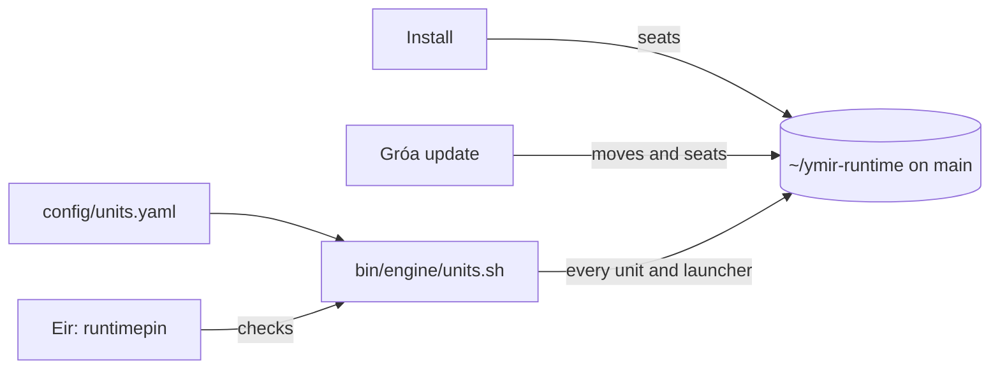

# Every service and app runs from main

Every Ymir service and desktop app on your machine runs from one checkout, `~/ymir-runtime`, which only ever
stands on `main`. A `git checkout` in the folder where you or your agents work can no longer change what your
machine is running.

This page is for the person running Ymir. The plan behind it is plan 269.

## What you get

- A fresh install seats `~/ymir-runtime` for you. You do not run anything by hand.
- Every systemd user unit and every launcher (Rödd, Bilskirnir, Hlidskjalf, Óðrerir, Sessrúmnir, Smíðja) points
  at that checkout.
- One list says what Ymir installs on a seat: `config/units.yaml`. One command writes all of it:
  `bin/engine/units.sh`.
- An update moves the checkout and every unit with it. A machine installed before this existed gets its pin
  seated by the next update.

## What you need

- A git checkout of Ymir with an `origin` (or `YMIR_RUNTIME_SOURCE` set to another clone source).
- systemd for the units. A host without it skips the unit step and says so. Launchers are written on Linux.

## The commands

| You want | Run |
|---|---|
| Seat the pin and move everything onto it | `bin/engine/runtime-seat.sh` |
| Ask what is off the pin, changing nothing | `bin/engine/units.sh check` |
| Move every unit and launcher onto the pin | `bin/engine/units.sh write` |
| See what Ymir owes this seat, and every app under `apps/` | `bin/engine/units.sh list` |
| Move the pin to the latest main and restart the units | `bin/engine/runtime-deploy.sh` |
| Have Eir check and mend it | `bin/agents/eir-doctor.sh check` and `fix` (surface `runtimepin`) |

`units.sh check` exits 1 when a unit or launcher runs a working tree, or names a Ymir tree but is not in the
register. Each row says which. `units.sh write` logs every line it replaces to
`<home>/state/units-replaced.log`, so nothing is lost.

## Adding an app

An app joins by shipping its launcher template as `apps/<name>/electron/<name>.desktop.in` (or under
`resources/`). A template that needs a unit ships `<name>.service.in` beside it. Nothing else is edited:
`units.sh list` finds it from `apps/*`.

A service that is not an app goes in `config/units.yaml`, written relative to the runtime root, with the fleet
roles it belongs on.

## Limits

- The launcher for an app the pin does not carry yet is skipped with a named line, never written pointing
  at a file that is not there. It appears after the app is merged to main and the pin moves.
- A drop-in that deliberately names a working tree is reported, not silently removed. Remove it yourself
  when its reason is gone.
- `YMIR_RUNTIME_UNITS` still overrides which units a deploy restarts. Leave it unset.

## If it does not work

| You see | Do this |
|---|---|
| `no pinned runtime` | Run `bin/engine/runtime-seat.sh`. Check the network, or set `YMIR_RUNTIME_SOURCE`. |
| `OFF-PIN` for a unit | Run `bin/engine/units.sh write`. |
| `UNREGISTERED` | The unit names a Ymir tree but nobody registered it. Add it to `config/units.yaml`. |
| The pre-push ward `runtime-pinned` refuses a push | Run `bin/engine/units.sh write`, then push again. |
