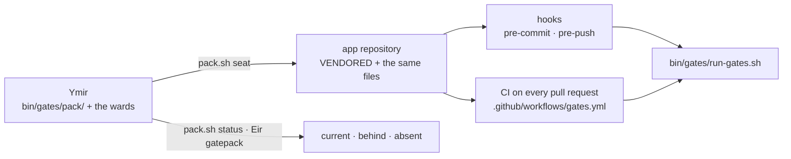

# The gate pack — the same gates in every app repository

## What it is

Ymir's apps live in their own public repositories. The gate pack gives each of them the same gates Ymir judges itself
with: secrets, personal data, commit identity and the vault. The files are copied byte for byte from Ymir, so a gate
judges an app exactly as it judges Ymir.



## What a seated repository carries

| Piece | Path in the app | What it does |
|---|---|---|
| the wards | `bin/gates/guards/*`, `bin/gates/secret-scan.sh` and their helpers | Ymir's own wards, unchanged |
| the one door | `bin/gates/run-gates.sh` | `staged` (a commit), `range <base> <head>` (a push or a pull request), `tree` (CI: every file and the whole history) |
| the hooks | `.githooks/pre-commit`, `.githooks/pre-push`, `bin/gates/install-hooks.sh` | every commit and push meets the door; a push to `main` is refused |
| the CI workflow | `.github/workflows/gates.yml` | pinned, checksum-verified gitleaks; the sync check; the planted-fault test; the tree; the pull request's range, title and body |
| the sync check | `bin/gates/vendor-sync.sh` | `--check` against Ymir at the recorded commit, `--behind` against Ymir's `main` |
| the planted-fault test | `tests/gates.test.sh` | one invented fault per gate, and a clean control |
| the ledger | `VENDORED` | the Ymir commit, the wards (`files:`) and the pack's own files (`pack:`) |
| the root mark | `.pi/README.md`, `RULES/00-the-gate-pack.md` | where the wards find the repository's root, and the rule in plain words |
| gitleaks' config | `.gitleaks.toml` | seeded once, then **the repository's own**: a test fixture that looks like a key is declared there with its reason |

## Where the private list lives

> [!IMPORTANT]
> The operator's deny list (their own words, machine names and mail domains) is **never** in an app repository and
> **never** sent to the hosting service, not even as an encrypted secret.

- **On a seat** the hooks read it from the home (`$YMIR_HOME`), and a machine named as a host is a refusal there.
- **In CI** there is no home. The workflow judges the shapes: keys, private addresses, personal mailboxes and a
  commit's author and committer. The run says so in one line, `judging shapes only`.
- **The home's audit** reads the list too, so the words are judged on a clock as well as at the commit.

## What you need

- A Ymir checkout (for `seat`), `git`, `python3`, and `gh` signed in (for `status`).
- `gitleaks` on the seat if you want the scan in the hooks; CI always installs it.

## The commands

Seat or re-seat the pack in a clone, from a Ymir checkout:

```bash
bin/gates/pack.sh seat ~/code/an-app
```

Prove it in that clone, then commit the files and `VENDORED` on a branch and open a pull request:

```bash
bash tests/gates.test.sh && bin/gates/run-gates.sh tree
```

Is one clone current?

```bash
bin/gates/pack.sh check ~/code/an-app
```

Is every app repository current? (Eir shows the same on its `gatepack` row.)

```bash
bin/gates/pack.sh status
```

## Which repositories

`status` reads the app registry, `config/app-repos.yaml`: every app that is neither archived nor kept in Ymir's own
tree. Repositories that are not apps are listed in the home, one `owner/repo` per line, in
`$YMIR_HOME/config/gate-pack-repos.txt`.

## Limits

- **The private-path ward judges what a change adds.** It is a surface ward, and an app that left Ymir with its
  history names Ymir's public layout in older lines. A commit and a pull request are judged on their added lines;
  the whole-tree run lists inherited lines without refusing them.
- **A re-seat is a pull request in each repository.** Eir reports `behind`; it never re-seats by itself.
- **`--behind` fails an app's CI once Ymir's `main` changes a ward.** That is the point: the app is re-seated, the
  same day.

## If it does not work

| You see | What it means | What to do |
|---|---|---|
| `refused: … is not the pack's` | the repository already has its own file at a pack path | move that file, then seat again |
| `DIFFERS from Ymir` in CI | a copy was edited in the app | change it in Ymir, then `pack.sh seat` the app again |
| `BEHIND Ymir main` in CI | Ymir changed a ward since the seat | `pack.sh seat` the app from Ymir's `main` and open a pull request |
| `gate gitleaks REFUSED` on a test file | a fixture looks like a key | declare that one fixture in the app's `.gitleaks.toml`, with its reason |
| `hooks: this clone already uses core.hooksPath=…` | another hook manager owns the clone | call `bin/gates/run-gates.sh staged` from that manager's pre-commit |

## CHANGE LOG

- **2026-11-25** — the pack, its seat and status doors, and Eir's `gatepack` row (plan 372).
