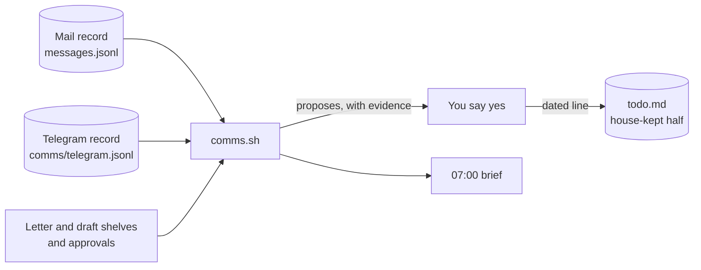

# Your messages, in, out and owed — and the to-do they move

## What it is

One door, `bin/records/comms.sh`, answers four questions about your communications:

- **What came in, and what went out?** Mail and Telegram, per channel, for any span of hours.
- **What do I still owe?** Every letter, draft and approval waiting to be sent, with who it is for and where it sits.
- **What does that change on my list?** It proposes to-do changes, and each proposal carries the message behind it.
- **What did the morning say?** The 07:00 brief carries the same counts and the same proposals.

It never sends, replies to, labels or deletes a message. Mail is read where it already lives. Nothing reaches your
to-do without your yes.

## How it fits together



## What you need

| Thing | Where | Notes |
|---|---|---|
| Your home | `$YMIR_HOME` | resolved the usual way (`bin/vault/hodd.sh path`) |
| The mail record | `hodd/memory/mail/messages.jsonl` | written by the mail desk's ingest; the door only reads it |
| The Telegram record | `hodd/memory/comms/telegram.jsonl` | appended by the Skírnir bot (both ways) and by the hotline when it sends |
| Your to-do | `hodd/life/personal/me/todo.md` | the door adds a house-kept half at the end; your half is never edited |
| Gmail (optional) | the mailbox grant | read-only search, for your Gmail drafts and a signing platform's reminders |

## Do it

```bash
bin/records/comms.sh summary --hours 24     # per channel: in · out · owed
bin/records/comms.sh list --channel telegram
bin/records/comms.sh owed                    # everything waiting to be sent
bin/records/comms.sh todo-matches            # proposed changes, each with its message
bin/records/comms.sh todo-apply 1a2b3c4d     # write only the ones you said yes to
bin/records/comms.sh brief                   # the morning brief's section
```

By voice, say *"update my to-do from my mail"*. Nanna reads the proposals to you through the `todo_from_mail` hand,
and writes only the ones you approve. The `comms` hand answers *"what did I send?"* and *"what do I still owe?"*.

## How a message proposes a change

| Kind | When | Evidence it shows |
|---|---|---|
| **tick** a *Send / Answer / Ask* item | a mail went out to every person the item names, with the item's own words in the subject | the mail, its address and its date |
| **tick** a *Confirm / Accept* item | the platform said it is done, or its reminders to you stopped, or the person who asked has since written to you from inside that account | the request, and the mail that shows it moved |
| **open** an item under *Today* | an incoming mail the desk marked *reply needed*, with nothing sent to that person since | the mail |
| **wait** under *Waiting on others* | you asked a question and nothing has come back from that person since | your mail |

A *Confirm* or *Accept* is graded **medium** unless the platform says it is completed. Mail cannot see a signature
or an accepted invitation, so the proposal says what it saw and asks you.

> [!IMPORTANT]
> Your own lines are never edited. An approved change is written as a dated line in the house-kept half
> (**Today**, **This week**, **Waiting on others**), ending with the item's id so it is never proposed twice.

## Limits

- The counts are only as fresh as the mail ingest. When its newest row is older than the span, the brief says so.
- Telegram is recorded by the Skírnir bot and the hotline. The pi Telegram bridge does not record yet.
- Meetings, the calendar and Trello are not in the record yet (plan 261, phases C4 and C5).
- The brief reads offline, so it does not list your Gmail drafts. `comms.sh owed` does.

## If it does not work

- **`the home is unresolved`:** set `YMIR_HOME`, or check `bin/vault/hodd.sh path`.
- **No SignWell-style proposal:** the reminder series is read live from Gmail. Run `bin/mail/mail-scan.sh --query
  'in:drafts'` to check that the grant answers.
- **A proposal looks wrong:** do not apply it. The evidence column names the message, so the fault can be traced.
  The proofs are `python3 -m unittest discover -s bin/records/tests -p 'test_comms.py'`.

*Where this sits:* plan 261 · [the mail desk](gna-the-one-mail-desk.md) · [the hotline](the-hotline.md) ·
[your todos](the-allfathers-todos.md).

## Appended 2026-11-12 — what you owe is counted per conversation, and an answer closes the line

The **open** row above proposed a line for every *reply needed* mail from the last three days. Now:

| Kind | When | Evidence it shows |
|---|---|---|
| **open** under *Today* (last two days) or *This week* | a **conversation** where the last word is theirs, it asks you something (the mail desk says *reply needed*, *request* or *meeting*, or was unsure), and you have sent nothing back: not in that thread, and not a new mail to them on the same subject. One line per conversation, from the last 14 days (`--days`) | their last mail and why the desk thinks it asks |
| **send** under *Today* | a draft waits in Gmail's drafts folder (read live). Its conversation gets no second line | the draft and its date |
| **close** | a line the house wrote is answered: a reply you **sent** (a draft is not an answer), or its draft has left the folder | the mail that answered it |
| **wait** | as before, except a password reset, an address to confirm or a test mailbox is never *waiting on others* | your mail |

A close ticks the house's own line in place and says what answered it. Your own lines are still never touched.

Calendar mail no longer counts as owed. Invitations, updates, acceptances and declines are answered in the calendar.
To apply today's rules to mail already stored, run:

```bash
python3 bin/mail/gna_import.py --account <your address> --rejudge --dry-run   # what would change
python3 bin/mail/gna_import.py --account <your address> --rejudge             # append the changed verdicts
```

The store is append-only, so the re-judge appends new rows and the newest row of each message counts. `bin/day/day.sh`
now says *you owe a reply in N conversations*, using the same rule.

## The daily log and your list, joined

The house keeps two records of your day: the **daily log** (`hodd/memory/daily/<date>.md`, written by
`bin/records/daily-log.sh`), which says what was done, and your **to-do list**, which says what is still to do. They
are now joined both ways.

- **Log to list.** A log entry tagged `open` (or `todo`) from the last three days is offered by
  `comms.sh todo-matches` as an *open* line under *Today*, with the log entry as its evidence. It is written only when
  you say yes (`comms.sh todo-apply <id>`), and the line ends with `· log <date>T<time>` so you can find the entry.
- **List to log.** A line you tick, in your own half or the house-kept half, is written to today's log once as
  `done: <the line> (item <id>)`, tagged `todo`. The house finds your ticks by comparing the list with what it saw
  last time (`hodd/memory/comms/todo-seen.json`). The first run only remembers what is already ticked. A tick another
  machine has already logged is not logged again. The derived half is not counted, because the house rewrites it.
- **The day says both.** `bin/day/day.sh` prints *today's log: N entries · M marked open, K of them not on your list
  yet*.

```bash
bash bin/records/daily-log.sh add "the calendar grant needs one consent" --tag open   # an open entry
bash bin/records/comms.sh todo-matches          # offers it; also writes new ticks to the log
bash bin/records/comms.sh todo-matches --no-log # offers only, writes nothing
bash bin/records/comms.sh log-ticks             # only write new ticks to the log
bash bin/records/comms.sh log-join              # today's counts
```

Your list is only read here. A tick is read from it, never made in it.

## CHANGE LOG

- **2026-11-12** — Written, and carried into main by the gathered batch; from here appended, never rewritten.
- **2026-11-12 (later)** — Appended: owed is counted per conversation; send and close proposals; the re-judge.
- **2026-11-12 (evening)** — Appended: the daily log and the list joined (plan 274).
