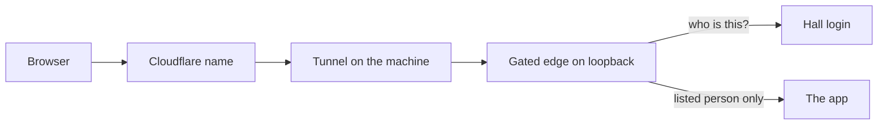

# Publish an app behind the login

You can reach one of your apps from outside the machine, on a name of your own, and only the people you name can
open it. Everyone else is sent to the sign-in, and a signed-in stranger sees a polite "this one is private" page.
This page explains how to set it up. The first app published this way is the Smíðja visualizer.

## What you need

- An app listening on loopback on its machine.
- A Cloudflare tunnel already running on that machine, with its config file and name.
- Gimlé's login, running as the hall. Its bridge must have a rules file (`OIDC_APP_RULES`).
- A name per app. Use a second-level name such as `app-host-a.example.org`, because a third-level name has no
  certificate.
- `docker` or `caddy` on the machine, for the small edge that asks the login.

## How it works



The tunnel never dials the app. It dials the edge, and the edge asks the hall's login on every request. The hall
answers from the rules file, which says who may open each name.

## The config

Write one file per machine in your home, `config/machines/<machine>/publish.yaml`. Nothing in it is shipped
with Ymir.

| Key | Meaning |
|---|---|
| `gate` | The hall's https address. Unsigned browsers are sent there. |
| `edge_port` | A free loopback port for this machine's edge. Never a hall port. |
| `tunnel.config` | The cloudflared config whose ingress is extended. |
| `tunnel.name` | The tunnel name or id, for the DNS route. |
| `tunnel.restart` | Optional command that reloads the tunnel. |
| `apps[].host` | The public name. |
| `apps[].upstream` | Where the app listens. |
| `apps[].allow` | Who may open it: addresses, or `operator` for the address in `hodd/identity/operator.yaml`. |

## The commands

Check the file. It refuses an app with nobody named:

```
bin/forge/gjallarhorn-publish.sh check
```

See what would be written:

```
bin/forge/gjallarhorn-publish.sh plan
```

Write the hall's rules file from every machine's config, then put it where the hall's bridge reads it:

```
bin/forge/gjallarhorn-publish.sh rules --all --out <file>
```

Raise the edge, extend the tunnel and create the DNS routes:

```
bin/forge/gjallarhorn-publish.sh apply
```

`apply` raises the edge first and asks it, as an unsigned browser, for every name. If any name is answered by
anything but a sign-in challenge, it stops before the tunnel or DNS is touched. Show the answers from outside:

```
bin/forge/gjallarhorn-publish.sh status
```

## Limits

- The rules file lives where the hall runs. Publishing the names on a second machine needs the rules file updated on
  the hall too, or the name is open to every gate user.
- The edge is Caddy, in a container named `ymir-publish-edge` or as a `caddy` process.
- A tunnel never dials a hall port, and the edge port is refused if it is one. This door is the one deliberate way to
  reach an app, and it is always gated.

## If it does not work

| You see | Cause and fix |
|---|---|
| `allow names nobody` | The app has no audience. Add an address or `operator`. |
| `the guard did not hold` | The edge answered something other than a sign-in. The hall address is wrong or the hall is down. Nothing was published. |
| A signed-in person sees the private page | Their address is not in the hall's rules file for that name. Re-render and copy the file. |
| `no publish config` | The file is missing for this machine's name. |

## CHANGE LOG

- 2026-11-21 — first written: the door that publishes an app behind the hall login, with the Smíðja visualizer as the first app.
