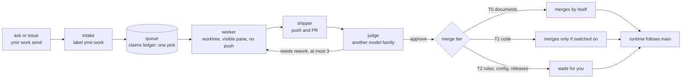

# The work road — from an ask to a merged, released change

## What it is

The work road is one path an ask follows. An issue or a sentence becomes a queue item, a worker builds it in a worktree, a judge from another model family reads it, and a merge tier decides whether it merges by itself or waits for you. After a merge, the runtime follows `main`. Releases to npm stay a door only you open.

You make two choices and nothing else: **where the road runs** (the mode) and **which models do which work** (the profile). Both live in one file, the dispatch config in your home (`hodd/config/eindri-dispatch.json`). You never edit it by hand: `ymir work` does.



## What you need

- `gh` signed in to the repository host, for the issues and pull requests.
- On the machine that runs workers: the `opencode` harness (free models need no key) or `pi` with a local model rail.
- For fleet mode: the fleet registry (`hodd/data/fleet.json`) naming the machine that holds the `heart` role.

## The two choices

| Mode | Who runs the queue, judge and merges | Who runs workers |
|---|---|---|
| `solo` (default) | this machine | this machine |
| `fleet` | the heart (always on) | the heart, plus any machine that offers lanes |
| `offline` | this machine, with the queue journaled | this machine, local models only |

| Role | What it does | Default model (free) |
|---|---|---|
| `triage` | reads the untrusted issue text and writes the brief | `opencode/mimo-v2.6-flash-free` |
| `worker` | builds the change in a worktree | `opencode/deepseek-v4.1-flash-free` |
| `judge` | reviews the diff and re-proves its claims | `opencode/nemotron-3.5-super-vl-free` |
| `mender` | fixes a red check, at most three rounds | `opencode/deepseek-v4.1-flash-free` |

The judge must be another model family than the worker. `ymir work models set judge <model>` refuses a judge on the worker's family. A paid model is never a default; you opt in per errand.

## The commands

```sh
ymir work                                  # mode, models per role, lanes, queue, runtime
ymir work mode fleet                       # solo | fleet | offline
ymir work models                           # each role, and whether this machine can serve it
ymir work models set worker opencode/deepseek-v4.1-flash-free
ymir work send "make the homepage install page match the new one-road install"   # becomes a labelled issue
ymir work intake --dry-run                 # what the road would pick up now (a Nornir tick runs it on the heart)
ymir work dedupe --apply                   # name duplicate open errands dead (rows are kept)
ymir release npm 0.2.1                     # dry run: checks everything, publishes nothing
ymir release npm 0.2.1 --yes               # the publish, only when you say so
```

`ymir install` asks the mode and the models once. Without a terminal it takes the defaults: `solo` and free models.

## Merge tiers

| Tier | What it covers | What happens after the judge approves |
|---|---|---|
| T0 | documents, fix notes, a lock file | merges by itself once checks are green |
| T1 | ordinary code and tests | merges by itself only when `merge.t1` is `auto` (off by default) |
| T2 | rules, config, gates, secrets, identity, releases, deletions | waits for you, always |

## Research on the road

Every role asks before it reads: research goes through `ymir_research` (Huginn). A kept answer to the same question, newer than a week, is reused with no web call. Each call is measured (tokens read, tokens handed back, kept answer reused or not) in `state/research-saving.jsonl`, and `ymir work` shows the totals.

## Limits

- Intake reads only repositories named in `intake.repos` of the config.
- After three failed rework rounds the road stops and asks you.
- `ymir release npm` never runs by itself; it needs `--yes` and a token held in the sealed hoard.

## If it does not work

- `ymir work models` says `no — …` for a role: that model cannot be served here; set another with `ymir work models set`.
- A judge is refused as the same family as the worker: choose a judge from another family.
- Nothing is picked up: `ymir work intake --dry-run` lists what it sees; check `intake.repos` and the `ymir:work` label.

## CHANGE LOG

- 2026-11-24 — opened with plan 365: the mode, the models per role, the merge tiers, the release door and kept research answers.
