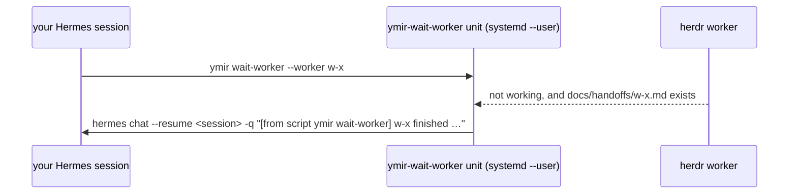

# Ymir in Hermes: the seat, the doctor and the worker wake

This page explains how Ymir installs itself into Hermes. It also covers how you check that installation, and how a finished worker wakes the Hermes session that sent it. The work comes from plan 317, slices 1 to 9.

## What it is

Hermes reaches Ymir through three things, and Ymir seats all three from the **pinned release** (`~/ymir-runtime`), never from a working tree:

- **The doors.** These are the `ymir` MCP server and the record doors (`well`, `bolthorn`, `skuld`), plus `snotra`.
- **The skills shelf.** The release's `.agents/skills` loads in every working directory.
- **The worker script.** `~/.hermes/scripts/ymir-workers.py` is what a Hermes cron runs to print the workers that have finished.

An update moves the pin, and the next seat moves Hermes with it. Ymir corrects only what it wrote. It records those entries in `~/.hermes/.ymir-owned.json`. Any entry you wrote yourself, such as `hnoss`, `chrome-devtools` or `trello`, is reported as `operator-owned` and never changed.

## What you need

- Hermes installed, with `hermes` on your PATH.
- A pinned release at `~/ymir-runtime`. Install creates it; `bin/engine/release.sh` moves it.
- herdr, if you want the worker wake.

## The commands

| Command | What it does |
|---|---|
| `ymir hermes seat --dry-run` | Shows the exact change, and writes nothing. |
| `ymir hermes seat` | Seats Ymir in Hermes. It takes a dated backup of `config.yaml` first and writes through `hermes config set`. |
| `ymir hermes seat --check` | Compares **values**, not names. It exits 1 and names every entry that differs from the release. |
| `ymir doctor hermes` | Prints one row per surface, with four states for each door: configured, listening, authenticated and answering. It exits 0 only when every surface answers. |
| `ymir wait-worker --worker w-name` | Run this from a Hermes session. It starts a supervised waiter. When `w-name` stops working and has written its handoff, a turn lands in that session. |
| `ymir wait-worker --once --cron` | The cron's check. It prints each worker that has finished since the last tick, and prints nothing when none has. |

`bin/seat/hermes-seat.sh` does the same as `ymir hermes seat`. The installer, Gróa's update and `harness-extensions-install.sh --check` all print a `hermes` row.

## How the wake works

The waiter is a transient systemd user unit. It is not a child of your session, so it survives when the session's own processes are killed. Follow it with `journalctl --user -u ymir-wait-worker-…`.

> [!IMPORTANT]
> A session that holds a lost turn (`unknown`) is never written into. A session in the middle of a turn is waited for. A worker that is idle without a handoff does not count as finished. Panes are never closed.

## Limits

- The desktop plugin (slice 13) is not built yet. `doctor` reports it and does not count it as red.
- Ymir seats the cron **script** but not a cron **job**. Whether Nornir results should wake a session is the Allfather's decision. Until then they stay notes.
- `YMIR_HERMES_DIGEST_SCOPE=house` limits the first-turn digest to the house, as it worked before. The default is every working directory.

## If it does not work

- **`doctor` shows `digest` or `cron` red.** The pin is older than this code. Build and flip a release, then run `ymir hermes seat` again.
- **`seat --check` says `drift`.** Run `ymir hermes seat --dry-run` to see the change, then run it without the flag.
- **The waiter never delivers.** Read its journal. A `paused` line means the session holds a lost turn; recover it in Hermes. A `busy` line clears once the session's current turn ends.

## CHANGE LOG

- **2026-11-18** — Opened with plan 317 slices 1–9: the seat corrects what it owns, `ymir doctor hermes`, no swallowed errors, and wait-worker wakes the session as a turn.
