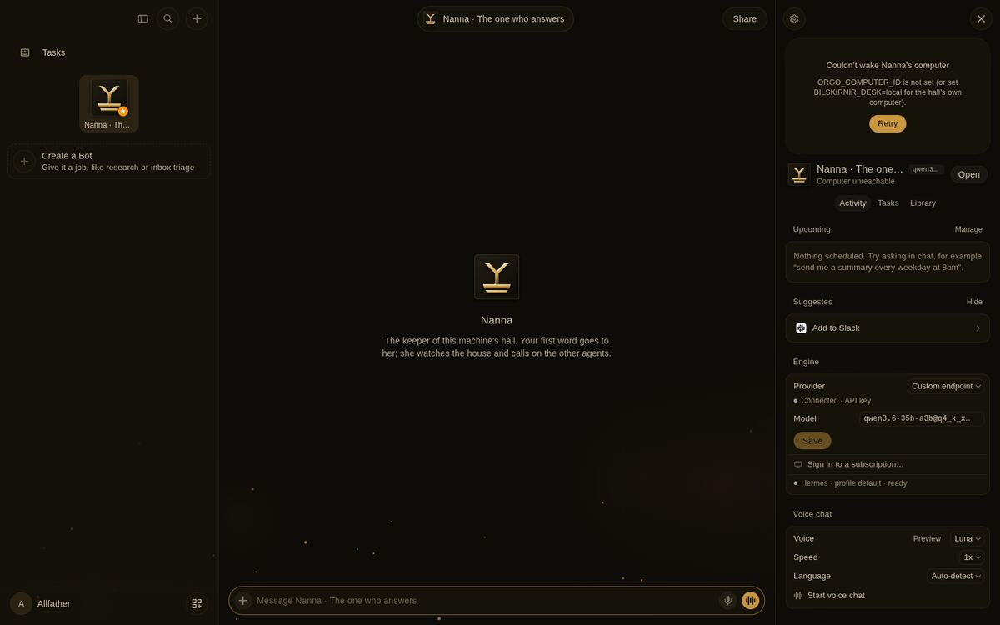
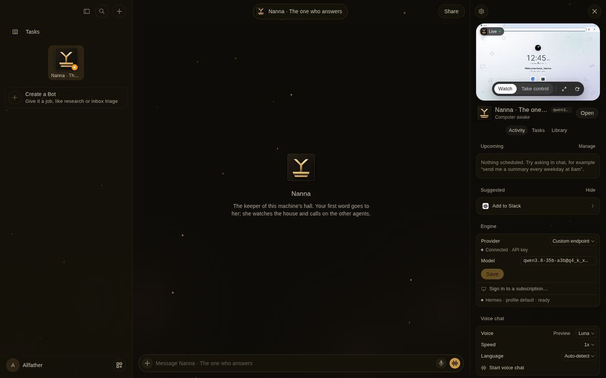
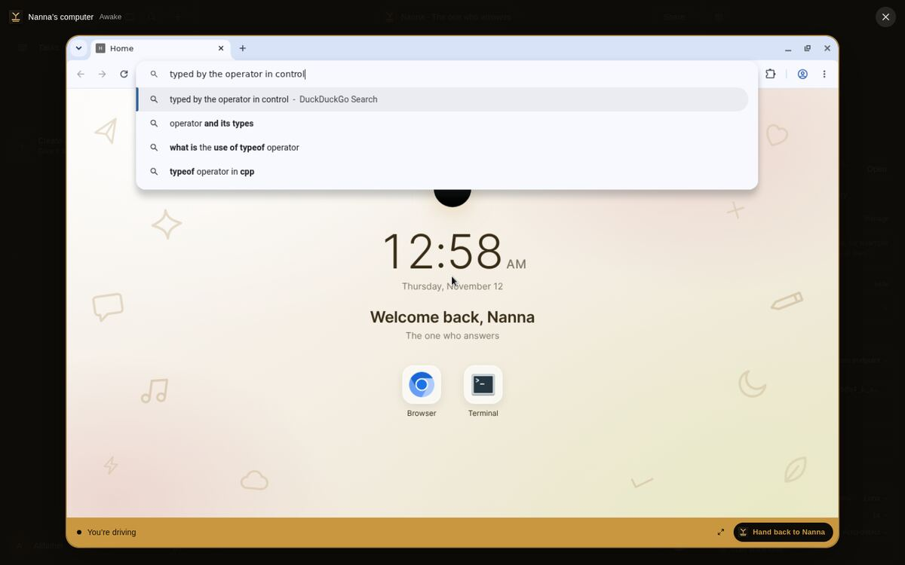
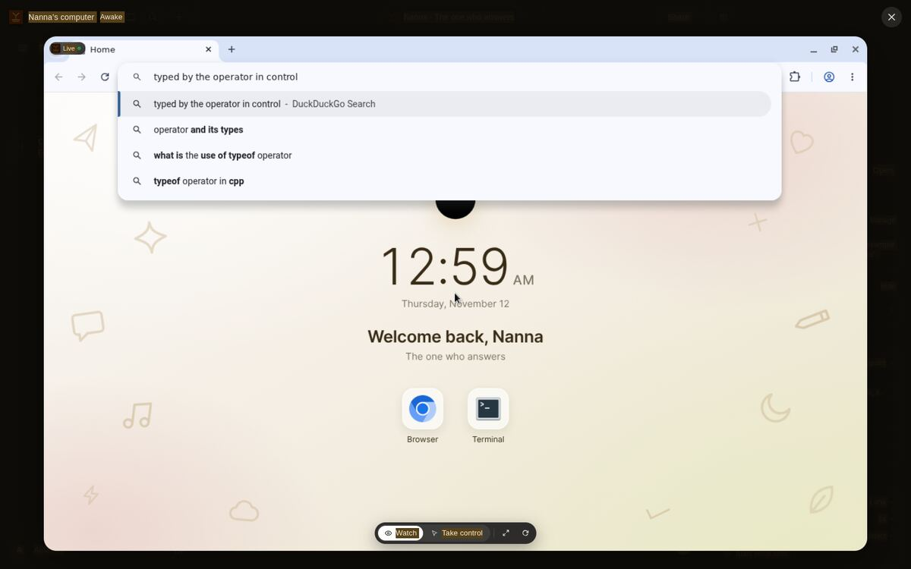
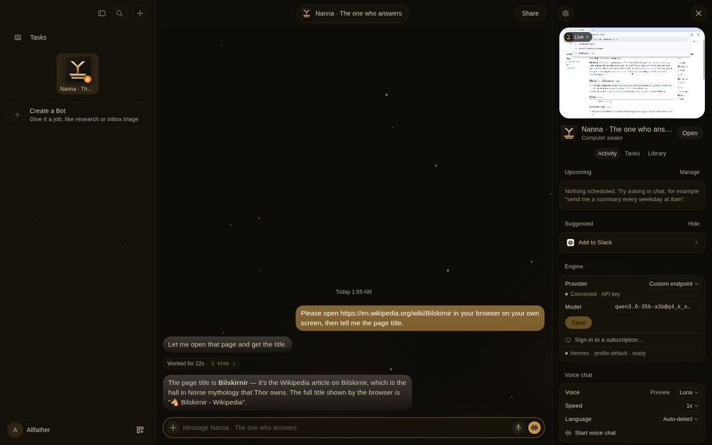

# The hall has its own desk, in place of Orgo

**Date:** 2026-11-12 · **Component:** bilskirnir · **Doors:** `apps/bilskirnir/house/desk.sh`, `apps/bilskirnir/setup.sh`

## What was wrong

Bilskirnir's computer panel knew only Orgo, a paid cloud-computer service. With no `ORGO_COMPUTER_ID` it said
*"Couldn't wake Nanna's computer"*. Nanna had no screen to work on, so her browser toolset had been turned off
(2026-11-12: she retried a missing browser seven times).

## What was forged

- **The desk.** One Linux desktop in a container on this machine: `apps/bilskirnir/house/desk/Dockerfile`
  (Debian, TigerVNC, Chromium, xfwm4) and `desk-screen`, which runs one Xvnc display per agent (`:99`, `:100`, …).
  It is started and stopped by the door `house/desk.sh up | down | status | build`.
- **Loopback only.** Every screen's RFB port is bound to `127.0.0.1`/`::1`, the X servers take no TCP and no
  abstract socket, and the VNC password stays in `data/desk/vnc.pass` (0600, git-ignored). The server does the
  VNC handshake itself (Bot HQ's relay design in `server/src/vnc.ts`, kept), so the password never reaches a browser.
- **The setting.** `BILSKIRNIR_DESK=local|orgo`, default `local` (`server/src/env.ts`). `server/src/machine.ts`
  chooses the computer; `server/src/desk-local.ts` answers the same calls Orgo answered, through `docker exec`
  and a TCP upstream. Orgo works unchanged for anyone who sets `orgo`, and `ORGO_API_KEY` is now optional.
- **The agent's browser.** `setup.sh` brings the desk up and, only when it stands, turns Nanna's `browser`
  toolset back on, pinned to her own screen's Chrome (`browser.cdp_url: http://127.0.0.1:9299`). `--check`
  reports image, container and pin. Managed agents get the same pin from `engine.ts`.
- **The library** downloads from the desk too (resolved and fenced inside the agent's folder on the desk).
- **No blue, no purple on the desk.** Bot HQ's desk dressing gave dark avatars a blue-grey wallpaper and a
  blue/violet terminal palette. They now wear the house's bronze, steel and rust, as the web app already did.

## Proof (real Chromium, driven over the DevTools protocol, on test ports 8788/5174/8643)

| Accept | Seen |
|---|---|
| Nanna's panel shows her live desktop |  |
| The operator takes over and types |  |
| Handed back: keys sent while watching do not arrive |  |
| Nanna opens a page when asked |  |

`desk.sh status` printed `image=present container=running screens=1`; `ss` showed the first screen on
`127.0.0.1:5990` and `[::1]:5990` only; `setup.sh --check` printed `desk up`, `agent's browser drives her desk`,
`ready`; `npx tsc --noEmit` in `server/` is clean.

## A lesson for the next hand

A take-over test that sends `Control+L` from Playwright sends an **uppercase** L. Xvnc turns that into
Ctrl+Shift+L, Chrome's address bar never takes focus, and the typed text vanishes, which looks exactly like a
broken relay. Send `Control+l`. The relay was never at fault.

## Left undone

- Computer-use (the model moving the mouse) is not wired for the desk; the agents drive the browser by DevTools.
- The DevTools ports are fixed at 9200 + display by `server/box/hqlib.py`.
- The live hall (worktree `house-cloth`) still runs the old code until this branch is merged and it restarts.
- Nanna's Chrome profile on the desk was first made with the old accent; its tab strip keeps Chromium's
  light theme until the profile is reset.

## CHANGE LOG

- **2026-11-12** — Written, and carried into main by the gathered batch; from here appended, never rewritten.
