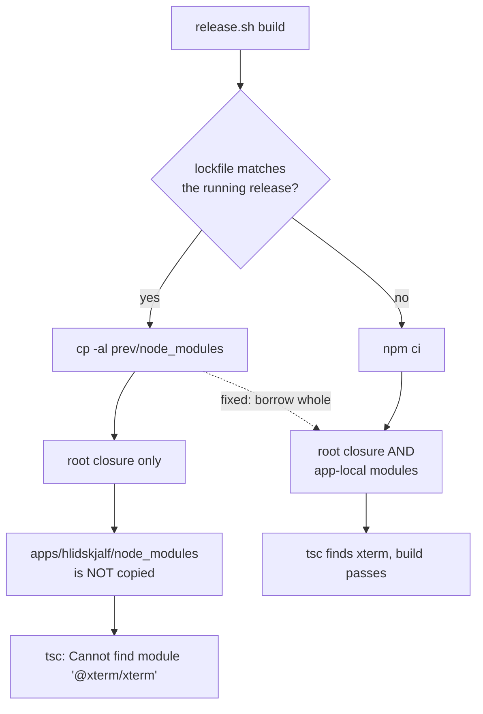

# A release borrowed a closure that was not whole — Hlidskjalf built without its own terminal

**Date:** 2026-11-20 · **Component:** hlidskjalf · **Errand:** `build-xterm`

## What was wrong

`bin/engine/release.sh build` failed on `main`. The release reported that it had built and
proved, except for the one app it could not compile:

```
apps/hlidskjalf/src/components/Terminal.tsx(2,48): error TS2307: Cannot find module '@xterm/xterm'
                                                          or its corresponding type declarations.
apps/hlidskjalf/src/components/Terminal.tsx(136,34): error TS7006: Parameter 'd' implicitly has an 'any' type.
```

The second error is a consequence of the first: `@xterm/xterm` has no declarations to find, so
`term` was `any`, so the callback parameter was `any`. Nothing was annotated to hide it.

## Why

**`@xterm/xterm` was never missing from the manifest, and never missing from the lockfile.**

| Where it is declared | State on `main` |
|---|---|
| `apps/hlidskjalf/package.json` | `"@xterm/xterm": "^6.0.0"` — declared |
| root `package-lock.json` | `apps/hlidskjalf/node_modules/@xterm/xterm`, version `6.0.0`, integrity verified against the registry tarball |

npm hoists most packages to the root `node_modules`, but it **nests a package inside the workspace
that owns it** when it cannot hoist it. `@xterm/xterm` 6 is exactly such a package: it lives at
`apps/hlidskjalf/node_modules/@xterm/xterm` and nowhere else. That is where a real `npm ci` puts it,
and the last release that installed for itself built fine.

The release build then borrowed that closure instead of installing it. When the new release's
lockfile is byte-identical to the running release's, `release.sh` hard-links the previous
`node_modules` rather than pay for a second install — a good economy, and the reason the fault
reached `main` instead of a log. But it copied **only the root `node_modules`**:

```bash
cp -al "$prev/./node_modules" "$tmp/./node_modules"
```

The root closure does not contain `apps/hlidskjalf/node_modules`; a workspace's own nested modules
are inside the app's folder, not inside the root one. So the new release got a borrowed closure with
no `@xterm/xterm` in it at all, `tsc` could not resolve the import, and the release still believed it
had borrowed a proved dependency set.

Measured on the failing build's own log — the borrow, then the compile:

```
+ cp -al …/releases/0d14a4d60b78/./node_modules …/.building-79f430dac08f-1099246/./node_modules
+ npm run build -w apps/hlidskjalf
src/components/Terminal.tsx(2,48): error TS2307: Cannot find module '@xterm/xterm' …
```

And the two directories, side by side:

| Release | `apps/hlidskjalf/node_modules/@xterm` |
|---|---|
| the one that ran `npm ci` | `xterm` — present |
| the one that borrowed | does not exist — absent |

So the app split that moved other apps out (#823) was not the cause, and neither was the closed
xterm-6.0.0 bump (#739): no manifest, no lockfile entry and no workspace list was wrong. The fault
was one line of economy in the release door.



## What was built

**The borrow is now the whole closure, or it is refused.** `bin/engine/release.sh` gained one
function, `borrow_closure`, and the install loop calls it instead of the bare `cp -al`:

- it first checks the **source against the new release's own lockfile**: every workspace whose
  packages the lock nests inside it (`apps/<x>/node_modules/…`, `packages/…`, `systems/…`,
  `tools/…`, `src/…`) must exist in the source. A borrow that cannot deliver what the lock declares
  is **refused before anything is copied**, and the door falls back to a real `npm ci`;
- a permitted borrow hard-links the root `node_modules` **and every workspace's own nested
  `node_modules`**, found under the source's own tree.

So a release can borrow the economy, and the economy can no longer be a lie.

**`d` was given its type.** `apps/hlidskjalf/src/components/Terminal.tsx` now writes
`term.onData((d: string) => …)`. xterm 6 declares `onData: IEvent<string>`, so `string` is the
callback's real parameter type, not an `any` silenced with a cast. With the module resolving this is
redundant and harmless; with it missing, it is no longer what the compiler complains about second.

## The proof

The function has its own test — no release is built by it, and nothing outside a temporary
directory is written:

```
$ bash bin/engine/tests/test_release_borrow_closure.sh
  ok   a complete borrow succeeds
  ok     it carries the root closure
  ok     it carries the app-local package
  ok     and both are hard links, not a second copy
  ok   an incomplete borrow is refused
  ok     and it copies nothing
  ok   a hoisted-only lock borrows from the root closure
  ok     and the closure arrived
release-borrow-closure test: 8 passed, 0 failed
```

The real gate is the release itself, built from this branch, borrowed closure and all:

```
$ bash bin/engine/release.sh build --ref HEAD
build	<sha>	from … (HEAD) — log …
release-proof[6]{app,state,detail}:
  "hlidskjalf","ok","Electron 43.8.9 from the release"
  …
built and proved
```

## Files

- `bin/engine/release.sh` — `borrow_closure`; the install loop refuses an incomplete borrow and
  installs instead
- `bin/engine/tests/test_release_borrow_closure.sh` — the whole-closure proof, 8 assertions
- `apps/hlidskjalf/src/components/Terminal.tsx` — `onData((d: string) => …)`
- `.agents/skills/galdr-ymirsystem/assets/brokk-distro-runtime.md` — the borrow rule appended to the
  release model's book

## CHANGE LOG

- 2026-11-20 — review-mend: added missing heading for #842
