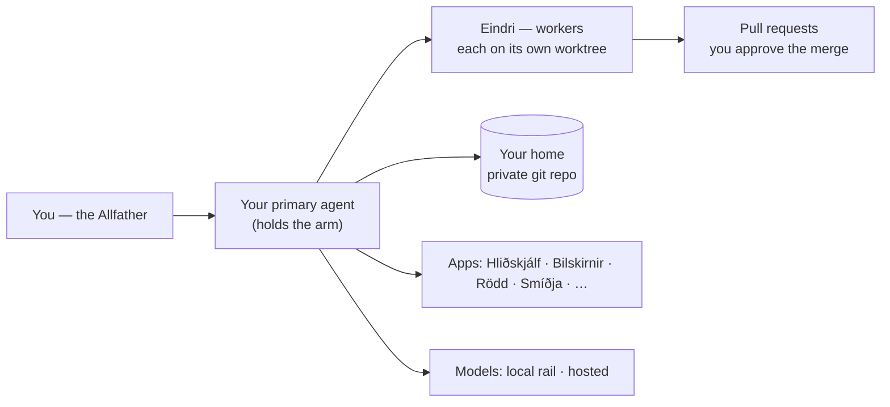

# Onboarding — setting up Ymir from nothing

This is the one page a new user reads first. It takes you from an empty machine to a working house: Ymir installed, your
private home created and filled in, your agents named, your models chosen, your apps installed, and — if you have more
than one machine — your fleet joined up. Each section links to the deeper page when you need it.

Examples use invented names (`Ada`, `host-a`, `example.org`). Use your own.

## Contents

1. [What you are setting up](#1--what-you-are-setting-up)
2. [Before you start](#2--before-you-start)
3. [Install Ymir — Linux, macOS, Windows](#3--install-ymir--linux-macos-windows)
4. [Your home — the private repository](#4--your-home--the-private-repository)
5. [Name yourself, your machines and your agents](#5--name-yourself-your-machines-and-your-agents)
6. [Single machine or fleet](#6--single-machine-or-fleet)
7. [Models — the rail, the catalogue, the allow-list](#7--models--the-rail-the-catalogue-the-allow-list)
8. [The harnesses — pi and herdr](#8--the-harnesses--pi-and-herdr)
9. [The arm — the one session that acts](#9--the-arm--the-one-session-that-acts)
10. [The apps, each in its own repo](#10--the-apps-each-in-its-own-repo)
11. [The high seats — Hliðskjálf and Valaskjálf](#11--the-high-seats--hliðskjálf-and-valaskjálf)
12. [Gimlé — the team's hall](#12--gimlé--the-teams-hall)
13. [Telegram, mail and the calendar](#13--telegram-mail-and-the-calendar)
14. [Keeping it healthy — Eir, Gróa, Sága, Nornir](#14--keeping-it-healthy--eir-gróa-sága-nornir)
15. [The laws you will meet](#15--the-laws-you-will-meet)
16. [Checklist](#16--checklist)

---

## 1 · What you are setting up



| Piece | What it is | Where it lives |
|---|---|---|
| **Ymir** | the program: engine, tools, gates, the shipped skills | a release under `~/.local/share/ymir/releases/<sha>`, pinned as `~/ymir-runtime` |
| **Your home** | everything private: names, machines, plans, memory, secrets (encrypted) | a private git repo, default `~/Documents/ymirhome` (`$YMIR_HOME`) |
| **Your primary agent** | the counsellor on each machine; it plans, dispatches and reviews. Its *role* is Brokk; its *name* is yours to give | the seat roster in your home |
| **Eindri** | worker agents, each sent out on its own git worktree | spawned by `bin/agents/einherjar-spawn.sh` |
| **Apps** | windows and services, each in its own repo and home | `~/.local/share/ymir-apps/<app>/` |

> [!IMPORTANT]
> The Ymir repository is **public**. Nothing private ever goes into it — not a name, a key, a host, a plan. Private
> things live in your home and nowhere else.

---

## 2 · Before you start

| You need | Why | Check |
|---|---|---|
| **git** and a **GitHub account** | Ymir's code, your home, the apps' repos | `git --version` · `gh auth status` |
| **Node 20+** | the installer and the apps | `node --version` |
| **python3** | most doors | `python3 --version` |
| **bash 4+** | the gates and the doctor (macOS ships 3.2) | `bash --version` |
| **A private GitHub repo** for your home (empty is fine) | so your machines share one home | — |
| **An agent harness**: [pi](https://pi.dev) (the house's own) and optionally Claude Code, OpenCode | your agents run in one | `pi --version` |
| **[herdr](https://herdr.dev)** | the panes your agents and workers sit in | `herdr --version` |
| Optional: an **NVIDIA GPU** | a local model rail | `nvidia-smi` |
| Optional: **Tailscale** | the fleet's network between machines | `tailscale status` |

---

## 3 · Install Ymir — Linux, macOS, Windows

One portable core, one install layer per platform. The installer writes into a prefix you own: no `sudo`.

### Linux (Omarchy/Arch first; any distro works)

```bash
curl -fsSL https://raw.githubusercontent.com/zerwiz/ymir/main/install.sh | bash
ymir            # the first setup: prints its PLAN, changes nothing until you agree
```

On Omarchy the layer also seats the launcher entries, desktop placement and shell plugins.

### macOS

```bash
brew install bash node git gh python
curl -fsSL https://raw.githubusercontent.com/zerwiz/ymir/main/install.sh | bash
ymir
```

You do not need to change your login shell; the scripts find Homebrew's bash on their own (or the one in `YMIR_BASH`).

### Windows

Ymir runs inside **WSL2** (Ubuntu). Install WSL2, open the Ubuntu terminal, and follow the Linux steps there. The apps'
windows open through WSLg.

### Android (a light "hand")

In Termux the same `curl … | bash` detects Termux and installs a hand: pi, its extensions, the home and the doors to the
other machines — no rail, no local model. See `docs/installations/termux.md`.

### Without installing

```bash
npx @zerwiz/ymir            # try it
npm install -g @zerwiz/ymir # or keep it; then: ymir
```

After install, everything is on one command: `ymir raise | lower`, `ymir hlidskjalf`, `ymir smidja`, `ymir eir`,
`ymir groa`, `ymir mimir`, `ymir plan`. Deep page: [`docs/features/install-ymir.md`](../features/install-ymir.md).

---

## 4 · Your home — the private repository

The first setup asks where your home lives (default `~/Documents/ymirhome`) and whether to link your private GitHub repo.
Then it **seeds** the home from the shipped shapes — it never overwrites a file you already have:

```bash
bin/engine/home-seed.sh --check   # what is missing (writes nothing)
bin/engine/home-seed.sh           # add what is missing
bin/gates/checks/home-contract-check.sh --list   # every file Ymir reads from your home, and why
```

### The shape

```
ymirhome/
├── AGENTS.md                      your private contract (untracked shape: hodd/AGENTS.example.md)
├── hodd/                          THE HOARD — everything private
│   ├── identity/
│   │   ├── operator.yaml          who you are (the name your agents call you)
│   │   ├── seats.yaml             every machine → its primary agent's name, role, user
│   │   ├── seats.md               the human map of the same
│   │   └── projects.yaml          every project: its repo, default branch, auth reference
│   ├── data/fleet.json            your machines and their roles (heart · forge · dev · hand)
│   ├── secrets/platform.env.age   your keys, encrypted (age); never committed in the clear
│   ├── security/operator-words.txt  the words the privacy wards refuse in public repos
│   ├── memory/                    the well, the daily logs, the Runes audit ledger
│   └── docs/ · plans/ · machines/<host>/
├── config/
│   ├── agents.yaml                which harness and model each figure runs on
│   ├── models-allowed.yaml        the models a worker may use
│   ├── cron.yaml                  the Nornir schedule (jobs gated by role: @heart, @dev …)
│   └── runtime.env                which Ymir release this machine runs
├── svartalfaheim/<realm>/projects/<project>/plans/   THE PLAN LEDGER — numbered, append-only
└── state/                         runtime state (not for reading by hand)
```

| File | Shipped shape (copy, then fill) | Written by |
|---|---|---|
| `hodd/identity/seats.yaml` | `hodd/identity/seats.yaml.example` | `bin/agents/seat-identity.sh` |
| `hodd/identity/operator.yaml` | the seeder | you |
| `hodd/data/fleet.json` | `.agents/config/fleet.json.example` | `bin/fleet/` doors |
| `hodd/identity/projects.yaml` | `registry/projects.yaml.example` | you |
| `config/agents.yaml` | `.agents/config/agents.yaml.example` | `bin/fleet/agents-config.sh` |
| `config/models-allowed.yaml` | `.agents/config/models-allowed.yaml.example` | `bin/model/model-allow.sh` |
| `config/cron.yaml` | `.agents/config/cron.yaml.example` | you |

### Editing the home

Every machine shares it, so every edit is a short window: **pull first, push straight after**.

```bash
bin/vault/home-sync.sh begin                       # fetch + merge
# … edit …
bin/vault/home-sync.sh ship "what changed" <named paths>   # commit those paths only, push
```

Never `git add -A` in the home. Secrets: `bin/vault/hodd.sh emit secrets/platform.env` decrypts in memory; the key stays
on your machines. Deep pages: [`the-home-contract.md`](../features/the-home-contract.md),
[`docs/installations/ymir-home.md`](../installations/ymir-home.md).

---

## 5 · Name yourself, your machines and your agents

Names are yours. Ymir ships the roster **empty on purpose** and never invents one.

```bash
# who you are — your agents call you by this name in every answer
$EDITOR "$YMIR_HOME/hodd/identity/operator.yaml"

# this machine's primary agent: its name (yours) and its role (the counsellor)
bin/agents/seat-identity.sh --ensure            # at install: use the roster, or ask
bin/agents/seat-identity.sh set host-a Freyja   # name the seat on host-a
bin/agents/seat-identity.sh --list              # every seat and its primary
bin/seat/seat-surface.sh                        # render the name into every harness's contract
```

- **No agent is named Brokk.** Brokk is the counsellor's *role*. Each machine's agent gets its own name, so a fleet can tell
  its agents apart (law: `RULES/44`). An unsealed name shows as *unnamed* until you seal it (`status: sealed`).
- Every agent introduces itself as **house · fleet · machine · operator**, read from `seats.yaml` (`fleet.name`,
  `fleet.house`, `fleet.operator`).
- A machine can also have a **machine agent** (the one that keeps the computer itself), named in the same roster.
- Your assistant's name (the one that answers first in Bilskirnir) is `fleet.assistant`.

Deep pages: [`the-seat-name.md`](../features/the-seat-name.md), [`brokk-the-primary-agent.md`](../features/brokk-the-primary-agent.md).

---

## 6 · Single machine or fleet

| Mode | When | What changes |
|---|---|---|
| **Single machine** (the default) | one computer | nothing to set: a fleet of one. The machine is `dev` and runs every job its role owns |
| **Fleet** | two or more machines | each machine gets a **role** in `hodd/data/fleet.json`; jobs and services go where their role is |

### The roles

| Role | Duty | Typical machine |
|---|---|---|
| **heart** | always on: the Nornir schedule, the always-held arm, mail and Telegram, shared stores, small web gates | a small server |
| **forge** | heavy compute: transcription, meetings, model work | a strong box |
| **dev** | where you work; one dev seat may host the model rail if it has the GPU | your desk, your laptop |
| **hand** | light: borrows everything from the others | a phone, a tablet |

### Joining a machine

1. Install Ymir on it (section 3) and clone **the same home** (`git clone <your home repo> ~/Documents/ymirhome`).
2. Put it in `fleet.json` with its role, its user and its **Tailscale name** (never a LAN address).
3. SSH keys both ways between the machines (keys only, no passwords).
4. Name its seat (section 5).
5. `bin/fleet/arm-send.sh --who` — every machine and who holds its arm.

The machines talk through two proven roads: the **arm's wake queue** (`bin/voice/rodd-arm.sh tell`, and across machines
`bin/fleet/arm-send.sh <machine> "<line>"` / `bin/fleet/fleet-tell.sh`) and **a line typed into a herdr pane**
(`bin/agents/eindri-send.sh`). The home is the shared record. Deep pages: [`build-a-fleet.md`](../features/build-a-fleet.md),
[`fleet-roads.md`](../features/fleet-roads.md), [`fleet-tell.md`](../features/fleet-tell.md).

---

## 7 · Models — the rail, the catalogue, the allow-list

| Kind | What | How |
|---|---|---|
| **The local rail** | one `llama.cpp` router on a GPU machine, one model loaded at a time, swapped on request; free | `bin/model/llama-ensure.sh ensure` · `bin/model/rail-resolve.sh status` |
| **Hosted** | any OpenAI-compatible provider (OpenRouter, OpenCode Go, …) and Claude | through pi's provider registry |
| **The catalogue** | the one list of what this machine can serve | `bin/model/catalog.sh` · `--has <provider/model>` |
| **The allow-list** | the models a worker may use; a spawn asking for another is refused | `config/models-allowed.yaml` · `bin/model/model-allow.sh list` |
| **Per figure** | which harness and model each agent runs on | `config/agents.yaml` · `bin/fleet/agents-config.sh show` |

Rule of thumb: **local models run in pi; hosted ones in pi or OpenCode**. Use a strong model to judge and a fast one to
code. Give every failing road a **free fallback** (a free tier, then the local rail). Deep pages:
[`the-model-rail.md`](../features/the-model-rail.md), [`approved-models.md`](../features/approved-models.md).

---

## 8 · The harnesses — pi and herdr

- **[pi](https://pi.dev)** is the house's harness: your primary agent and most workers run in it. Ymir installs its
  extensions (the arm, the tools, Telegram, memory) into your **root agent**, so a pi session opened anywhere — in `~` or
  in any project — has all of Ymir. Claude Code, OpenCode, Codex and Cursor get the same contract and skills; Claude Code
  is held by a hook so it never spawns its own sub-agents (workers are always Eindri).
- **[herdr](https://herdr.dev)** is the seat backend: the panes, tabs and sessions every agent and worker sits in. You see
  them with `herdr agent list`, read one with `herdr agent read <pane>`, and speak into one with
  `bin/agents/eindri-send.sh <pane> "<line>"`. tmux is the fallback.

---

## 9 · The arm — the one session that acts

On each machine **one** session holds the **arm**: it is woken when work arrives (a message, an alarm, a finished worker),
it dispatches the Eindri, and it alone merges. Every other session on that machine is read-only for spawning and merging.

```bash
bin/voice/rodd-arm.sh who          # who holds the arm here
bin/fleet/arm-send.sh --who        # across the fleet
bin/pi/syn-watch.sh status         # the watcher that keeps it (a systemd user unit)
```

In pi the arm is held by the session automatically. Deep pages: [`the-seats-and-the-arm.md`](../features/the-seats-and-the-arm.md),
[`ratatoskr-arm.md`](../features/ratatoskr-arm.md).

---

## 10 · The apps, each in its own repo

Each app has its own GitHub repo and installs into its own home. One door does them all:

```bash
bin/apps/apps.sh list                # every app, where it runs from, its releases
bin/apps/apps.sh install <app>       # or --all
bin/apps/apps.sh update <app>        # builds, checks, switches only when green
bin/apps/apps.sh rollback <app>
```

| App | What it is for |
|---|---|
| **Hliðskjálf** | the control plane — the high seat; stays inside Ymir |
| **Bilskirnir** | the business hall: every agent its own room and its own computer screen; talk to them by voice while you watch; the calendar (Mánagandr) and the Nornir schedule on a page. Needs `hermes` for its first agent |
| **Rödd** | the voice: speak to Ymir, it answers aloud and hands work to workers. Needs a host seat with a card or a fast CPU |
| **Smíðja** | the smithy: repeatable agent+code pipelines run by Völundr; its board at `:8437` |
| **Sessrúmnir** | the developer's desktop seat over the agents |
| **Óðrerir** | the hall's live board (a nightly snapshot) |
| **Hvergelmir** | the house's spring of shared state |

Every public app repo carries the **privacy ward** (gitleaks and the private-word scan; the word list lives only in the
repo's secret). Deep page: [`apps-install-and-update.md`](../features/apps-install-and-update.md).

---

## 11 · The high seats — Hliðskjálf and Valaskjálf

- **Hliðskjálf** — your control plane on this machine (`ymir hlidskjalf`): the gates, the work, the house at a glance. Local
  only, no login: the desktop session is the authority.
- **Valaskjálf** — the **fleet command hall**, served beside Gimlé for **one identity only** (yours). It shows the
  status of every machine, the alarms, the mail waiting on you, every cron, the pull requests, the work, and the
  **Council room**, where a line naming `@seat` reaches that machine's arm holder and comes back with a *RECEIVED*. Your
  collaborators never see its door.

---

## 12 · Gimlé — the team's hall

Gimlé is the suite you share with collaborators, on your own server: **one Google sign-in**, then the board (Plane), the
documents (AFFiNE), the whiteboard (Excalidraw), bookings (Cal.com) and the desk. **One MCP door** lets every agent work in
them *as the person who asks*. An access list in your home says who belongs where; the plans and docs of each project are
mirrored onto the board and into the documents. Gimlé is its own kit, installed on your heart from a site file in your
home; a second company runs its own copy. Deep page: [`gimle-the-hall.md`](../features/gimle-the-hall.md).

---

## 13 · Telegram, mail and the calendar

- **Telegram** — talk to your agents from your phone; each machine's agent can have its own bot
  ([`telegram-across-the-fleet.md`](../features/telegram-across-the-fleet.md)).
- **Mail (Gná)** — the inbox read into lanes: *needs you · waiting on them · answered*. Nothing is sent without your
  approval of the exact bytes.
- **The calendar (Mánagandr)** — read-only through one door; *is he free?* answers free, busy or unknown (never free when
  unknown). Grant it once with your Google account.

---

## 14 · Keeping it healthy — Eir, Gróa, Sága, Nornir

| Figure | Does | Command |
|---|---|---|
| **Eir** | diagnoses every surface and mends what is broken | `ymir eir` · `bin/agents/eir-doctor.sh check|fix` |
| **Gróa** | updates Ymir and every app, never forced, then mends forward | `ymir groa` · `/updateymir` |
| **Sága** | the session start: one digest of what is owed, read once | `bin/time/saga-session-start.sh` |
| **Nornir** | the schedule (`config/cron.yaml`), jobs gated by role | `bin/time/nornir-jobs.py` |
| **Garmr** | the hound: watches what runs, listens and leaves | runs as a root service on each machine |

---

## 15 · The laws you will meet

- **Nothing private in a public repo.** Names, hosts, mails, plans and keys live in your home.
- **Every change leaves by pull request**; you approve the merge. Documents may go straight to `main`.
- **Workers are Eindri** — each on its own worktree, each with a receipt; no harness spawns its own sub-agents.
- **Append, never rewrite** — plans, rules, fix notes and the ledger grow by dated entries.
- **One fix note per change** in `docs/fixes/<component>/`.
- **English for the work, Old Norse for the names.**

The full law is in `RULES/`; `bin/agents/skill-find.sh "<words>"` finds the skill for any craft.

---

## 16 · Checklist

- [ ] git, gh, Node 20+, python3, bash 4+ installed; pi and herdr installed
- [ ] Ymir installed and `ymir` first setup accepted
- [ ] Home created at `~/Documents/ymirhome`, linked to a private GitHub repo, seeded (`home-seed.sh --check` clean)
- [ ] `operator.yaml` names you; `seats.yaml` names this machine's agent (sealed)
- [ ] `projects.yaml` lists your projects
- [ ] Single machine, or `fleet.json` with every machine's role and Tailscale name, SSH keys both ways
- [ ] `models-allowed.yaml` and `agents.yaml` written; `bin/model/catalog.sh` lists your models
- [ ] The arm is held (`rodd-arm.sh who`)
- [ ] Apps installed (`apps.sh list`)
- [ ] Telegram, mail and calendar granted, if you use them
- [ ] `ymir eir` is green

## CHANGE LOG

- **2026-11-22** — written: the one onboarding page, from install to fleet, at the operator's word.
