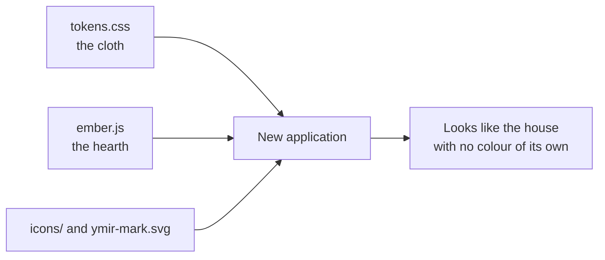

# The house cloth — how a Ymir application looks

**Status:** design rule for new applications — written 2026-11-12 at the Allfather's word: *"we need to make a house
cloth document. for how ymirs applications should look like."*

Every Ymir application wears one cloth: stone and bone, bronze and blood, three typefaces, and the hearth burning
behind the work. The cloth lives in one place, `midgard/design-system/`, and a new application **imports** it. It never
copies it. Sessrúmnir, Hlidskjalf and Rödd are the reference: they show the cloth worn well, and they are not changed by
this document.

> [!IMPORTANT]
> The first application built to this page is **Bilskirnir** (plan 259, the hall of rooms). It must pass the checklist
> at the end before its first window opens. The three reference apps stay as they are.

## Where the cloth lives

One folder holds everything an application needs to look like the house:

| File | What it gives you | How an app takes it |
|---|---|---|
| `midgard/design-system/tokens.css` | every colour, typeface, size, space, radius, shadow and motion timing, as `--ymir-*` variables | import it once, at the app's entry |
| `midgard/design-system/ember.js` (+ `ember.d.ts`) | the hearth: embers rising with a sway over drifting haze | `import { startEmbers } from '…/midgard/design-system/ember.js'` |
| `midgard/design-system/icons/` and `icons.md` | the rune glyph set and which glyph names which subsystem | use the SVGs; never emoji in the chrome |
| `midgard/design-system/runes.md` | the rune marks | for status and identity marks |
| `midgard/design-system/ymir-mark.svg` | the Ymir mark | the window icon and the header emblem |

The full reasoning behind each value is in `docs/design.md` (§0 the cloth, §4 the visual language). This page is the
short rule for building an application with it.



## The colours

The cloth is dark stone with bone text, lit by bronze. Use the token name in code, never the value.

| Role | Token | Value | Use it for |
|---|---|---|---|
| Ground | `--ymir-bg-0` | `#0e0c09` | the window behind everything |
| Panel | `--ymir-bg-1` | `#151209` | panels, the side rail |
| Raised | `--ymir-bg-2` | `#1a1610` | cards, a selected row |
| Well | `--ymir-bg-3` | `#221d14` | hover, inset wells |
| Text | `--ymir-text-0` | `#cfc3a9` | body text (about 10:1 on a panel) |
| Text, softer | `--ymir-text-1` | bone at 82 % | secondary text |
| Text, dim | `--ymir-text-2` | `#9a8f75` | labels, disabled |
| Text, faint | `--ymir-text-3` | `#6b6250` | placeholders |
| Accent | `--ymir-cyan-1` | `#c9973f` (bronze) | links, focus, the active item |
| Accent, deep | `--ymir-cyan-2` | `#7d5f2a` | hover on the accent |
| Second accent | `--ymir-violet-1` | `#96a0a8` (steel) | realm identity |
| Line | `--ymir-steel-1` | `#2b241a` | borders |
| Strong line | `--ymir-steel-2` | `#7d5f2a` | dividers, rules |
| Good | `--ymir-ok` | steel | done, healthy |
| Heed | `--ymir-warn` | bronze | degraded, waiting |
| Wound | `--ymir-danger` | `#c2584a` (blood) | failed, refused, sealed |
| Note | `--ymir-info` | bone-dim | neutral information |

Each state colour has a `-dim` wash for chip backgrounds (`--ymir-ok-dim` and so on). The names `cyan` and `violet` are
historical; the values are bronze and steel. Keep using the names, because every app already does.

**Heraldry is not chrome.** The eight house colours (`--ymir-house-*`) mark a house's seal and nothing else. Never use
one for a button, a border or a background.

## The typefaces

The cloth has three faces, and each does one job:

| Face | Token | Job |
|---|---|---|
| Cormorant | `--ymir-font-head` | headings and the app's name — it speaks |
| Newsreader | `--ymir-font-body` | body and chat text — it reads |
| IBM Plex Mono | `--ymir-font-mono` | code, numbers, paths, status — it counts |

Every stack falls through to Noto Sans Runic, so a rune renders wherever it is written. Numbers that change (counts,
durations, timers) use the `.tabular` class so they do not jump.

## Space, edges and motion

- **Space:** a 4 px base and an 8 px rhythm, from `--ymir-space-1` (4 px) to `--ymir-space-7` (48 px). Panel padding is
  `--ymir-space-4`.
- **Edges:** `--ymir-radius` (8 px) for controls and `--ymir-radius-panel` (12 px) for panels, a 1 px `--ymir-border`,
  and `--ymir-bevel` — a brass hairline inside the stone that sells the carved edge.
- **Motion:** short and quiet. `--ymir-dur-fast` (120 ms) to `--ymir-dur-roll` (240 ms), all on `--ymir-ease`. A loading
  state is the hearth or a rune, never a spinning wheel.
- **Reduced motion:** honoured everywhere. `tokens.css` collapses transitions, and the hearth draws one still frame.

## The hearth

The ember is the house's signature: a slow fire behind the work, taken from the landing page's hero. It is decoration,
so it never sits on top of text and never takes a click.

How the reference apps burn it, and what a new app copies:

| App | Where the hearth burns | What to learn from it |
|---|---|---|
| Hlidskjalf | `src/components/EmberBackground.tsx`, a fixed canvas behind the whole shell and the login | the simplest wrapper: a canvas, `startEmbers(canvas)` in an effect, return its stop function |
| Sessrúmnir | behind the chat column and the home screen, inside the column at `z-index: -10` | the layering: the column's colour sits on a pseudo-element at `-20`, and `isolation: isolate` keeps the fire inside the column so it is seen |
| Rödd | behind the engine's page, which is made transparent so the fire shows through | a hearth can warm a page you did not write, without moving its layout |

A new application does it the Hlidskjalf way, with the Sessrúmnir layering when the fire belongs to one column rather
than the whole window:

```tsx
import { useEffect, useRef } from 'react';
import { startEmbers } from '../../../midgard/design-system/ember.js';

export function Hearth() {
  const ref = useRef<HTMLCanvasElement>(null);
  useEffect(() => (ref.current ? startEmbers(ref.current) : undefined), []);
  return <canvas ref={ref} aria-hidden="true"
    style={{ position: 'fixed', inset: 0, width: '100%', height: '100%', pointerEvents: 'none', zIndex: 0 }} />;
}
```

`startEmbers` already handles the device pixel ratio, resizing of its container, reduced motion and cleanup. An app
never writes its own particle loop.

## Following the machine's theme

The cloth is the default, not a cage. A user theme or a high-contrast theme always wins when chosen.

Sessrúmnir is the reference here: it carries the cloth as its built-in `fensalir` theme, and its theme engine writes a
chosen theme's colours onto the page at runtime. A test holds its first-paint CSS and the cloth theme identical.

A new application starts on the static tokens. When it learns to follow a theme, it does so by **overriding the
`--ymir-*` variables at runtime**, never by keeping a second palette. Whether any app yet follows the live Omarchy
desktop theme is an open question in plan 259.

## What a new application must never do

- **Write a colour by hand.** A hex value in an app's own styles is a copy of the cloth, and it stops matching the day a
  token changes. Every colour is a `var(--ymir-*)`.
- **Restate the palette under new names.** If the app needs its own names (`--bg`, `--accent`), each one is defined as
  `var(--ymir-…)`, never as a value.
- **Copy `ember.js` or write a second particle loop.** One fire, imported.
- **Keep two hearth components.** One wrapper per app.
- **Use emoji or a stock icon set in the chrome.** The glyphs are runes, from `midgard/design-system/icons/`.
- **Use a house colour as chrome.** Heraldry marks a house; it never paints a button.

## Checklist before an application's first window

1. The entry file imports `midgard/design-system/tokens.css`, and the HTML loads Cormorant, Newsreader, IBM Plex Mono
   and Noto Sans Runic.
2. `grep -rnE '#[0-9a-fA-F]{3,8}\b'` over the app's own styles and components finds nothing.
3. The hearth is one component that calls `startEmbers` from `midgard/design-system/ember.js`, sits behind the content,
   and is `aria-hidden` with `pointer-events: none`.
4. Status is shown by colour **and** a rune **and** a word, never colour alone.
5. With reduced motion on, nothing moves and the hearth is a still frame.
6. The window icon and the header emblem are the Ymir mark or the app's rune.
7. Put side by side with Hlidskjalf and Sessrúmnir, the new app looks like the same house.

## Where this sits

`docs/design.md` is the full design document, and this page is its rule for new applications. The reference apps are
`apps/hlidskjalf`, `apps/sessrumnir` and `apps/rodd`. The first app built to this page is Bilskirnir (plan 259, in the
Allfather's home).

## Dressing an app you did not write — the Rödd way

Written 2026-11-12 at the Allfather's word: *"when we're applying the house cloth we can't just straight add it on … If
you look at the rödd, it looks much better."*

Some Ymir apps start from someone else's code (Rödd from a voice engine's web page, Bilskirnir from Bot HQ). The cloth is
not painted over such an app; it is **dressed onto it**, the way Rödd does it:

| Keep | Change |
|---|---|
| the app's own layout, spacing and type | the **colours only**, by mapping the app's own colour variables onto `--ymir-*` in one file |
| the app's own components | the page background goes transparent, so the **hearth** burns behind everything |
| the app's own icons | any fake OS chrome (macOS window buttons and the like) is removed |
| identifiers, API paths, storage keys | every **visible word**, rewritten in the house's voice |

Rödd's `apps/rodd/patch/house.css` is the model: about a dozen variables, mapped once, and nothing else touched. An app
that looks worse after the cloth was dressed wrongly — undo and map fewer things, never restyle more.

## CHANGE LOG

- **2026-11-12** — Written at the Allfather's word, from the three reference apps as they stand; no app was changed.
- **2026-11-12** — Added "Dressing an app you did not write — the Rödd way", at his word that the cloth must not be painted on.
- **2026-11-12** — The cloth has no blue and no purple (RULES/54): `house-colour-guard.sh` refuses a cool hue anywhere
  in the repo and names the house colour it becomes; the house accents for Muninn, Dvalin, Utgard and Mannheim moved
  to steel, bone, blood and faint bone.
