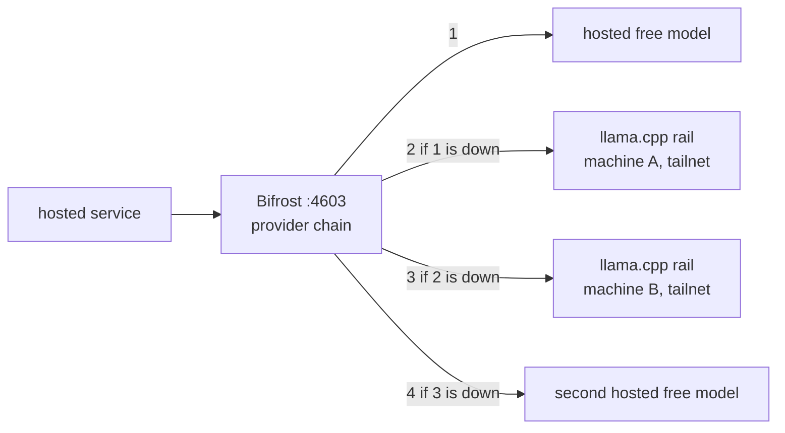

# Who calls a model — the house's AI callers

This page answers one question: *if a machine is off, does a hosted service still get an answer
from a model?* It explains the one door every hosted service should call, and lists the kinds of
caller and how each one is pointed at that door.

> [!IMPORTANT]
> Every AI call made by a hosted service goes through **one door**: Bifrost
> (`.agents/backend/model-bridge.py`, port 4603). The door tries a hosted free model first. Next it
> tries one machine's llama.cpp rail, then another machine's, then a second hosted free model.
> Only llama.cpp is a local road: no LM Studio, no ollama.

The **named inventory** (each caller, its machine, its settings file and its owner) is private. It
names clients and machines, so it lives in the home at `hodd/docs/fleet/ai-callers.md`, never here
(RULES/04).

## How the chain works



- **The steps live in the home**, at `<home>/config/model-chain.json`, never in this repository.
  A step names a provider and a model. A llama.cpp step names a **fleet host**. The door reads that
  host's tailnet name from the fleet registry (`<home>/hodd/data/fleet.json`).
- **A step is passed over** when it is down, times out, or rate-limits (429). It is also passed
  over when it refuses its key (401/403), fails on its side (5xx), or answers 200 with an error and
  no answer. It is then marked down for 30 seconds (`YMIR_CHAIN_HEALTH_TTL`). A dead machine costs
  one probe per window (`probe_timeout`, default 10 s), not one per request.
- **A probe can be wrong**, for example a gateway whose model list is slow. So when the health
  check skips every step, the door asks each one once more before it answers 503. The log calls
  that pass `(last ditch)`.
- **The door says which step answered.** Each reply carries the header `X-Ymir-Chain-Step`. The
  log has a line `[chain] answered step=<name> … passed=[<steps passed over and why>]`.
- **The step's model replaces the caller's model.** A caller may keep asking for its old model
  name, and the log shows `asked=<old> model=<served>`.

A chain file looks like this (the names are examples):

```json
{"steps": [
  {"name": "hosted-free", "provider": "opencode-go", "model": "beam-free", "timeout": 120},
  {"name": "rail-a", "provider": "llamacpp", "host": "host-a", "port": 8080, "pi_auth": "llamacpp-host-a", "model": "<a model kept loaded there>", "timeout": 180},
  {"name": "rail-b", "provider": "llamacpp", "host": "host-b", "port": 8080, "model": "<a model kept loaded there>", "timeout": 180},
  {"name": "hosted-free-2", "provider": "openrouter", "model": "<a second free model>", "timeout": 120}
]}
```

Pick a rail model that the rail **keeps loaded**. A fallback then answers at once and never makes
a busy GPU swap models.

Read the chain and the health of each step:

```bash
bin/bridge/bifrost-bridge.sh --chain
curl -s http://127.0.0.1:4603/chain
```

The proof that each step gives way to the next is `bin/bridge/tests/test_bifrost_chain.sh`.

## Reaching the door from a container

Bifrost listens on loopback only, because the halls are local (the 2026-11-14 law). A container
reaches it in one of two ways, and neither opens it to the LAN:

1. **Through a proxy on the compose network.** A Caddy site that forwards to the bridge gateway
   address. Use this when the container sits on a network that cannot dial the host at all.
2. **Through a bridge relay.** A `socat` unit that listens on the compose bridge's gateway address
   only and forwards to `127.0.0.1:4603`.

The same image works on any machine, because the model setting is configuration. The URL a
container is given names the door, and the door decides which model answers.

## The kinds of caller

| Kind of caller | Where its model setting usually lives | How it joins the chain |
|---|---|---|
| A web app's AI features in a container | an env file: a base URL and a model id | point the base URL at the door (directly, or through the proxy it already uses) |
| A document service with a model map | a model map file plus env overrides per door | point the chat door's URL at the door; leave classifiers and embedders on their own doors |
| A heart service (a desk backend, a whiteboard AI bridge) | a unit's env file, sometimes a constant in code | set its base URL to `http://127.0.0.1:4603/v1`; a constant in code must first be made configurable |
| An agent harness the operator drives | the model the operator picked | not changed: the chain would override the operator's own choice |
| A model server (llama.cpp, a classifier on its own protocol, an embedder) | its own config | not a caller: it is a model, or not a chat model |

## A second machine

Every machine carries the same home, so the chain file and the fleet registry come with it. To
test a service there through the chain:

1. Raise Bifrost from the pin with `bin/bridge/bifrost-bridge.sh --ensure`. When the home has a
   chain file, it serves `chain`. Check it with `bin/bridge/bifrost-bridge.sh --chain`.
2. Give the containers the door by configuration, as on the first machine.
3. Use the service's AI feature once, then read Bifrost's log for the `[chain] answered` line.

## If it does not work

| What you see | What to do |
|---|---|
| Every call answers 503 `no model step answered` | Run `bin/bridge/bifrost-bridge.sh --chain`. It names each step and why it is down. |
| A rail step says `host '<name>' has no address` | The fleet registry has no `tailnet` or `lan` for that host. Add one in `<home>/hodd/data/fleet.json`. |
| A rail step says `probe http 401` | The rail is keyed. Name its key in the step, with `pi_auth` or `key_env`. |
| A container times out reaching the door | Its network cannot dial the host. Use a proxy on its compose network. |

## CHANGE LOG

- **2026-11-21** — first written, with the chain (the operator's word that day: a free hosted model
  for everything hosted, with the fleet's llama.cpp rails as fallbacks, and llama.cpp only).
