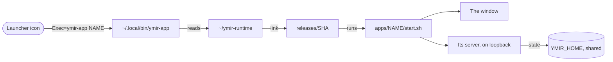

# Runbook — add an app to Ymir

**Status:** runbook — written 2026-11-13 at the Allfather's word: *"make a run book also in my ymir for how to add apps
to ymir"* (plan 275).

An app is not done when it runs from your checkout. It is done when it is built inside a release, opens from a
launcher icon on every machine, wears its own rune, survives an update and a reboot, and passes the same test on
every machine of the fleet — a dev machine and the heart. This page names every place a new app must be written into, in the order to do it.

> [!IMPORTANT]
> An app that skips a step here breaks quietly: the icon opens nothing after an update, the window shows yesterday's
> face, or it runs from a working tree that a branch switch deletes. Every step below exists because one of those
> happened (plan 275).

## How an app reaches the desktop

The launcher never names a folder. It runs one command, and that command finds the release that is current.



## The steps

Do them in this order. The table names the file each step changes and how to prove it.

| # | Step | Where | Proof |
|---|---|---|---|
| 1 | Put the code in `apps/<name>/`, never in `bin/` | `apps/<name>/` (RULES/23) | `ls apps/<name>` |
| 2 | Declare the one Electron, exactly | `apps/<name>/package.json`: `"electron": "43.8.9"` | `bin/desktop/electron-lib.sh` refuses any other major |
| 3 | Write one start script with `--stop` and `--check` | `apps/<name>/start.sh` | `apps/<name>/start.sh --check` |
| 4 | Write the launcher template | `apps/<name>/electron/ymir-<name>.desktop.in` | `Exec=__YMIR_APP__ <name>`, `Icon=ymir-<name>` |
| 5 | Teach the one command the app's name | `bin/desktop/ymir-app` (the `case`, and `--list`) | `ymir-app --list` |
| 6 | Add the launcher row | `bin/desktop/shortcuts.sh` (the app table) | `bash bin/desktop/shortcuts.sh` writes `~/.local/share/applications/ymir-<name>.desktop` |
| 7 | Choose a rune no other app wears | `midgard/design-system/runes.md` (app runes), `icons.md`, `icons/<rune>.svg` | the rune map lists the app |
| 8 | Mint and cut its icons | `bin/desktop/design-icon.sh`: the `APPS` row, `raster_targets`, the `raster_all` case | `design-icon.sh mint <name>`, `raster`, `install` |
| 9 | Build it inside the release | `bin/engine/release.sh`: `APPS`, the `npm ci` list, the Electron list, the build lines, `prove()` | `release.sh build --ref main` prints the app `ok` |
| 10 | Keep its state in the home, never in the release | the app reads `$YMIR_HOME` through `bin/vault/hoard-lib.sh` (`ymir_home_root`); shared paths go in `SHARED_PATHS` | a release flip loses nothing |
| 11 | Write its how-to and fix note | `docs/features/<name>.md`, its row in `docs/features/_catalogue/`, then `bin/records/weave-features.sh`; `docs/fixes/<component>/` | the wards pass on push |
| 12 | Test on both machines through DevTools | `YMIR_DEVTOOLS_PORT=9305` | the same checks pass on a dev machine and the heart |

## What the start script must do

The start script is where most breakage has come from. Each rule below was learned from a crash or a dead icon.

| Rule | Why |
|---|---|
| Run from the pin (`$YMIR_RUNTIME_DIR`), never from the tree it was copied from | a working tree moves under branch switches |
| Bind its server to `127.0.0.1` only | no door is opened that nobody named (RULES/24) |
| Resolve every home path through `ymir_home_root`, and name folders by their **real** path (`pwd -P`, `realpath`) | Hermes refused every message when a home was named through the release link (`profile_mismatch`) |
| Serve its HTML with `Cache-Control: no-cache` | Electron kept an old `index.html` and showed yesterday's face after an update |
| Close the window through its **main** process, then wait | killing the whole process group makes Electron trap (SIGTRAP cores) |
| Never claim the graphics card at boot; raise GPU work when it is asked for | the card is shared with the model rail and the voice |
| Read `YMIR_DEVTOOLS_PORT` and pass `--remote-debugging-port` | an app that cannot be tested through DevTools is not tested |

## Raising it by hand on another machine

Over ssh, a start script that launches a window must outlive the shell that started it. Raise it in a user unit that
stays up after the script exits, and give each raise its own unit name:

```sh
systemd-run --user --unit=<name>-$(date +%s) -p KillMode=process -p RemainAfterExit=yes \
  --setenv=YMIR_DEVTOOLS_PORT=9305 bash -lc "$HOME/ymir-runtime/apps/<name>/start.sh"
```

A plain `systemd-run --collect` stops the unit when the script finishes and kills the window with it. A reused unit
name is refused while the old unit is still loaded, and the restart silently does not happen.

## Carrying it to every machine

1. Commit on `main` (the release builds a commit, never a working tree).
2. Build and flip the release: `bin/engine/release.sh build --ref main`, then `release.sh flip <sha>`.
3. On each other machine, bring the commit (by `git pull` once it is on GitHub), build, flip, and run
   `bin/desktop/design-icon.sh install` so its icon and launcher are written.
4. Run the same DevTools checks on each machine, and write what each printed into the plan.

## If it does not work

| Symptom | Look at |
|---|---|
| The icon opens nothing | `grep Exec ~/.local/share/applications/ymir-<name>.desktop` — it must be `ymir-app <name>`; then `ymir-app <name>` in a terminal |
| The window is the old one after an update | the HTML's `Cache-Control` header; reload once |
| "WebSocket is not defined" or another riddle at start | the Electron major: `bin/desktop/electron-lib.sh` names the remedy |
| The icon is wrong or blank | `design-icon.sh list`, then `mint <name>`, `raster`, `install` |
| It worked, then died seconds after an ssh start | the unit it was raised in (see above) |

## CHANGE LOG

- **2026-11-13** — written at the Allfather's word (plan 275), from the steps that made Bilskirnir and Rödd whole.
