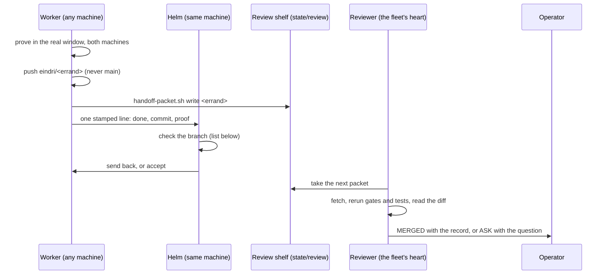

# Runbook — deliver work across the fleet: from a finished worker to a merge

**Status:** runbook — written 2026-11-14 at the operator's word: *"do we need a runbook of this, for our fleet?"*

Work is forged on any machine of a fleet and merged in one place. A worker (an Eindri) finishes on its own branch,
and the helm on that machine checks it. What happens next is **the operator's choice, per project**: the project's
`delivery` row in the operator's own project registry (`$YMIR_HOME/hodd/identity/projects.yaml`) says who merges.

| `delivery` | Who gathers and merges |
|---|---|
| `operator-merges` (the default) | the helm opens the PR; the operator reviews and merges |
| `reviewer-merges` | a reviewer seat on the fleet's **heart** (the machine the fleet registry gives the `heart` role) fetches, reruns the proof, opens the PR, merges and tells the operator |
| `batch` | the helm gathers related errands into one PR with `bin/forge/gather.sh` (`docs/features/gather-a-batch.md`) |

A fleet of one machine is its own heart. Nothing on this page assumes a host name, a machine count or who the
operator is; each comes from the operator's registries. The steps below are written for `reviewer-merges`, the
longest road; the other two stop earlier.

> [!IMPORTANT]
> The law is `RULES/08` (its `reviewer-merges` row), plan 206 §4 (*the one pass*) and plans 203 and 205. If this page
> and the law disagree, the law wins and this page is corrected by a dated entry.

## Who does what

| Role | Where | Does | Never |
|---|---|---|---|
| Worker (Eindri) | a herdr pane and its own worktree, on any machine | builds the errand, proves it in the real window, pushes **its branch**, writes the handoff packet, reports one stamped line to the helm | pushes `main`, opens or merges a PR |
| Helm | the session holding the Gná arm on that machine | briefs and seats workers (`docs/runbooks/send-an-eindri.md`), checks each branch against its brief, answers each report | merges, or hands over a branch it has not checked |
| Reviewer | Forseti, seated on the fleet's heart (`reviewer-merges` only) | takes the packet from the review shelf, fetches the branch, reruns gates and tests **on the heart**, reads the diff against the plan, opens the PR, merges, records the merge in Runes, tells the operator | merges a red or conflicting head, or a branch whose head is not the packet's |
| Operator | anywhere | chooses each project's `delivery`; reads the verdicts and merge notices; answers the reviewer's questions | — |

## The road

## The steps, with the commands

| # | Who | Step | Command |
|---|---|---|---|
| 1 | Worker | Commit on `eindri/<errand>`, based on `origin/main` | `git switch -c eindri/<errand>` (if the worktree is detached), `git commit -- <named paths>` |
| 2 | Worker | Push the branch | `git push origin eindri/<errand>` |
| 3 | Worker | Write the packet | `bin/forge/handoff-packet.sh write <errand> --task '…' --plan <n> --branch eindri/<errand> --gate 'name\|cmd\|exit\|tail' --test 'cmd\|exit\|tail' --claim 'line\|state\|evidence' --not-done 'item\|why' --need 'what\|who'` |
| 4 | Worker | Check the packet | `bin/forge/handoff-packet.sh check <errand>` passes |
| 5 | Worker | Report | `bin/agents/eindri-send.sh --from "agent <errand>" <helm pane> "<result>"` |
| 6 | Helm | Check the branch (below), then answer the worker | `git diff origin/main...eindri/<errand>`, the worker's proof rerun |
| 7 | Reviewer | The one pass | plan 206 §4; `bin/forge/review-shelf.sh`, `bin/forge/review-verdict.sh` |
| 8 | Reviewer | Tell the operator | `bin/notify/send.sh` (mail and Telegram), a Runes merge record |

When several errands belong together, the worker names the order in `--need` (*"after eindri/one-hlidskjalf"*) and
the helm says it in its answer; the reviewer gathers them in that order. This replaces the helm-side gathering in
`docs/features/gather-a-batch.md` (corrected there by a dated entry).

## What the helm checks before a branch goes on

- It does what the brief named, and nothing else; a removal the brief did not name goes back (never remove a feature).
- It is based on `origin/main`, with no old copies of squash-merged commits.
- Its proof was rerun by the helm in the real window from a release, on two machines, or the missing machine is named
  in the packet's `--not-done`.
- No secret, private name or path (the repository is public), no AI attribution, named files only, a fix note per
  change, the feature page and catalogue row when a user-facing feature moved.
- The tests it touched pass, and a behaviour change carries its own test.

## If it does not work

| Symptom | Look at |
|---|---|
| A packet sits on the shelf and nothing happens | the heart: is the reviewer seated (`herdr agent list` there), is the heart healthy (memory, restart loops), `bin/forge/review-shelf.sh`; is the project's `delivery` really `reviewer-merges` |
| The reviewer refuses | the refusal names rule, file and line; it returns to the worker, who mends on the same branch |
| The heart cannot reach GitHub | its `gh` login (plan 206 §2 measured it invalid once) |
| The operator never hears of a merge | plan 206 §12: the verdict door must call `bin/notify/send.sh` |
| A branch is pushed but has no packet | the worker did not finish step 3; the helm sends it back |

## Related

- `docs/runbooks/send-an-eindri.md` — seating a worker and its brief.
- `docs/features/the-review-loop.md` — the watch and the reviewer's questions.
- `docs/features/the-wards-the-delivery-gate.md` — what the wards refuse on push.
- `docs/features/gather-a-batch.md` — the older helm-side batch road.

## CHANGE LOG

- **2026-11-14** — written at the operator's word (*"do we need a runbook of this, for our fleet?"*), then made general
  at his next word: *"it's a public repo and users might run their fleets in different ways"* — the delivery row,
  the heart's role and the machine count come from each operator's own registries, never from this page.
