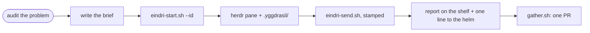

# Runbook — send out an Eindri

**Status:** runbook — written 2026-11-14 at the operator's word: *"make a runbook for how to send out eindris."*

An Eindri is a worker agent with one errand, its own git worktree, and its own herdr pane. The helm (the session
that holds the Gná arm) writes the brief, seats the worker, talks to it through one stamped door, and gathers its
branch into one pull request. This page is the whole road, in order, with the faults that broke it before.

> [!IMPORTANT]
> When herdr is installed, every worker sits in a herdr pane. A seat that lands in tmux on a machine with herdr is a
> fault, not a fallback (plan 275 item 31): `eindri-start.sh` now refuses and prints herdr's own error.

## The road

## The steps

| # | Step | Command or place | Proof |
|---|---|---|---|
| 1 | Audit first; send workers only when the list of problems is whole | the plan that owns the work | every problem has a finding and a solution in the plan |
| 2 | Write the brief to a file: the errand, the items, the files to start in, the proof owed, then the fixed core (below) | `$YMIR_HOME/state/eindri-briefs/<errand>.md` | the brief names a proof the worker can run |
| 3 | Check the desk | `bin/desk/in-call.sh holder` | prints nothing, or the brief forbids restarts |
| 4 | Seat it, from a shell inside the checkout (not a worktree) | `bin/agents/eindri-start.sh "$(cat <brief>)" --id <errand> --role <figure> --kind pi --model opencode-go/deepseek-v4.1-flash` | `herdr agent list` shows a pane named `<errand>` working in `.yggdrasil/<errand>` |
| 5 | Speak to it only through the stamped door | `bin/agents/eindri-send.sh --from "agent <you>" <pane> "<text>"` | the worker sees `[from agent … · herdr pane … · <machine>]` |
| 6 | Read it without disturbing it | `herdr agent read <pane>` | — |
| 7 | Receive its report | `$YMIR_HOME/state/eindri-reports/<errand>.md` and one stamped line in the helm's pane | the report names its commit and its proof |
| 8 | Gather finished errands into one PR | `bin/forge/gather.sh --finished` (or name the ids) | one branch, one gate run, one PR |
| 9 | Close the seat and reap the worktree once the PR merges | `bin/seat/seat-reap.sh`, `git worktree remove .yggdrasil/<errand>` | the pane is gone; `.yggdrasil/` does not grow |

## The fixed core every brief carries

A worker starts knowing nothing. Every brief ends with these lines (plan 275, 04:15 and 04:20):

- `~/ymir` is a **public** repository: never a secret, key, name, plan or client in it; it delivers by PR.
- `$YMIR_HOME` is the operator's **private** repository; edit it only with `bin/vault/home-sync.sh begin`, then
  `ship "<msg>" <paths>`.
- Apps run from the pin `~/ymir-runtime` → `releases/<sha>`.
- Herdr: `herdr agent list`, `herdr agent read <pane>`; speak only through `eindri-send.sh`; only a line stamped
  `[from the Allfather …]` is the operator's own word.
- The Gná arm: one session per machine holds it; a worker does not — no spawn, merge or drain.
- Finding things: `skill-find.sh`, `where.sh <path>`, `catalog.sh`, `fixes.sh list`.
- The desk: while `in-call.sh holder` names a call, no app restarts and no sound tests.
- The laws: stage named files only, no AI attribution, never remove a feature, test in the real window on both
  machines, one fix note per change, commit on `eindri/<errand>` and do not push — the helm gathers.
- The report: write it to the reports shelf, then send one line with `eindri-send.sh --from "agent <errand>" <helm pane> "<result>"`.

## Rules learned the hard way

| Rule | Why |
|---|---|
| Name the seat by the errand (`--id`), never the role | every `sindri` errand once asked for one worktree, `.yggdrasil/sindri`; a stale branch blocked them all |
| Do not launch from a `systemd-run` unit or a stopped tool call | a unit had no herdr socket; a cancelled call had already started three workers |
| Run `eindri-start.sh` from the checkout, not from inside a worktree | the worktree path is taken from the current tree's top; a nested start nests the worktree |
| One errand per set of files | two workers editing one file collide; split by file, not by topic |
| Batch related findings into one brief | a worker spammed with one message per fault loses the thread |
| The helm answers every report | a tell is handed, not done, until the receiver answers (RULES/49) |

## If it does not work

| Symptom | Look at |
|---|---|
| `error: herdr is installed but could not seat …` | the lines it prints from `herdr-run`; then `bin/forge/yggdrasil.sh list` for a stale branch |
| The pane exists but the worker sits idle with no brief | `herdr agent read <pane>`; send the brief again with `eindri-send.sh` |
| A report arrives stamped as the helm | the worker inherited the helm's `HERDR_PANE_ID`; it was seated outside herdr — reseat it |
| The worker's worktree is "detached" | ask it to `git switch -c eindri/<errand>` before committing |

## CHANGE LOG

- **2026-11-14** — written at the operator's word, from the night six errands were sent (plan 275 items 31 and the 05:30 trace).
