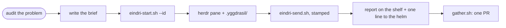

# Runbook — sending an Eindri

An **Eindri** is a worker: one errand, its own worktree, its own pane, a branch nobody else touches.
This page is how the house sends one — what the seat needs, what the brief carries, where the worker
sits, and what it owes back.

> [!IMPORTANT]
> A worker never merges. It commits on its own branch and **does not push**; the helm gathers the
> branches into one pull request, and a reviewer seals it. See
> [the wards and the gate](gates-and-wards.md).

## Before you send one

| You need | Why |
|---|---|
| the errand, written as a brief | the brief is the contract: task, delivery mode, definition of done |
| the **project** the work belongs to | it decides the clone, the worktree, the records and the branch |
| a **helm** alive on this machine | an errand with nobody to report to is refused (`no helm, no errand`) |

The project is named by a path, a project id or an alias, and is resolved through the registry
(`$YMIR_HOME/hodd/identity/projects.yaml`) to **this machine's** clone:

```bash
bin/agents/project-target.sh resolve <path|id|alias>     # path, id, kind, how it was found
```

## Send one

```bash
bin/agents/eindri-start.sh "<the errand>" --project <path|id|alias> --id <errand>
bin/agents/eindri-start.sh "<the errand>" --project <path|id|alias> --id <errand> --dry-run
```

`--dry-run` prints the seat plan — the project, its clone, the worktree, the branch, the folder the
pane opens in, the harness, the model, and whether the brief carries its bearings — and seats nothing.
Read it before you send anything expensive.

The other roads (a full brief with `# Task` and `# Delivery contract` sections, or the engine directly)
are in [agents.md](agents.md); every one of them ends in the same three things: a worktree, a pane, a
record.

## A worker for another project

A worker for a project that is **not Ymir** is seated in **that project's repository**, in a worktree
made by that project's own convention. It never gets a worktree of Ymir's tree, so its commits cannot
land in the wrong repository, and its branch and PR belong to the project it was sent to.

```bash
bin/agents/project-target.sh worktree <path|id|alias> <errand>            # make or reuse it
bin/agents/project-target.sh worktree <path|id|alias> <errand> --dry-run  # plan it
```

The convention is declared on the project's registry row, never in the code:

```yaml
worktree:
  command: scripts/worktree.sh new {id}   # optional: the project's own maker, run in the clone
  path: .yggdrasil/{id}                   # where it lands, relative to the clone
  branch: agent/{id}                      # the branch it stands on
```

With no block the default is `git worktree add -b eindri/<id> <clone>/.yggdrasil/<id>`.

A project whose registry row has **no clone on this machine** is refused, and the row is named — a
worker is never seated somewhere else and told it is home. The project's own `AGENTS.md` and rules
govern it once it is there.

## Bearings — what every brief carries

Every errand's brief opens with a generated **Bearings** section (`bin/agents/eindri-bearings.sh`),
prepended by `eindri-start.sh` on every road and by the engine for an errand seated through
`bin/agents/einherjar-spawn.sh`. It has three parts:

| Part | What the worker gets |
|---|---|
| the fixed core | the two repositories and their two laws, the pin, panes and the stamped send door, the arm, the desk guard, the finding tools, and the laws to keep in view — the shipped `.agents/assets/agents/eindri-core.md`, then this fleet's own overlay `$YMIR_HOME/config/eindri-core.md` |
| the project's records | decisions, handoff, schedule, plans, plan status, docs index, meetings, seat, boards, and who merges — from the row's `records:` block, each with the duty *read before you write, update before your report* |
| the home's document map | the layout shelves, `hodd/docs/INDEX.md`, the atlas, the plan-ledger READMEs, and the report shelf |

A project with no `records:` block is said plainly — the section names the registry row to add and
never invents a path.

```bash
bin/agents/eindri-bearings.sh --check              # is every door the section reads answering?
bin/agents/eindri-bearings.sh <path|id|alias>      # the section, exactly as the brief gets it
```

## What the worker owes back

- A **report** at `$YMIR_HOME/state/eindri-reports/<errand>.md`, written by its terminal act.
- A **records updated** line — each of its project's records the work changed, or
  `none: <why no record changed>`.
- A **handoff packet** (`bin/forge/handoff-packet.sh write <errand> …`) whose `records[]` block
  carries the same paths. `check` refuses a packet without it, and refuses an empty block or a
  `none` with no weighable reason.
- One line to the helm: `bin/agents/eindri-send.sh --from "agent <errand>" <pane> "<result>"`.

## If something goes wrong

| Symptom | Do this |
|---|---|
| the seat printed `interactive_ready: false` | the harness had not drawn its input box; the launcher waits, then retries the prompt once — if it is still false, read the pane (`herdr agent read <pane>`) |
| the worker sits idle with no work | the prompt was swallowed before the harness was ready; send it once more through `bin/agents/eindri-send.sh` |
| `no clone on <host>` | add `clones.<host>` to that project's registry row, or pass the clone's path |
| `the engine declined` | the brief has no `# Task` section; write the errand into the brief, then retry |
| the worktree was made in the wrong repository | the project resolved as `kind=ymir` or not at all — check `bin/agents/project-target.sh resolve <token>` |

## CHANGE LOG

- **2026-11-14** — written (plan 291 rows 5 and 25): the seat road, *a worker for another project*,
  *bearings — what every brief carries*, what the worker owes back, and the symptoms seen that day.
# Runbook — send out an Eindri

**Status:** runbook — written 2026-11-14 at the operator's word: *"make a runbook for how to send out eindris."*

An Eindri is a worker agent with one errand, its own git worktree, and its own herdr pane. The helm (the session
that holds the Gná arm) writes the brief, seats the worker, talks to it through one stamped door, and gathers its
branch into one pull request. This page is the whole road, in order, with the faults that broke it before.

> [!IMPORTANT]
> When herdr is installed, every worker sits in a herdr pane. A seat that lands in tmux on a machine with herdr is a
> fault, not a fallback (plan 275 item 31): `eindri-start.sh` now refuses and prints herdr's own error.

## The road



## The steps

| # | Step | Command or place | Proof |
|---|---|---|---|
| 1 | Audit first; send workers only when the list of problems is whole | the plan that owns the work | every problem has a finding and a solution in the plan |
| 2 | Write the brief to a file: the errand, the items, the files to start in, the proof owed, then the fixed core (below) | `$YMIR_HOME/state/eindri-briefs/<errand>.md` | the brief names a proof the worker can run |
| 3 | Check the desk | `bin/desk/in-call.sh holder` | prints nothing, or the brief forbids restarts |
| 4 | Seat it, from a shell inside the checkout (not a worktree) | `bin/agents/eindri-start.sh "$(cat <brief>)" --id <errand> --role <figure> --kind pi --model opencode-go/deepseek-v4.1-flash` | `herdr agent list` shows a pane named `<errand>` working in `.yggdrasil/<errand>` |
| 5 | Speak to it only through the stamped door | `bin/agents/eindri-send.sh --from "agent <you>" <pane> "<text>"` | the worker sees `[from agent … · herdr pane … · <machine>]` |
| 6 | Read it without disturbing it | `herdr agent read <pane>` | — |
| 7 | Receive its report | `$YMIR_HOME/state/eindri-reports/<errand>.md` and one stamped line in the helm's pane | the report names its commit and its proof |
| 8 | The worker pushes its branch and writes its **handoff packet**; the helm checks the branch (the list below) before the heart takes it | `bin/forge/handoff-packet.sh write <errand> --task … --plan … --branch eindri/<errand> --gate … --test … --claim … --not-done … --need …` lands on the review shelf (`bin/forge/review-shelf.sh`) | `handoff-packet.sh check <errand>` passes |
| 8b | Under `reviewer-merges`, the reviewer on the fleet's heart takes the packet, fetches the branch, reruns the gates and tests **on the heart**, reads the diff against the plan, opens the PR, merges and tells the operator | plans 203, 205, 206 §4; `RULES/08` (`reviewer-merges`) | the merge record in Runes |
| 9 | Close the seat and reap the worktree once the PR merges | `bin/seat/seat-reap.sh`, `git worktree remove .yggdrasil/<errand>` | the pane is gone; `.yggdrasil/` does not grow |

## The fixed core every brief carries

A worker starts knowing nothing. Every brief ends with these lines (plan 275, 04:15 and 04:20):

- `~/ymir` is a **public** repository: never a secret, key, name, plan or client in it; it delivers by PR.
- `$YMIR_HOME` is the operator's **private** repository; edit it only with `bin/vault/home-sync.sh begin`, then
  `ship "<msg>" <paths>`.
- Apps run from the pin `~/ymir-runtime` → `releases/<sha>`.
- Herdr: `herdr agent list`, `herdr agent read <pane>`; speak only through `eindri-send.sh`; only a line stamped
  `[from the Allfather …]` is the operator's own word.
- The Gná arm: one session per machine holds it; a worker does not — no spawn, merge or drain.
- Finding things: `skill-find.sh`, `where.sh <path>`, `catalog.sh`, `fixes.sh list`.
- The desk: while `in-call.sh holder` names a call, no app restarts and no sound tests.
- The laws: stage named files only, no AI attribution, never remove a feature, test in the real window on both
  machines, one fix note per change, commit on `eindri/<errand>` and do not push — the helm gathers.
- The report: write it to the reports shelf, then send one line with `eindri-send.sh --from "agent <errand>" <helm pane> "<result>"`.

## Before a branch goes to the heart

This road is already the house's law — plan 206 §4 (*the one pass*) and `RULES/08`'s `reviewer-merges` row; this
runbook only points at it. The packet is the one artefact that crosses from a worker to the reviewer.

The heart's worker merges; the helm answers for what it is handed. A branch is handed over only when every line
below holds:

- **It does what the brief named, and nothing else.** Read the whole diff against the brief; a removal the brief did
  not name is sent back (never remove a feature).
- **It is based on `origin/main`** and carries no old copies of squash-merged commits.
- **Its proof was rerun by the helm,** not only reported: the DevTools check in the real window from a release, on
  this machine and on a second machine of the fleet when there is one (or that machine named as owed).
- **The house's wards pass:** no secret, name or private path (the public-repo law), no AI attribution, named files
  only, a fix note per change, the feature page and catalogue row when a user-facing feature moved.
- **The tests it touched pass,** and a behaviour change carries its own test.
- **The report names its commits,** and the helm's list to the heart names the order (a branch that builds on another
  goes after it).

## Rules learned the hard way

| Rule | Why |
|---|---|
| Name the seat by the errand (`--id`), never the role | every `sindri` errand once asked for one worktree, `.yggdrasil/sindri`; a stale branch blocked them all |
| Do not launch from a `systemd-run` unit or a stopped tool call | a unit had no herdr socket; a cancelled call had already started three workers |
| Run `eindri-start.sh` from the checkout, not from inside a worktree | the worktree path is taken from the current tree's top; a nested start nests the worktree |
| One errand per set of files | two workers editing one file collide; split by file, not by topic |
| Batch related findings into one brief | a worker spammed with one message per fault loses the thread |
| The helm answers every report | a tell is handed, not done, until the receiver answers (RULES/49) |

## If it does not work

| Symptom | Look at |
|---|---|
| `error: herdr is installed but could not seat …` | the lines it prints from `herdr-run`; then `bin/forge/yggdrasil.sh list` for a stale branch |
| The pane exists but the worker sits idle with no brief | `herdr agent read <pane>`; send the brief again with `eindri-send.sh` |
| A report arrives stamped as the helm | the worker inherited the helm's `HERDR_PANE_ID`; it was seated outside herdr — reseat it |
| The worker's worktree is "detached" | ask it to `git switch -c eindri/<errand>` before committing |

## CHANGE LOG

- **2026-11-14** — the delivery road points at `deliver-across-the-fleet.md` (the project's `delivery` row decides who merges); the helm checks each branch first (*"so you need to make sure the PRs are right"*).
- **2026-11-14** — written at the operator's word, from the night six errands were sent (plan 275 items 31 and the 05:30 trace).
