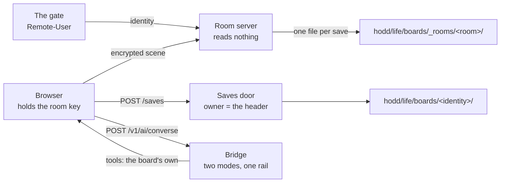

# The whiteboard — the half of it we own

The whiteboard at the suite's hostname is two different things wearing one name, and the
difference decides what can be changed without a rebuild.

The **drawing surface** is the upstream Excalidraw fork, shipped as a built bundle: 53 MB of
minified assets with no source tree on this machine. A button added inside its Share dialog
needs the upstream source forked and rebuilt, which is a project of its own.

The **room server** and the **AI bridge** are ours, in Node, and they are what this folder
holds. They are also where the problems lived: a board that vanished when the last hand left,
no way to save one under its owner, and an assistant that could only answer in Mermaid.

> [!IMPORTANT]
> This tree is the source of truth. The seat that runs the whiteboard is a deployment
> directory outside the repo, so a change here reaches the board by a sync and a service
> restart — never by editing the deployed copy, which would drift within a day.

## What is here

| Part | What it does | Door |
|---|---|---|
| Room server | Relays encrypted scene bytes, decides entry server-side, writes every room's scene down | `services/collab/index.mjs` |
| Members | Issues invites (hashed at rest, with an expiry), revokes them, protects a room | `services/collab/members.mjs` |
| Saves | Stores a board under the identity the gate asserted | `services/collab/saves.mjs` |
| Snapshots | One file per room per save, append-only, the stamp in the name | `services/collab/snapshots.mjs` |
| Identity | Reads the one header the proxy sets, and refuses everything else | `services/collab/identity.mjs` |
| Runes | One ledger line per save, list and open — through the house's one writer | `services/collab/runes.mjs` |
| Bridge | One rail, two modes: bare Mermaid, and conversation with the board's tools | `services/ttd-bridge/index.mjs` |
| The wall | Turns a usage limit into a sentence with a reset time | `services/ttd-bridge/usage-limit.mjs` |
| Tools | The seven tools the assistant may hold, and the boundary that keeps it at seven | `services/ttd-bridge/tools.mjs` |
| Units | The bridge and room server as services, with no secret in either file | `units/` |

## The two properties that are not negotiable

**The server cannot read a room.** The key lives in the URL fragment, which a browser never
sends. Every scene arrives already encrypted, and the snapshot on disk is the same ciphertext
beside its iv — so a room restored from disk behaves exactly like a room restored from memory,
because it is the same bytes.

**The owner is the gate's word.** A save belongs to the identity the proxy asserts in a
header, never to a value the client sends. A person lists only their own saves, and asking for
another person's save is refused **by name** — "that save is not yours" — because an empty
list would read as *you saved nothing*, which is a lie.



## Doors, as commands

The room server and the bridge are both plain Node with no build step. Each has a scratch-proof
that starts the real service against a temporary store and prints what it proved, so a claim
about them is a command rather than a memory.

```bash
# the room server's two promises: a scene survives a restart, a save has one owner
node systems/whiteboard/services/collab/test/prove-live.mjs

# the bridge's three: converse asks, generate stays bare Mermaid, the wall has a time
node systems/whiteboard/services/ttd-bridge/test/prove-live.mjs

# the units' own tests
cd systems/whiteboard/services/collab && npm test
cd systems/whiteboard/services/ttd-bridge && npm test
```

## Attention, before a swap

Raising the new bridge or room server **stops the running one**, which drops every open room's
live session — a scene still held in memory is written on the last client leaving, so it is not
lost, but the people drawing see a reconnect. Do it in a quiet minute, never mid-session.

The seat is two values and one command: the deployment directory, and the port. `units/` carries
templates for both services; each reads its rail key from `~/.config/ymir/whiteboard-bridge.env`
(mode 600) rather than carrying it in the unit file, which is how the previous unit leaked one.

## Limits

- The snapshots are ciphertext. Nothing on this machine can read a saved room without the key,
  including the operator. A room can be re-handed to a browser, never inspected in a shell.
- A save is the app's own JSON stored as it was sent. The server does not validate a scene
  beyond "it has an elements list", because the app's own format is the app's business.
- No guest owns a save yet. A guest link (ticket 0034) has no hall identity, so its ownership
  needs its own answer rather than inheriting one.

## If it does not work

The room server prints one line at start naming what is on and what is off: the snapshot
directory and its cadence, the board shelf, the identity header, and whether a Runes door was
found. Read that line first — a clean skip with its reason is a pass, a silent one is not.

The bridge's `/healthz` reports both modes, the seven tools and whether a vision model is
configured. A usage limit now arrives as a sentence with a time in it, so "it does not work"
and "the meter is spent until 02:40" no longer look the same.

## CHANGE LOG

- **2026-11-14** — carves the folder: the room server and the bridge as our own tree, with the
  scene snapshots, the owner-asserted saves, the converse mode, the wall in words and the unit
  templates. Earlier history for these two services lived in a deployment directory with no
  version control, which is why the fix notes of 2026-10 name a path that no longer exists.
